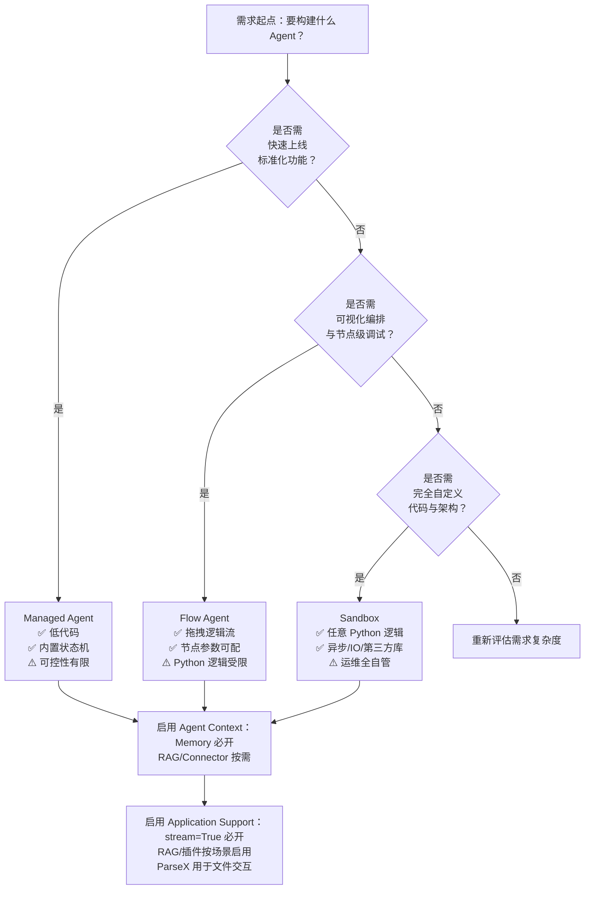

# Agent 开发相关指南对比

为帮助开发者在百炼平台上高效、准确地选型 Agent 构建方案，本文对三类核心 Agent 开发范式（Managed Agent、Flow Agent、Sandbox）及支撑其能力的关键上下文机制（Agent Context）和应用级功能支持（Application Support）进行系统性对比。对比聚焦于**技术实现边界、配置自由度、运维成本与适用阶段**，旨在为从 PoC 快速验证到生产级高可靠智能体的全生命周期开发提供清晰的技术选型依据。

> ⚠️ 注意：本文所涉所有能力均以百炼平台当前（v2.4.x）正式发布版本为准；`agent context` 与 `application support` 并非独立 Agent 类型，而是跨类型通用的能力层与服务层，其启用方式、参数约束与限制条件需与具体 Agent 类型协同设计。

## 关键维度对比

| 维度 | Managed Agent | Flow Agent | Sandbox | Agent Context | Application Support |
|------|----------------|-------------|----------|------------------|------------------------|
| **输入格式** | 标准 Chat 消息数组（`messages: [{role, content}]`），自动注入预置工具描述与会话状态 | 同标准 Chat 消息；支持在流程节点中显式传入结构化变量（如 `{"user_id": "u123", "order_status": "pending"}`） | 同标准 Chat 消息；入口函数 `main.py` 接收完整 `request` 对象（含 `messages`, `session_id`, `parameters` 等字段） | 非独立输入，作为运行时上下文动态注入：RAG chunks、Memory 条目、Connector 响应、ParseX 解析结果等均按配置拼接进 LLM 输入 prompt | 非独立输入，是能力集合：插件调用由模型自主触发；RAG/Connector 需提前注册并配置；流式参数通过请求头或 query 参数控制 |
| **输出格式** | 标准 Chat 响应（`choices[0].message.content` 或 `tool_calls`），自动处理工具调用结果聚合与多轮状态流转 | 同标准 Chat 响应；支持流程节点自定义返回值（如 JSON 结构），可被下游节点直接引用 | 完全由 `main.py` 控制：可返回 `{"content": "...", "tool_calls": [...]}` 或自定义 JSON Schema；不强制遵循 Chat API 格式，但需兼容 `/v1/agents/{id}/chat` 接口契约 | 不产生独立输出，仅影响 LLM 输入质量与决策依据；最终响应仍由 Agent 类型决定 | 提供增强型输出能力：`stream=True` 返回 SSE 流；`incremental_output=True` 实现 token 级增量更新；不改变响应语义结构 |
| **支持模型** | 仅限 Agent 专用模型（如 `qwen-7b-agent`, `qwen2.5-72b-agent`） | 同 Managed Agent，必须为 Agent 专用模型 | 同 Managed Agent，必须为 Agent 专用模型 | 依赖底层 Agent 所用模型：`qwen-plus`/`qwen-max`/`qwen2.5-72b-instruct` 支持全量 Context；`qwen-turbo` 仅支持基础 Memory 缓存 | 无模型绑定要求；所有支持 Tool Calling 的模型均可使用插件；RAG/流式等功能与模型无关，由平台网关统一处理 |
| **API 端点** | `/v1/agents/{agent_id}/chat`（统一端点） | `/v1/agents/{agent_id}/chat`（统一端点） | `/v1/agents/{agent_id}/chat`（统一端点） | 无独立端点；配置通过 `CreateAgent` 请求体中的 `context_config` 字段声明 | 无独立端点；功能通过请求参数（`stream`, `incremental_output`）、配置项（插件 schema 注册）、前置服务（知识库/Connector 创建）协同生效 |
| **计费方式** | 按 Agent 实例调用次数 + 模型 token 消耗（输入+输出）计费；托管逻辑不额外计费 | 同 Managed Agent；流程节点内 Python 代码执行不产生额外计算费用 | 同 Managed Agent；但沙箱 CPU/内存资源消耗更高，超时重试将产生额外 token 费用与请求次数 | 无独立计费项；RAG 检索、Connector 调用、ParseX 解析均计入对应服务计费（如 RAG 按 chunk 数/调用次数），不叠加 Agent 调用费 | 插件调用本身免费（模型推理费已覆盖）；RAG/Connector/ParseX 按各自服务计费标准单独结算；流式传输不额外计费 |
| **典型场景** | 客服问答机器人、FAQ 自动回复、标准化表单填写助手等“开箱即用”业务 | 多步骤审批流（申请→风控校验→人工复核→通知）、电商导购（商品检索→比价→库存确认→下单建议）等需逻辑编排的链路 | 需深度集成内部系统（如调用私有 ERP API）、复杂数据清洗与可视化、实时行情分析与策略生成等高度定制化任务 | 所有需“扩展 LLM 认知边界”的场景：知识库问答、用户历史偏好推荐、跨系统状态同步（如 CRM+订单系统）、[多模态](../concepts/multi-modal.md)内容理解（PDF/表格解析后注入） | 所有需提升用户体验与工程效率的场景：实时响应（流式）、减少带宽（增量输出）、调用外部工具（插件）、增强领域知识（RAG）、解析用户上传文件（ParseX） |

## 各方案适用场景建议

- **Managed Agent**  
  ✅ **推荐场景**：MVP 快速验证、标准化 SaaS 功能嵌入（如钉钉/企微客服插件）、低技术门槛团队构建轻量智能体。  
  ❌ **不推荐场景**：需精细控制工具调用顺序与重试逻辑、依赖未预置的第三方服务、要求会话状态跨渠道持久化（如 Web + App 共享 memory）。  
  💡 **选型提示**：当 80% 业务逻辑可用平台预置模板覆盖，且可接受“黑盒”状态管理时，首选此模式。

- **Flow Agent**  
  ✅ **推荐场景**：中等复杂度业务流程自动化（如保险理赔初审、HR 入职引导）、需条件分支与人工干预节点混合的场景、希望保留可视化调试能力的团队。  
  ❌ **不推荐场景**：算法逻辑涉及大量数值计算或异步 I/O（如 WebSocket 长连接）、需动态加载未预装 Python 库、要求完全绕过平台流程引擎。  
  💡 **选型提示**：当需要“所见即所得”的逻辑编排、明确的错误定位路径（节点级日志）、以及比 Managed 更高的可控性，但又不愿承担沙箱运维成本时，此为最优平衡点。

- **Sandbox**  
  ✅ **推荐场景**：企业级核心业务智能体（如交易风控引擎、合规审计助手）、需与遗留系统深度耦合、算法模型需在线训练/微调、对延迟与资源隔离有硬性要求。  
  ❌ **不推荐场景**：无 Python 工程能力的团队、无专职运维支持、安全合规要求禁止任意代码执行（如金融核心系统）。  
  💡 **选型提示**：此模式是“全权委托”，平台仅提供沙箱环境与网络白名单；[记忆管理](../concepts/memory-management.md)、错误恢复、监控埋点、灰度发布等均需自行实现——适合成熟 AI 工程团队。

- **Agent Context（上下文能力层）**  
  ✅ **必选场景**：所有需超越单轮对话、利用历史信息或外部知识的 Agent（即绝大多数真实业务场景）。  
  ❌ **可省略场景**：纯单轮指令执行（如“把这句话翻译成英文”）、测试用 Hello World Agent。  
  💡 **关键提醒**：Context 不是独立模块，而是能力开关。务必根据所选 Agent 类型检查模型兼容性（如 `qwen-turbo` 不支持 RAG），并在 `context_config` 中精确声明所需模块，避免隐式降级。

- **Application Support（应用支撑层）**  
  ✅ **通用增强**：所有 Agent 均应启用 `stream=True` 提升首屏响应速度；RAG 和插件是提升专业性的核心杠杆。  
  ❌ **避免滥用**：勿在 Sandbox 中重复实现 RAG 检索逻辑（应复用平台 RAG 服务）；勿为简单计算启用插件（直接用 Python 代码更高效）。  
  💡 **最佳实践**：将 Application Support 视为“能力货架”——RAG 解决“不知道”，插件解决“做不到”，流式解决“等不及”，按需组合，而非堆砌。

## 技术选型决策树（面向开发者）

> 📌 **最后建议**：  
> - **起步阶段**：用 Managed Agent + Memory + RAG 快速验证核心价值；  
> - **增长阶段**：迁移到 Flow Agent，加入条件判断与多系统协调；  
> - **成熟阶段**：对关键路径（如支付、风控）采用 Sandbox 封装，其余模块仍用 Flow/Managed 降低整体维护成本；  
> - **始终贯穿**：将 Agent Context 作为“认知基础设施”统一配置，将 Application Support 作为“体验增强套件”按需装配。  

本对比 Wiki 将随百炼平台能力演进持续更新，最新版本请以控制台文档中心为准。

## 被对比主题页

- [agent development](../guides/agent-development.md)
- [agent context](../guides/agent-context.md)
- [application support](../guides/application-support.md)

