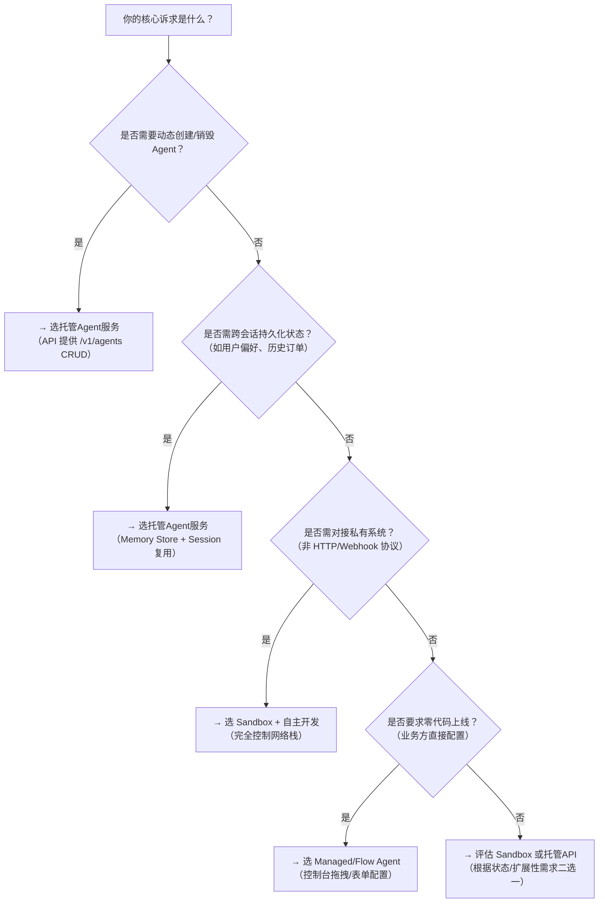

# 自主Agent开发与托管Agent服务对比

本文旨在帮助开发者在百炼平台上进行技术选型时，清晰理解「自主Agent开发」（即通过控制台或 SDK 编排 Flow Agent / Managed Agent / Sandbox）与「托管Agent服务」（即直接调用 `Managed Agents API`）两类方案的核心差异。随着业务复杂度提升，开发者常面临“该用低代码配置还是用 API 全面接管”的决策困惑。本对比聚焦实际工程落地维度——包括接入方式、控制粒度、运维负担、扩展能力与成本模型，不涉及抽象概念辨析，所有结论均基于百炼平台 v2.3+ 的当前能力边界。

---

## 关键维度对比

| 维度 | 自主Agent开发（控制台驱动） | 托管Agent服务（Managed Agents API） |
|------|-----------------------------|-------------------------------------|
| **输入格式** | 统一 JSON 输入（`{"input": {...}}`），由平台自动注入上下文、Memory、Session ID；支持文件上传（需先通过 `/files` 上传并传入 `file_id`） | 原生 RESTful 请求体：`POST /v1/sessions/{session_id}/messages` 接收标准消息对象（含 `role`, `content`, `files` 等字段）；支持结构化 `tool_input` 和自定义元数据（`metadata` 字段） |
| **输出格式** | 同步返回 JSON，含 `output`（最终结果）、`trace`（启用 `enable_tracing` 时）、`session_id`；不暴露中间 step 事件流 | 支持两种模式： • 同步响应（默认）：返回完整 `message` 对象，含 `agent_steps` 数组（每步含 `tool_calls`, `llm_output`） • 流式 SSE（`Accept: text/event-stream`）：按 `agent_step`、`agent_finish`、`error` 等事件类型实时推送 |
| **支持模型** | 全量支持百炼平台已开放的推理模型（如 `qwen-max`, `qwen-plus`, `qwen-turbo`），模型选择在控制台配置或 API 创建 Agent 时指定；Sandbox 可通过 `model` 参数显式调用任意兼容模型 | 同上，但模型绑定发生在 Agent 实例创建阶段（`POST /v1/agents` 中的 `model` 字段），运行时不可动态切换；不支持 Sandbox 内部自行调用非平台托管模型（如本地部署的 Llama-3） |
| **API 端点** | 统一入口：`POST /v1/chat/completions`（需 Header `x-bailian-agent-id`）；无环境/会话/技能等独立资源端点 | 多资源端点体系： • `/v1/agents`（CRUD Agent 实例） • `/v1/environments`（隔离配置） • `/v1/sessions`（有状态会话管理） • `/v1/skills`（Webhook 技能注册） • `/v1/memory`（结构化记忆读写） • `/v1/files`（文件生命周期管理） |
| **计费方式** | 按 Agent 调用次数 + 模型 token 消耗计费（`/v1/chat/completions` 调用即计 1 次）；Sandbox 额外收取沙箱运行时费用（按秒计费，冷启动不额外计费） | 按 API 调用次数计费： • Agent 创建/更新/删除：按次 • Session 创建/消息发送/状态查询：按次 • Memory 读写/文件上传/技能调用：按次 • **模型 token 消耗单独计费**（与底层模型服务账单合并） |
| **典型场景** | • 客服机器人快速上线（Managed Agent 配置知识库+工单工具） • 内部运营自动化（Flow Agent 连接审批系统+邮件通知） • PoC 验证（Sandbox 快速集成私有 Python SDK） | • 多租户 SaaS 应用中为每个客户动态生成专属 Agent 实例 • 与企业现有 CRM/ERP 系统深度集成，需精确控制会话生命周期与事件回调 • 构建 Agent 编排平台（如低代码平台后台），需批量管理数百个 Agent 及其 Skill、Environment |
| **状态管理能力** | • Managed/Flow Agent：仅支持会话级短期状态（`session_id` 绑定），Memory 存储需手动开启且不可跨会话共享 • Sandbox：可自行实现 Redis/MemoryDB 持久化，但平台不提供原生状态服务 | 原生支持： • `Session`：自动维护对话历史、step 上下文、超时控制 • `Memory Store`：键值对结构化存储（带 TTL），支持跨会话复用（如用户画像缓存） • `Environment`：配置版本隔离，支持 A/B 测试与灰度发布 |
| **扩展性与集成自由度** | • Managed/Flow Agent：工具集受限于平台内置能力（HTTP、KB、SQL 等），无法引入私有协议或定制认证逻辑 • Sandbox：高自由度，但需自行处理重试、限流、凭证安全等 | • Skill 支持任意 Webhook（HTTPS + Basic Auth / Bearer [Token](../concepts/token.md) / 自定义 Header） • Credential Vault 加密存储敏感信息（如 API Key），运行时自动注入到 Skill 请求中 • 可通过 `/webhooks` 订阅 `agent_finish` 事件，触发下游系统动作（如更新数据库、发 Slack 通知） |
| **可观测性与调试** | • 控制台提供可视化 trace 日志（含 prompt、tool input/output） • Sandbox 支持 `print()` 输出至日志，但无分布式链路追踪 | • 全链路结构化日志（含 `request_id`, `session_id`, `step_id`） • 支持 `GET /v1/sessions/{id}/events` 查询完整事件序列 • 可导出 OpenTelemetry 兼容 trace 数据（需开通高级监控） |

---

## 适用场景建议

### ✅ 推荐使用「自主Agent开发」当：
- 团队以业务人员或低代码开发者为主，追求**最快上线速度**（< 1 小时完成客服机器人配置）；
- 任务流程相对固定（如“查知识库 → 填工单 → 发邮件”），无需频繁变更执行逻辑；
- 无多租户、灰度发布、事件驱动等复杂运维需求；
- 预算敏感，希望避免 API 调用次数产生的额外账单（仅支付模型 token 费用）。

### ✅ 推荐使用「托管Agent服务（Managed Agents API）」当：
- 系统需**动态创建/销毁 Agent 实例**（例如：为每个企业客户分配独立 Agent，并随合同到期自动停用）；
- 已有成熟后端架构，要求 Agent 行为**完全融入现有事件总线与监控体系**（如 Kafka 消息消费、Prometheus 指标上报）；
- 需要**强状态一致性保障**（如金融场景中，用户会话中断后必须从断点恢复，而非重新开始）；
- 开发者具备 RESTful API 集成经验，且愿意承担额外的客户端 SDK 封装与错误重试逻辑。

> ⚠️ 注意：二者**并非互斥**。实践中常见混合模式：  
> - 使用 Managed Agents API 创建和管理 Agent 实例与 Environment；  
> - 在生产环境中，仍通过统一的 `/v1/chat/completions` 端点（携带 `x-bailian-agent-id`）发起调用，兼顾简洁性与可控性。

---

## 技术选型决策树（面向开发者）

**最后建议**：  
- 初期验证阶段，优先使用 **Flow Agent**（可视化编排 + 快速迭代）；  
- 业务稳定后，若需规模化、可审计、可编排，则平滑迁移至 **Managed Agents API**；  
- 所有涉及**外部系统深度集成、长周期状态管理、合规敏感操作**的场景，应跳过低代码层，直接采用 API 方案设计。  

百炼平台持续演进中，后续版本将提供「API 驱动的 Flow Agent」混合模式（即通过 API 创建 Flow Agent 实例），敬请关注官方 Release Notes。

## 被对比主题页

- [agent development](../guides/agent-development.md)
- [managed agents api](../api/managed-agents-api.md)

