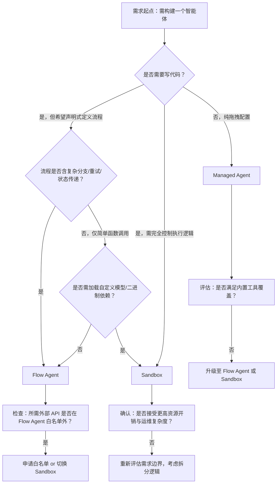

# 智能体开发框架对比

为帮助开发者在百炼平台上高效选型，本文对平台提供的三类核心智能体（Agent）开发范式——**Managed Agent**、**Flow Agent** 和 **Sandbox**——进行系统性对比分析。随着业务场景从轻量级客服问答向复杂决策链路、私有系统集成、实时异步协同演进，不同框架在抽象层级、控制粒度、扩展能力与运维成本上存在显著差异。本对比聚焦实际工程落地的关键技术维度，旨在为技术负责人与一线开发者提供可操作的选型依据，避免因框架错配导致返工、性能瓶颈或安全合规风险。

## 核心能力对比表

| 维度 | Managed Agent | Flow Agent | Sandbox |
|------|----------------|-------------|----------|
| **输入格式** | JSON 对象（`{ "input": { ... } }`），支持多轮对话上下文自动注入；不支持自定义 schema 校验 | JSON 对象（`{ "inputs": { ... } }`），支持显式声明 `inputs` 字段名，可配合 Prompt 模板变量（如 `{{query}}`）做结构化绑定；支持 JSON Schema 输出校验（可选） | JSON 对象（`{ "input": { ... } }`），完全自由解析；`input` 内容直接传入 `run(input: dict)` 函数，无预处理约束 |
| **输出格式** | 固定结构 JSON：`{ "output": "...", "status": "success", "trace_id": "..." }`；**不支持流式响应（SSE）** | 同步：标准 JSON；流式：`text/event-stream`（逐块返回 `data: {...}`）；支持 `output` 字段为任意合法 JSON（含嵌套对象/数组） | 完全由开发者控制：`return` 值序列化为响应体；支持同步 JSON 或手动构造 SSE 响应；可返回二进制（如图片 Base64）、多段结构化数据 |
| **支持模型** | 仅平台托管模型（如 `qwen-max`, `qwen-plus`），**不支持 LoRA 微调、自定义权重加载或本地模型接入** | 支持所有百炼托管模型；`llm` 节点可动态指定 `model` 参数，未指定时回退至 Agent 默认模型；**不支持加载外部模型文件** | 支持所有百炼托管模型（通过 SDK 调用）；**支持加载本地 `.bin`/`.safetensors` 权重、LoRA 适配器、HuggingFace `transformers` 自定义 pipeline**；可集成 vLLM/Triton 等推理后端（需满足资源限制） |
| **API 端点** | `/v1/agents/{agent_id}/invoke`（统一入口）；会话状态由平台自动管理 | `/v1/agents/{app_id}/invoke`（同步）、`/v1/agents/{app_id}/invoke-async`（异步）；需显式传入 `memory_id` 实现长期上下文延续 | `/v1/agents/{agent_id}/invoke`（同步）；**支持 `/v1/agents/{agent_id}/invoke-stream` 自定义流式端点（需在 `main.py` 中实现）**；无内置会话管理，状态需自行持久化（如写入 Memory Store 或外部 DB） |
| **计费方式** | 按 **调用量（次） + LLM Token 消耗（输入/输出）** 双维度计费；环境、技能、记忆存储等附加能力按月订阅 | 同 Managed Agent：调用次数 + Token；**额外收取流程节点执行费用（每节点每次执行计费）**；异步任务按运行时长（秒）叠加计费 | 按 **调用量（次） + LLM Token + Sandbox 运行时资源（CPU/内存/时长）** 三维度计费；上传依赖包、存储代码、网络出流量单独计费；支持预留实例降本 |
| **典型场景** | 快速上线 FAQ 机器人、销售话术引导、知识库问答（无需代码）；适合产品/运营人员主导的低代码验证 | 多步骤业务流程编排（如“用户投诉→工单创建→服务调度→满意度回访”）；需条件分支、错误重试、外部 API 编排与可观测性审计的中台级应用 | 需深度定制逻辑的场景：实时音视频分析+LLM推理、私有数据库复杂 SQL 生成与执行、调用企业内网 SDK、集成自研风控模型、构建 Agent 协同工作流（如 Planner-Executor 架构） |

## 适用场景建议

- **选择 Managed Agent 当：**  
  ✅ 业务逻辑简单、迭代周期短（< 1 天），目标是快速验证 MVP；  
  ✅ 开发者无 Python 工程能力，或团队以非技术人员（如产品经理、客服主管）为主；  
  ✅ 场景严格限定在平台内置工具范围内（知识库检索、基础数据库查询、通用 HTTP 请求）；  
  ❌ 避免用于：需自定义算法、调用未开放 API、要求毫秒级响应、或需与现有微服务深度耦合的场景。

- **选择 Flow Agent 当：**  
  ✅ 需要清晰的流程拓扑、可版本化 YAML 定义、完整执行轨迹追踪（`enable_tracing`）与企业级审计需求；  
  ✅ 业务链路含明确分支判断（如 `if 用户等级 > VIP → 走绿色通道`）、失败重试、超时熔断等可靠性保障；  
  ✅ 团队具备 YAML 配置与基础 Python 函数编写能力，但无需操作系统级控制；  
  ❌ 避免用于：需 `import torch` 进行张量计算、访问 `/dev/shm` 共享内存、或依赖未列入白名单的第三方域名（如内网 `http://erp.internal`）。

- **选择 Sandbox 当：**  
  ✅ 需完全掌控执行环境：安装私有 PyPI 包、调用 C 扩展、使用异步 I/O（`asyncio`）、集成企业内部 SDK（如钉钉/飞书机器人 SDK）；  
  ✅ 场景涉及敏感数据处理（需代码级加密/脱敏）、或需对接未开放公网的内网服务（经工单开通域名白名单后）；  
  ✅ 构建高阶 Agent 架构：如基于 ReAct 的自主规划器（Planner）、调用多个子 Agent 的协调器（Orchestrator）、或需持久化中间状态的长期运行 Agent；  
  ❌ 避免用于：简单问答、无状态转换、或对运维成本极度敏感（如百万级日调用量）且无定制需求的场景——此时 Managed Agent 性价比更高。

## 技术选型决策树（面向开发者）

> **关键提醒**：  
> - 所有框架均支持通过 `/v1/agents/{id}/invoke` 统一调用，**业务系统集成成本一致**；差异在于开发、调试与长期维护成本。  
> - 若项目初期选用 Managed Agent，后续可平滑迁移至 Flow Agent（复用部分节点逻辑）或 Sandbox（导出配置为代码骨架），平台提供迁移工具链。  
> - 生产环境强烈建议开启 `enable_tracing`（Flow/Sandbox）或 Session 事件流（Managed），确保问题可定位、链路可审计。

## 被对比主题页

- [agent development](../guides/agent-development.md)
- [flow agent api](../api/flow-agent-api.md)
- [managed agents api](../api/managed-agents-api.md)

