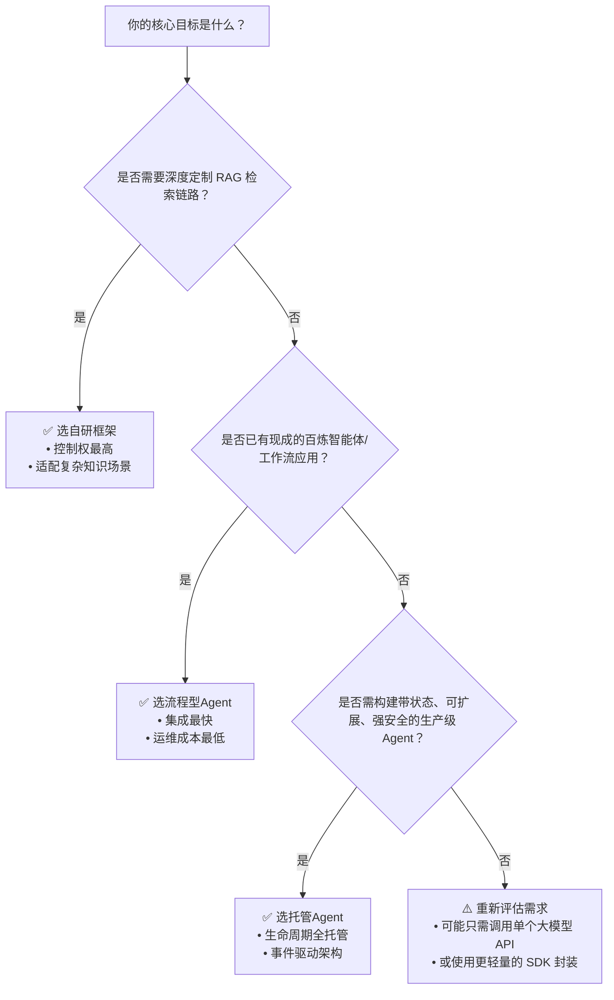

# 智能体开发框架：自研框架、流程型Agent与托管Agent对比

为帮助开发者在阿里云百炼平台上高效选型，本文系统对比三类主流智能体开发路径：**自研框架集成（LlamaIndex / Spring AI Alibaba）**、**流程型Agent（Flow Agent API）** 和 **托管Agent（Managed Agents API）**。对比基于实际开发体验、能力边界、运维成本与扩展性，聚焦“什么场景该用什么方案”，避免过度工程化或能力不足导致的返工。

---

## 关键维度对比

| 维度 | 自研框架（LlamaIndex / Spring AI Alibaba） | 流程型Agent（Flow Agent API） | 托管Agent（Managed Agents API） |
|------|------------------------------------------|------------------------------|------------------------------|
| **输入格式** | 灵活：支持 `Document` 对象、`messages` 数组、`prompt` 字符串；可编程构造上下文（如注入记忆、知识片段） | 严格结构化： • 同步调用：`input.prompt`（单轮）或 `input.messages`（多轮） • 异步调用：需封装为 `input` JSON 对象 | 高度结构化： • `POST /v1/sessions` 请求体含 `input`（字符串）、`memory`（键值对）、`files`（文件ID列表）等字段 • 支持 Jinja2 模板变量（`{{ input }}`, `{{ memory.user_id }}`） |
| **输出格式** | 可控性强： • LlamaIndex 返回 `Response` 对象（含 `response`, `source_nodes`, `metadata`） • Spring AI 返回 `ChatResponse` 或 `DocumentList` | 标准化流式/同步响应： • `stream=true`：SSE 流，每帧含 `delta` 或 `text` 字段 • 同步模式：返回完整 `output.text` + `usage` | 事件驱动型输出： • 默认返回 `session_id` + `status` • 订阅 `/events` 可接收 `agent_step`（工具调用）、`agent_finish`（最终结果）、`error` 等结构化事件 • 最终结果含 `output.text`、`tool_calls`、`memory_updates` |
| **支持模型** | ✅ 全量百炼文本模型（`qwen-max`, `qwen-plus` 等） ✅ 可自由切换 LLM / Embedding / Rerank 模型（如 `text-embedding-v3`, `gte-rerank`） | ⚠️ 间接支持： • 模型由已发布的智能体/工作流应用预绑定 • 调用者无法动态指定模型，需在控制台配置应用时选择 | ✅ 显式指定： • 创建 Agent 时通过 `model` 字段声明（如 `"qwen-max"`） • 支持运行时按环境（Environment）灰度切换模型版本 |
| **API 端点** | • LlamaIndex：SDK 封装，无直连 HTTP 端点 • Spring AI：`POST /v1/chat/completions`（OpenAI-like）或 `POST /v1/agents/{app-id}/call`（DashScope 封装） | • 应用调用：`POST https://dashscope.aliyuncs.com/api/v1/apps/{app_id}/completion`（北京地域） • 组件管理：`POST https://bailian.{region}.aliyuncs.com/{workspaceId}/promptTemplates`（多地域） | • 统一 RESTful：`POST https://bailian.aliyuncs.com/v1/sessions` • 所有端点均支持华北2（北京）、华东1（杭州）、新加坡等主流地域（以控制台开通为准） |
| **计费方式** | 按调用计费： • LLM 调用：按 token 计费（输入+输出） • Embedding / Rerank / Parse：按请求次数或页数计费 • 云端知识库：按存储量 + 检索次数计费 | 按应用调用计费： • 每次 `/completion` 调用即计费一次（无论是否流式） • Prompt 模板 / 记忆等组件管理操作免费 | 按 Agent 实例生命周期计费： • 创建 Agent 不计费 • Session 运行时按秒计费（含 LLM 调用、工具执行、内存读写） • 文件存储、Memory Store 容量单独计费 |
| **典型场景** | • 构建私有知识库问答系统（RAG） • 需深度定制文档解析、切分、重排逻辑 • 多模型协同实验（如 Embedding 用 v3，Rerank 用 gte-rerank） | • 快速上线标准化客服/导购机器人 • 基于可视化编排的工作流（审批、数据汇总） • 需复用 Prompt 模板与[长期记忆](../concepts/long-term-memory.md)的轻量级对话应用 | • 需状态持久化与复杂会话管理的 SaaS 应用（如智能助手、自动化运营） • 要求技能热插拔、凭证安全隔离的企业级 Agent • 需订阅执行事件、对接内部系统（如 CRM Webhook） |

---

## 各方案适用场景建议

### ✅ 推荐使用 **自研框架（LlamaIndex / Spring AI Alibaba）** 当：
- 你已有 RAG 应用开发经验，且需要**完全掌控检索链路**（例如：自定义中文语义切分规则、混合检索策略、多路召回融合）；
- 业务对**知识新鲜度与可控性要求极高**（如金融合规问答），必须本地构建向量索引并自主管理嵌入模型；
- 团队具备 Python/Java 工程能力，愿意承担 SDK 集成、错误重试、监控埋点等基础设施工作；
- 场景明确为“知识增强型问答”，而非通用对话代理。

> 💡 *典型误用警示*：若仅需调用一个预置的“合同审查”智能体，却强行用 LlamaIndex 从零实现解析+比对+生成，将显著增加开发与维护成本。

### ✅ 推荐使用 **流程型Agent（Flow Agent API）** 当：
- 你已在百炼控制台**通过可视化画布发布过智能体或工作流**，且希望前端/移动端快速接入；
- 业务需求稳定、迭代频率低（如月度报表生成、FAQ 自动回复），无需频繁调整底层逻辑；
- 需要**跨应用复用 Prompt 模板**（如统一品牌话术）或**沉淀用户基础记忆**（如“上次咨询的产品型号”）；
- 团队以产品/运营为主导，技术侧更关注“如何配置”而非“如何编码”。

> 💡 *关键限制提醒*：所有应用调用强制限定在北京地域；若你的服务部署在新加坡，需通过 API 网关代理或接受跨地域延迟。

### ✅ 推荐使用 **托管Agent（Managed Agents API）** 当：
- 你需要构建**生产级、高可用、可审计的智能体服务**，例如：面向千万用户的电商导购 Agent；
- 业务逻辑涉及**多步骤状态机**（如“用户提问→查库存→调支付→发短信→更新订单状态”），且各步骤需独立监控与告警；
- 必须满足**企业安全合规要求**：敏感凭证通过 `Vault` 加密存储、技能调用需 RBAC 权限控制、所有事件留存审计日志；
- 开发团队追求“代码即配置”，希望用声明式 API（YAML/JSON）定义 Agent 行为，并通过 CI/CD 自动化部署。

> 💡 *性能提示*：托管 Agent 的 `Session` 默认 7 天自动清理，适合长周期任务（如“跟踪用户购车全流程”），但不适合瞬时问答（此时 Flow Agent 更轻量）。

---

## 技术选型决策树（面向开发者）

**最后建议**：  
- **MVP 阶段**：优先尝试 Flow Agent API —— 5 分钟发布一个智能体，10 分钟完成前端接入，验证业务价值；  
- **规模化阶段**：若发现流程型 Agent 的灵活性瓶颈（如无法动态加载用户专属知识、无法细粒度监控工具调用），再平滑迁移至托管 Agent；  
- **专业 RAG 场景**：直接采用自研框架，但务必利用 `DashScopeCloudIndex`（云端知识库）降低冷启动成本，仅在必要时切换至本地索引模式。  

百炼平台的设计哲学是“**能力分层，按需取用**”。没有银弹方案，唯有匹配业务演进节奏的技术栈，才是可持续的智能体工程实践。

## 被对比主题页

- [frameworks](../api/frameworks.md)
- [flow agent api](../api/flow-agent-api.md)
- [managed agents api](../api/managed-agents-api.md)

