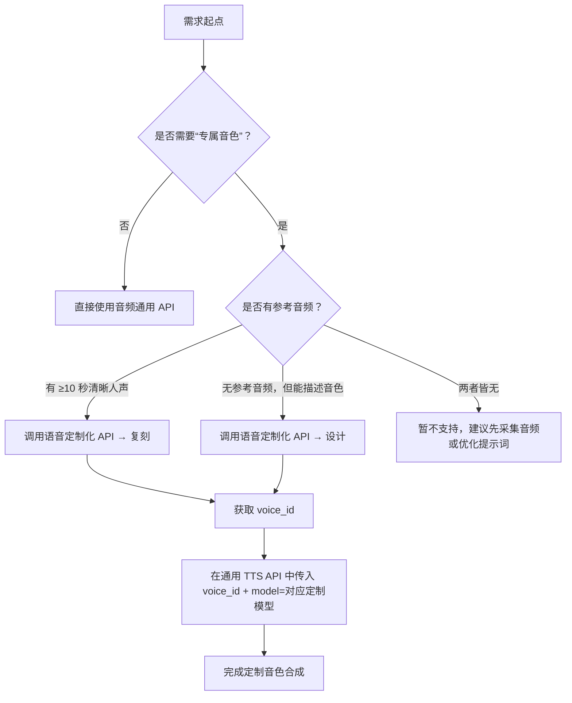

# 音频通用 API 与语音定制化 API 对比

为帮助开发者在百炼平台中高效选型，本文对两类核心音频能力——**音频通用 API（非实时音视频处理）** 与 **语音定制化 API（音色复刻与设计）** 进行系统性对比。二者定位不同：前者面向标准化、批量化、多任务类型的**通用音视频理解与生成**；后者聚焦于**个性化音色资产的创建与管理**，是语音合成（TTS）能力的前置增强模块。正确区分二者边界，可避免误用接口、计费偏差及集成路径错误。

---

## 关键维度对比

| 维度 | 音频通用 API | 语音定制化 API |
|------|--------------|----------------|
| **核心定位** | 非实时音视频处理服务集合（ASR/TTS/打标/生成/翻译），开箱即用，无需模型训练或音色准备 | 音色资产构建服务（Voice Cloning / Voice Design），为后续 TTS 合成提供**专属音色模型**，不直接生成最终音频内容 |
| **输入格式** | `multipart/form-data` 上传完整音视频文件（MP3/WAV/MP4 等，≤100 MB）；支持 `file` + 表单参数（如 `language`, `prompt`） | `application/json` 请求体；复刻需提供参考音频（`audio` 字段，Base64 或公网 URL）；设计需提供文本描述 `voice_prompt` 和预览文本 `preview_text` |
| **输出格式** | 结构化 JSON（含转写文本、SRT 字幕、标签列表、音频下载 URL 等）；部分接口支持 `response_format=srt` | JSON 响应，含音色唯一 ID、状态（`OK`/`DEPLOYING`）、预览音频 Base64（仅音色设计）、部署信息等；**不返回合成语音流或文件** |
| **支持模型** | 按功能分模型： • ASR：`qwen-audio-asr-v1` • TTS：`qwen-tts-v2` • 打标：`qwen-audio-asr-captioner` • 生成：`qwen-audio-t2a-v1` • 翻译：`qwen3-livetranslate-flash` | 按音色能力分目标模型： • 复刻支持：`qwen-audio-3.1-tts-plus`、`cosyvoice-v3.5-plus`、`qwen-audio-3.0-realtime-flash` • 设计支持：`cosyvoice-v3.5-plus`、`qwen-audio-tts`（Qwen-Audio-TTS 系列） • **不支持通用 TTS 模型（如 `qwen-tts-v2`）进行定制** |
| **API 端点** | 统一基础路径： `https://dashscope.aliyuncs.com/api/v1/services/aigc/audio/<service_name>` （如 `/asr`, `/tts`, `/captioning`） | 统一业务端点（地域隔离）： `POST https://{WorkspaceId}.{region}.maas.aliyuncs.com/api/v1/services/audio/tts/customization` （如 `myws.cn-beijing.maas.aliyuncs.com`） |
| **鉴权方式** | `Authorization: Bearer <api_key>`（全局 DashScope API Key） | `Authorization: Bearer <api_key>`（**业务空间专属 Key，严格绑定地域与 Workspace ID**） |
| **计费方式** | 按调用量计费： • ASR/TTS：按音频时长（分钟）计费 • 打标/生成/翻译：按请求次数或音频时长阶梯计费 • 所有调用均产生费用，无免费额度（除试用期） | **音色创建本身免费**； • 复刻/设计操作不计费 • 后续使用该定制音色调用 TTS 接口时，**按所选 `target_model` 的标准 TTS 计费规则收费**（如 `cosyvoice-v3.5-plus` 单位价格） • 无额外“音色调用费” |
| **典型场景** | • 会议录音批量转写为文字/字幕 • 视频自动添加多语种配音+字幕（音视频翻译） • 音频内容智能打标（如“背景有鸟鸣、人声低语、轻快钢琴”） • 文本生成带环境音效的短视频旁白（T2A） | • 为品牌 IP 创建专属播报音（复刻主持人原声） • 为游戏角色生成符合设定的虚拟音色（如“冷峻AI女声”） • 快速验证新音色效果（设计→预览→上线） • 构建企业级音色库并统一管理（`list_voice`/`query_voice`） |
| **实时性** | **纯非实时批处理**：必须上传完整文件，不支持流式输入；长任务返回 `task_id` 轮询结果 | **异步创建，同步预览（设计）**： • 复刻需审核（数分钟至数小时），状态轮询 • 设计创建后立即返回预览音频 Base64，无需轮询 |
| **文件/时长限制** | • 单文件 ≤ 100 MB • ASR/TTS ≤ 2 小时 • 音频生成 ≤ 30 秒 • 打标/翻译 ≤ 1 小时 | • 复刻参考音频：3–30 秒（推荐 10–20 秒清晰人声） • 设计预览文本：15–200 字符 • 无文件体积限制（Base64 编码后建议 ≤ 5 MB） |

---

## 适用场景建议

### ✅ 选择 **音频通用 API** 当：
- 你已有音视频文件，需要快速获得**转写、翻译、摘要或结构化标签**；
- 你需要**标准音色**（如通用男声/女声）进行语音合成，且对音色个性化无要求；
- 任务为一次性、离线、批量处理（如每日导出 100 条课程录音字幕）；
- 你希望最小化集成复杂度，使用统一域名和全局 API Key 即可调用全部能力；
- 你正在构建媒体内容分析平台、智能客服工单系统、无障碍字幕工具等通用型产品。

### ✅ 选择 **语音定制化 API** 当：
- 你需长期、高频使用**同一独特音色**（如企业代言人、虚拟主播、有声书主播），且标准音色无法满足品牌一致性；
- 你具备少量高质量参考音频（≥10 秒清晰人声），或能精准描述目标音色特征（如 `"年轻女性，语速适中，略带笑意，普通话带轻微京腔"`）；
- 你已规划将定制音色集成进自有 TTS 流水线，并愿意承担对应 `target_model` 的合成费用；
- 你运营多地域业务，需独立管理北京/新加坡 Workspace 的音色资产；
- 你正在开发音色即服务（VaaS）、AI 主播 SaaS、个性化教育语音助手等强调“声音身份”的产品。

### ⚠️ 注意：二者非互斥，而是协同关系
- **语音定制化 API 是 TTS 的“上游准备步骤”**：它不生成最终语音，而是产出一个可在通用 TTS 接口中使用的 `voice_id`；
- 在调用通用 TTS API 时，若指定 `model=qwen-audio-3.1-tts-plus` 且传入 `voice_id=xxx`（由语音定制化 API 创建），即可使用定制音色合成语音；
- 反之，未通过语音定制化 API 创建音色，则通用 TTS 仅能使用平台预置音色。

---

## 技术选型决策树（面向开发者）

**关键检查清单（上线前必验）：**
- ✅ 音频通用 API：确认文件格式/大小/时长在限制内；检查 `language` 参数是否与实际语种匹配；异步任务务必实现 `GET /tasks/{id}` 轮询逻辑。
- ✅ 语音定制化 API：确认 Workspace ID 与 API Key 地域一致（北京 Key 不能调用新加坡 Endpoint）；复刻任务创建后需监听 `status` 字段，仅 `OK` 状态方可用于 TTS；设计任务返回的 `preview_audio.data` 需 Base64 解码验证音质。
- ✅ 协同调用：TTS 请求中的 `model` 必须与定制时 `target_model` 完全一致；`voice_id` 为定制响应中 `output.voice_id` 字段值（非 `id` 或 `prefix`）。

---  
*本文档依据百炼平台 2024 年 Q3 版本 API 规范编写，具体行为以控制台最新配额说明及各子服务文档为准。*

## 被对比主题页

- [audio api directory](../api/audio-api-directory.md)
- [voice customization api directory](../api/voice-customization-api-directory.md)

