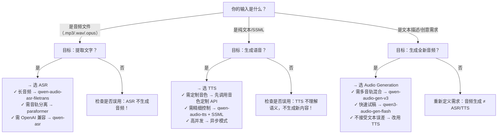

# 音频生成、语音合成与语音识别对比

## 对比目的与背景

在百炼平台的非实时音频处理能力体系中，**音频生成（Audio Generation）**、**语音合成（TTS）** 和 **语音识别（ASR）** 是三类基础且高频使用的音频 AI 能力，但其技术目标、输入输出范式、适用场景及工程集成方式存在本质差异。开发者在构建语音交互、内容创作、智能客服、无障碍服务等应用时，常因概念混淆或选型偏差导致 API 调用失败、计费异常或效果不达预期。

本页旨在为技术决策者与一线开发者提供清晰、可落地的横向对比参考，聚焦百炼平台当前（v3.1+）正式发布的非实时（离线/批量）能力，明确各方案的能力边界、协议约束与最佳实践，避免将 TTS 误用于转写、将 ASR 误用于配音，或在无需生成新音频时错误调用音频生成接口。

> ⚠️ 注意：本文所述能力均属于**非实时音频 API**，适用于文件上传、异步轮询、批量处理等离线场景；实时流式语音交互（如语音助手、实时会议转录）请参阅 [Realtime API 概述](raw/model-api-reference/realtime-api-directory/realtime-api-overview.md)。

---

## 关键维度对比表

| 维度 | 音频生成（Audio Generation） | 语音合成（TTS） | 语音识别（ASR） |
|------|------------------------------|------------------|------------------|
| **核心目标** | 根据文本/提示词（prompt）**从零生成全新音频内容**（含人声、音乐、环境音、多说话人对话等），强调创造性与表现力 | 将**结构化文本（含 SSML/LaTeX）确定性地转换为自然语音波形**，强调保真度、韵律可控性与音色一致性 | 将**原始语音信号（音频文件）准确转录为对应文本**，强调识别准确率、抗噪性与上下文理解能力 |
| **典型输入格式** | - `prompt`: 文本描述（如“一位沉稳男声朗读科技新闻，背景有轻微咖啡馆环境音”） - 可选 `reference_audio_url`（用于风格锚定） - 不接受纯文本无提示的“朗读”请求 | - `text`: 纯文本 / SSML XML / LaTeX 数学公式 - `voice`: 音色 ID（系统音色 / 复刻音色 / 设计音色） - `enable_ssml=true`（启用 SSML 解析） | - `input.file_urls`: 公网可访问的音频 URL 列表（Filetrans 类） - 或 `input.messages`: 含 `input_audio` 的消息数组（Flash 类） - 可选 `input_text` 上下文（≤400 字符）提升专业术语识别 |
| **典型输出格式** | - 生成的音频二进制流（支持 mp3/wav/opus） - 附带元数据（如生成时长、置信度、音轨信息） | - 合成的音频二进制流（支持 mp3/wav/opus） - 可选返回音素对齐、语调曲线等结构化语音分析结果 | - JSON 结构化文本结果：  ✓ `text`: 主识别文本  ✓ `segments`: 分段时间戳与文本  ✓ `words`: 词级时间戳（部分模型支持）  ✓ `language`: 自动检测语种 |
| **支持模型/引擎** | - `qwen-audio-gen-v3`（主推，支持多模态 prompt 控制） - `qwen3-audio-gen-flash`（轻量快速版，适合草稿生成） | - `qwen-audio-tts`（通用高质，支持 SSML 与多音色） - `cosyvoice`（强情感表现力，支持细粒度韵律控制） | - `qwen-audio-asr`（短音频流式友好） - `qwen-audio-asr-filetrans`（长音频异步转写） - `fun-asr` / `fun-asr-flash`（高精度、低延迟） - `paraformer`（支持音轨选择、语气词过滤、标点恢复） - `qwen-asr`（OpenAI 兼容协议支持） |
| **API 端点（HTTP）** | `POST https://{WorkspaceId}.cn-beijing.maas.aliyuncs.com/api/v1/audio/generation` | `POST https://{WorkspaceId}.cn-beijing.maas.aliyuncs.com/api/v1/audio/synthesis` | `POST https://{WorkspaceId}.cn-beijing.maas.aliyuncs.com/api/v1/audio/transcription`（同步） `POST https://{WorkspaceId}.cn-beijing.maas.aliyuncs.com/api/v1/audio/transcription/jobs`（异步 Filetrans） |
| **调用模式** | 异步为主（任务提交 → 轮询状态 → 下载音频），支持 SSE 流式返回首帧 | 同步（≤1 分钟音频）或异步（长文本/高并发场景）均可；CosyVoice 推荐异步以保障稳定性 | - Flash 类：支持同步（≤1 分钟）与异步 - Filetrans 类：**强制异步**（`X-DashScope-Async: enable`） - 所有 ASR 均支持 `X-DashScope-SSE: enable`（≥1 分钟生效） |
| **计费方式** | 按**生成音频时长（秒）× 模型系数**计费（例：`qwen-audio-gen-v3` 系数 1.5，生成 60 秒音频 = 90 计费单位） | 按**合成音频时长（秒）** 计费（与模型无关，统一单价）；SSML 解析、音色复刻调用不额外计费 | 按**输入音频时长（秒）** 计费（与模型无关）；上下文增强、热词注入不额外计费；Paraformer 音轨选择按所选音轨数计费 |
| **典型场景** | - AI 主播多角色配音（含背景音效） - 教育课件自动配乐与旁白生成 - 游戏 NPC 动态语音生成 - 广告创意音频草稿生成 | - 客服语音播报（IVR）、有声书朗读 - 新闻/公文自动化播音 - 多语言网站语音辅助（无障碍） - 与音色定制 API 联动实现专属播报音 | - 会议录音转文字纪要 - 在线课程视频字幕自动生成 - 电话客服质检与话术分析 - 法律/医疗口述记录数字化归档 |

---

## 各方案适用场景建议（面向开发者）

### ✅ 选 **语音识别（ASR）** 当：
- 你手头已有 `.mp3`/`.wav` 等音频文件，目标是**提取其中的说话内容为文本**；
- 需要高精度转写长会议录音（>30 分钟），优先选用 `qwen-audio-asr-filetrans` 或 `fun-asr`，并启用异步 + SSE；
- 需要区分多人发言（如双人访谈），选择支持**音轨分离**的 `paraformer` 模型，并传入 `track_id` 参数；
- 输入音频含专业术语（如医学名词、代码片段），务必通过 `input_text` 提供上下文（最多 5 条 user/assistant 对）；
- 需与 OpenAI 生态兼容（如使用 `openai-python` SDK），仅限 `qwen-asr` 模型，**不可用于 Filetrans 类任务**。

### ✅ 选 **语音合成（TTS）** 当：
- 你已有结构化文本（如 Markdown 文章、JSON 协议响应、SSML 脚本），目标是**生成高质量、可控音色的语音音频**；
- 需要品牌专属音色，应**先调用音色定制 API**（`/v1/voice/customize`）获取 `voice_id`，再在 TTS 请求中指定该 ID；
- 要求精细控制停顿、重音、语速（如数学公式朗读），必须使用 `qwen-audio-tts` + `enable_ssml=true`，配合 `<break>`、`<prosody>` 等标签；
- 高并发批量合成（如万条通知语音），推荐异步模式 + SDK 的 `jobs.create()` + `wait()` 流程，避免 HTTP 连接耗尽。

### ✅ 选 **音频生成（Audio Generation）** 当：
- 你**没有原始语音素材，也没有固定文本脚本**，而是希望 AI “自由发挥”生成一段符合描述的音频（如：“生成一段 20 秒的轻松钢琴BGM，适合作为播客片头”）；
- 需要**融合人声+音乐+环境音**的复合音频（如：“女声介绍产品，背景是城市雨声与轻快吉他”），TTS 无法实现此类多源混合；
- 场景强调**创意性与多样性**（如 A/B 测试不同配音风格），而非文本保真——此时不应使用 TTS（确定性输出），而应使用音频生成（随机种子可控）；
- **注意**：音频生成 *不保证文本逐字准确*，若需严格匹配文案，请改用 TTS；若需精准转录已有音频，请改用 ASR。

---

## 技术选型决策树（开发者速查）

> 💡 **关键提醒**：  
> - **音色定制（Voice Customization）不是独立音频能力，而是 TTS 的前置依赖**：所有复刻/设计音色必须通过 `/v1/voice/customize` 创建后，才能在 TTS 请求中作为 `voice` 参数使用。  
> - **三者不可互换**：用 ASR 处理 TTS 输出音频会引入二次失真；用音频生成替代 ASR 将完全丢失文本准确性；用 TTS 替代音频生成将无法获得环境音、多说话人等复合能力。  
> - **地域与协议一致性**：所有接口均须使用业务空间专属域名（`{WorkspaceId}.cn-beijing.maas.aliyuncs.com`）；ASR 中 `qwen-asr` 支持 OpenAI 协议，其余模型（含 TTS、音频生成）**仅支持 DashScope 协议**。

---  
*最后更新：2024年10月 | 百炼平台音频能力文档组*

## 被对比主题页

- [audio api directory](../api/audio-api-directory.md)
- [voice customization api directory](../api/voice-customization-api-directory.md)

