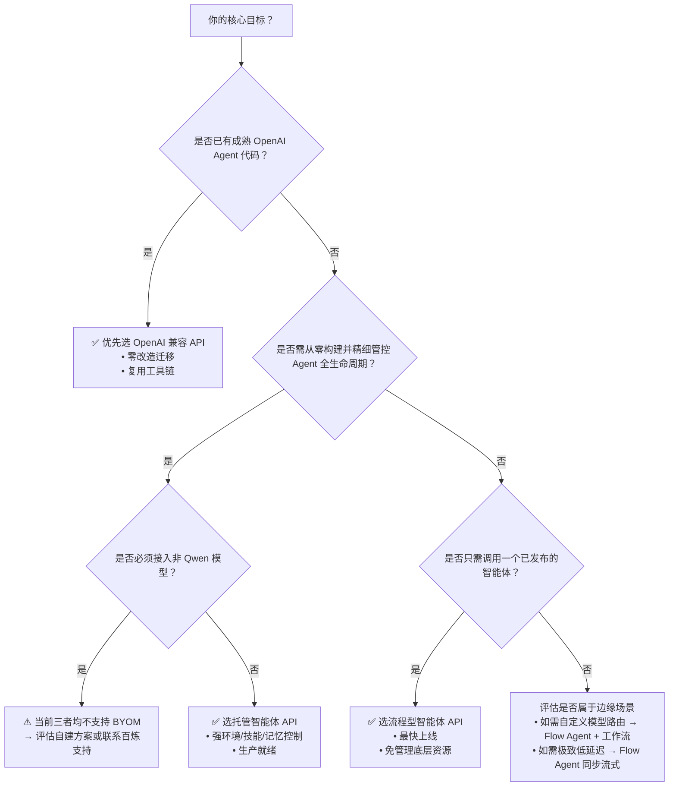

# 流程型智能体、托管智能体与 OpenAI 兼容智能体 API 对比

本文旨在为百炼平台开发者提供清晰、可落地的技术选型参考，系统对比三类主流智能体 API 方案的核心能力、接口设计、运维成本与适用边界。随着智能体应用从原型验证走向生产部署，不同抽象层级的 API 在模型支持、状态管理、工具集成、开发体验和计费模式上呈现显著差异。本对比基于当前（2024年Q3）百炼平台最新稳定版 API 文档，聚焦实际工程决策关键维度，避免概念泛化，强调“什么场景该用什么方案”。

## 关键维度对比

| 维度 | 流程型智能体（Flow Agent API） | 托管智能体（Managed Agents API） | OpenAI 兼容智能体 API（OpenAI-Compatible Agents API） |
|------|------------------------------|----------------------------------|--------------------------------------------------------|
| **定位与抽象层级** | 应用级编排接口：面向已发布/已配置的智能体或工作流，强调“调用”而非“构建” | 平台级托管服务：面向 Agent 全生命周期管理，强调“创建-配置-运行-观测”的完整控制权 | 协议兼容层接口：面向快速迁移与标准化集成，以 OpenAI `chat.completions` 语义为基底，扩展 Agent 特性 |
| **输入格式** | 二选一： • `input.prompt`（单轮字符串） • `input.messages`（类 OpenAI 格式，含 `role: "system"/"user"/"assistant"`）；需显式传 `app_id` | 高度结构化： • `/sessions/{id}/messages` 接口要求 `session_id` + `environment_id` + 消息体 • 消息体含 `content`, `role`, `tool_calls`, `tool_results` 等字段，支持多模态附件元数据 | 完全兼容 OpenAI： • `messages`（必填，标准数组）、`model`（必填）、`tools`、`tool_choice`、`session_id`（可选）等字段语义与 OpenAI 一致；`model` 必须为 Agent 专用型号（如 `qwen-plus-agent-v1`） |
| **输出格式** | 同步响应含 `output.text` / `output.choices[0].message.content`；流式响应按 chunk 返回 `delta.content`；异步任务返回 `task_id`，需轮询 `/responses/{task_id}` | 同步响应含 `id`, `session_id`, `status`, `messages`（含完整历史与 tool 结果），以及 `execution_trace`（调试模式下）；不支持原生流式，但可通过 SSE 实现近似流式 | 完全兼容 OpenAI `chat.completions` 响应结构： • `choices[0].message.content` 或 `choices[0].message.tool_calls` • 新增字段：`session_id`, `environment_id`, `usage`（含 `prompt_tokens`, `completion_tokens`, `total_tokens`） |
| **支持模型** | 不直接绑定模型：调用的是**已部署的智能体应用或工作流**，其底层模型由应用配置决定（可为 Qwen 系列、第三方模型或混合路由） | 严格限定：仅支持百炼托管的 `qwen-max`、`qwen-plus`、`qwen-turbo`；**不支持用户自定义模型或外部模型接入** | 严格限定：仅支持百炼专属 Agent 模型（如 `qwen-plus-agent-v1`, `qwen-max-agent-v1`）；通用大模型（如 `qwen-max`）不可直接作为 Agent 后端 |
| **API 端点与认证** | **双网关体系**： • 应用调用：`https://dashscope.aliyuncs.com/api/v1/apps/{APP_ID}/completion`，Bearer Token 认证 • 组件管理（Prompt/记忆）：OpenAPI 地址（如 `GET /{workspaceId}/promptTemplates/{id}`），AccessKey 签名认证 | 单一 RESTful 网关： `https://dashscope.aliyuncs.com/api/v1/agents/...`（如 `/agents`, `/environments`, `/sessions/{id}/messages`） 统一 Bearer Token 认证 | 单一兼容网关： `https://dashscope.aliyuncs.com/api/v1/agents/chat/completions` 统一 Bearer Token 认证，权限需包含 `agents:run` |
| **[长期记忆](../concepts/memory.md)支持** | ✅ 支持“[长期记忆](../concepts/memory.md)（旧）”：提供 `Memory`/`MemoryNode` 的完整 CRUD，但文档明确标注为**遗留能力**，新项目不推荐 | ✅ 原生支持：通过 `Memory Store` 资源实现，自动绑定 Session，TTL 默认 7 天（不可调），支持策略配置 | ✅ 原生支持：Session 级别自动维护 message history 与 tool call 结果缓存；Session TTL 默认 24 小时，支持 `POST /sessions/{id}/extend` 显式延长 |
| **工具调用（Tool Calling）** | ❌ 不直接支持：工具能力需在智能体应用内部通过 Prompt 工程或工作流节点预置，API 层无 `tools` 参数 | ✅ 原生支持：通过 `Skill` 资源注册工具，`Session` 消息中可触发执行；支持 `File`、`Webhook`、`Vault` 等扩展技能 | ✅ 原生支持：完全兼容 OpenAI `tools` / `tool_choice` 语法，支持 `function` 和 `code_interpreter` 类型；凭证通过 `Vault` 注入，隔离安全 |
| **环境隔离与多租户** | ⚠️ 有限支持：通过 `X-DashScope-WorkSpace` Header 指定子空间，但非强隔离；`app_id` 全局唯一，跨 workspace 复用需谨慎 | ✅ 强支持：`Environment` 是核心资源，可独立配置网络策略、依赖服务、密钥范围；天然支持多租户隔离 | ✅ 强支持：`Environment` 为一级资源，Agent 运行时绑定指定 Environment，Vault 凭证作用域严格受限于此 |
| **计费方式** | 按**调用量计费**： • 应用调用：按 token（输入+输出）计费，与底层模型一致 • Prompt 模板/[长期记忆](../concepts/memory.md)等组件操作：**免费**（当前策略） | 按**Agent 实例 + 运行时长 + token** 复合计费： • 创建 `Agent`/`Environment` 本身不计费 • `Session` 运行期间按 token 及内存占用计费；`Memory Store` 存储按量计费 | 按**token + Session 时长**计费： • 与 OpenAI 兼容，`usage` 字段明确分项（prompt/completion/total tokens） • Session TTL 内持续交互不额外计 Session 创建费，超时后新建 Session 重新计费 |
| **典型场景** | • 快速上线一个已调试完成的客服机器人（工作流应用） • 在小程序中嵌入一个固定功能的营销助手（新版智能体应用） • 需要批量管理 Prompt 模板并动态插值渲染 | • 构建企业级自动化 Agent（如法务合同审查 Agent，需调用 OCR、数据库、签名服务） • 需要细粒度控制运行环境（如金融场景沙箱隔离） • 团队需统一管理 Skill 库与 Memory Store 策略 | • 将现有 OpenAI Agent 代码零改造迁移到百炼 • 第三方 SaaS 平台集成百炼 Agent 能力（利用标准协议降低对接成本） • 快速验证 Agent 工具链可行性（`tools` + `tool_choice` 开箱即用） |

## 各方案适用场景建议

### ✅ 选择 **流程型智能体（Flow Agent API）** 当：
- 你的核心需求是**调用一个已发布、已测试、业务逻辑稳定的智能体或工作流**，而非从零构建；
- 你需要**低成本、低门槛地将智能体能力嵌入前端应用（H5/小程序/App）**，且对底层状态管理无定制要求；
- 你依赖 **Prompt 工程精细化运营**（如 A/B 测试多套模板、变量插值生成个性化文案），并需要 API 管理模板生命周期；
- 你暂时使用“长期记忆（旧）”满足轻量上下文保持，且能接受其遗留定位与 1 秒限频约束。

> ⚠️ 注意：若需强环境隔离、复杂工具链或长期记忆演进能力，此方案非最优解。

### ✅ 选择 **托管智能体（Managed Agents API）** 当：
- 你正在构建**生产级、高可靠、可审计的 AI 自动化系统**，要求对 Agent 的每个环节（环境、会话、记忆、技能）有完全掌控；
- 你的 Agent 必须**集成多个内部系统（ERP、CRM、数据库）或敏感服务（支付、身份认证）**，需要 `Environment` 级网络与凭证隔离；
- 你拥有专业 AI 工程团队，愿意投入精力管理 `Skill` 注册、`Memory Store` 策略、`Webhook` 事件处理等平台能力；
- 你追求**最简模型绑定路径**（直接选用 `qwen-plus` 等成熟模型），且无需兼容 OpenAI 生态。

> ⚠️ 注意：模型锁定为 Qwen 系列，不支持 Bring-Your-Own-Model（BYOM）；调试需启用 `X-Bailian-Debug`，学习成本略高。

### ✅ 选择 **OpenAI 兼容智能体 API** 当：
- 你已有成熟的 OpenAI Agent 代码库（Python/JS），希望**最小改动迁移至百炼**，复用现有 `tools` 定义、`tool_choice` 策略与 session 管理逻辑；
- 你的技术栈重度依赖 OpenAI 协议（如 LangChain、LlamaIndex），需**开箱即用的兼容性保障**，避免适配层开发；
- 你面向 ISV 或生态伙伴提供 Agent 能力，**标准化接口是降低集成门槛的关键**；
- 你重视**快速验证工具调用链路**（如一键接入天气、搜索、计算工具），且对 `Vault` 安全注入凭证有刚需。

> ⚠️ 注意：模型必须选用 `*-agent-v1` 后缀的专用型号；通用 `qwen-max` 无法直接替换，需确认 Agent 专用模型能力覆盖度。

## 技术选型决策树（面向开发者）

**最后建议**：  
- **MVP 验证阶段**：从 OpenAI 兼容 API 入手，利用其协议友好性快速闭环；  
- **规模化交付阶段**：若业务复杂度上升（多系统集成、合规审计、SLA 要求），平滑切换至托管智能体 API；  
- **存量应用集成阶段**：对已上线的智能体应用/工作流，继续使用流程型智能体 API，保持架构稳定。  

所有方案均依托百炼平台统一基础设施，未来能力演进（如新版记忆服务、多模型路由）将逐步收敛至统一 Agent 框架，当前选型可视为面向不同成熟度阶段的合理分层。

## 被对比主题页

- [flow agent api](../api/flow-agent-api.md)
- [managed agents api](../api/managed-agents-api.md)
- [openai compatible agents api](../api/openai-compatible-agents-api.md)

