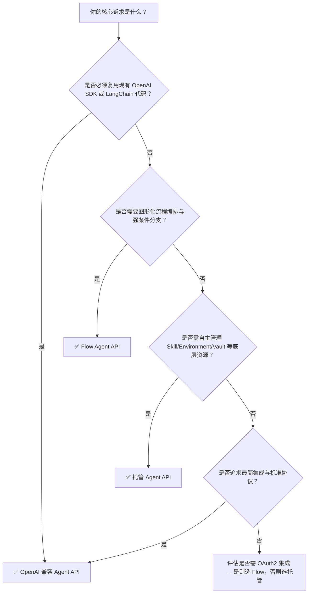

# Flow Agent、托管 Agent 与 OpenAI 兼容 Agent API 对比

本文旨在为百炼平台开发者提供清晰、可落地的技术选型参考，系统对比三种主流 Agent 调用方式的核心能力、接口契约与工程约束。随着智能体应用从单点实验走向生产集成，选择适配业务架构、运维习惯与团队技术栈的 Agent 接口范式至关重要：  
- **Flow Agent API** 面向强流程管控与企业级系统集成；  
- **托管 Agent API** 面向需自主管理会话生命周期与技能生态的中大型 AI 应用；  
- **OpenAI 兼容 Agent API** 面向快速迁移、多平台协同或已有 OpenAI 生态（如 LangChain、LlamaIndex）的开发者。  
下表从 7 个关键维度展开横向对比，所有信息均基于当前（2024 Q3）百炼平台正式版 API 行为。

## 关键维度对比

| 维度 | Flow Agent API | 托管 Agent API | OpenAI 兼容 Agent API |
|------|----------------|----------------|------------------------|
| **输入格式** | JSON 对象，以 `inputs: {key: value}` 显式注入预定义变量（如 `{"query": "会议纪要", "user_id": "u123"}`）；不支持原始 message 数组 | 首次调用需 `POST /agents/{id}/sessions` 初始化会话，后续 `POST /sessions/{id}/run` 提交 `input: string \| object`；支持结构化输入但非 OpenAI 格式 | 完全兼容 OpenAI `chat.completions` 输入：`messages: [{role, content, tool_calls?}]` + `tools`, `tool_choice`, `model` 等字段；支持 system/user/assistant/tool 多角色消息流 |
| **输出格式** | 同步响应返回 `{"output": {...}, "status": "success", "request_id": "req-xxx"}`；SSE 流式响应按步骤推送 `{ "step": "tool_call", "content": {...} }` 结构 | 同步响应为 `{"result": {...}, "session_id": "...", "status": "completed"}`；SSE 流式按执行步（reasoning/tool_call/tool_result）分段推送；无 OpenAI 风格 `choices` 封装 | 完全兼容 OpenAI 输出：同步返回 `{"choices": [{"message": {...}, "finish_reason": "stop/tool_calls"}]}`；SSE 流式按 `delta` 分块（含 `content`, `tool_calls`），支持 `function_call` 兼容模式 |
| **支持模型** | ❌ 不直接支持模型选择；仅运行控制台「智能体编排」创建并发布的 Flow Agent 实例（底层模型由 Flow 配置固化） | ✅ 限定支持 `qwen-max`、`qwen-plus`、`qwen-turbo` 三款 Qwen 模型；不可切换第三方或自定义模型 | ✅ 仅支持百炼专属 Agent 模型（如 `qwen-plus-agent-v1`, `qwen-max-agent-v1`）；通用大模型（如 `qwen-max`）不可直接作为 Agent 后端 |
| **API 端点** | `POST /api/v1/flow_agent/run`（同步） `POST /api/v1/flow_agent/run_async`（异步） `GET /api/v1/flow_agent/async_result?id=...`（轮询） | `POST /v1/agents`（创建） `POST /v1/agents/{id}/sessions`（启会话） `POST /v1/sessions/{id}/run`（执行） `GET /v1/sessions/{id}`（查状态） | `POST /api/v1/agents/chat/completions`（核心执行） `POST /api/v1/agents/sessions`（显式创建会话） `POST /api/v1/agents/environments`（环境管理） （路径与 OpenAI `/v1/chat/completions` 保持语义一致） |
| **认证方式** | OAuth2 Bearer [Token](../concepts/token.md)（`Authorization: Bearer <access_token>`）；[Token](../concepts/token.md) 需通过百炼 OAuth2 接口获取 | API Key Bearer [Token](../concepts/token.md)（`Authorization: Bearer <api_key>`）；Key 需在控制台申请并授权 `managed_agents:read/write` 权限 | API Key Bearer Token（`Authorization: Bearer <api_key>`）；Key 需授权 `agents:run` 权限；**不支持 OAuth2** |
| **计费方式** | 按 **Flow Agent 实例调用次数** 计费（无论同步/异步）；每次 `run` 或 `run_async` 触发一次计费；流式响应不额外计费 | 按 **Agent 实例运行时长（秒）+ 工具调用次数 + token 消耗** 组合计费；会话空闲超时（24h）后自动终止，停止计费 | 按 **Agent 模型 token 消耗量（prompt + completion） + 工具调用次数** 计费；Session 生命周期内多次 `chat/completions` 调用共享上下文但独立计费 |
| **典型场景** | - 企业内部审批流自动化（含人工审核节点跳转） - 金融风控多规则引擎串联（条件分支+外部系统回调） - 需完整审计链路与输入变量溯源的合规场景 | - 客服对话机器人（需跨会话记忆用户偏好） - 数据分析助手（动态加载数据库 Skill + 文件解析 Vault） - 内部工具平台（统一管理 50+ 自定义 HTTP/DB 工具） | - 快速将 LangChain Agent 迁移至百炼（零代码修改） - 多[模型路由](../concepts/model-routing.md)网关（复用 OpenAI SDK 统一接入 qwen-plus-agent-v1 / 第三方模型） - 实时协作白板中的 AI 助手（依赖 SSE 流式 + 多轮 message history） |

## 适用场景建议

### ✅ 优先选用 Flow Agent API 当：
- 业务逻辑高度结构化，需可视化编排（条件判断、循环、人工干预节点）；
- 系统已深度集成 OAuth2 认证体系，且要求每次调用携带完整业务上下文变量（如 `order_id`, `tenant_id`）；
- 审计与合规是刚性需求（如金融、政务），需确保每一步执行可追溯、可回放、可拦截。

### ✅ 优先选用托管 Agent API 当：
- 需要完全掌控 Agent 的生命周期（如主动销毁会话、批量重置 memory store）；
- 技术栈以自研框架为主，无需兼容 OpenAI 生态，但要求灵活绑定 Skill、Environment、Vault；
- 场景涉及大量私有工具集成（如内部 ERP 接口、定制化 OCR 服务），且需对工具错误做精细化重试策略配置。

### ✅ 优先选用 OpenAI 兼容 Agent API 当：
- 已使用 LangChain / LlamaIndex / CrewAI 等框架开发 Agent，希望最小成本迁移至百炼；
- 前端或移动端 SDK 依赖 OpenAI 标准接口（如 `openai-js`），需保持客户端代码零变更；
- 构建混合模型网关，同一套 client 代码可无缝切换百炼 Agent、OpenAI o1、Claude 等后端。

## 技术选型决策树（面向开发者）

> **重要提醒**：  
> - **不要混用认证方式**：Flow Agent 强制 OAuth2，另两者强制 API Key，混用将导致 `401 Unauthorized`；  
> - **模型不可互通**：`qwen-plus`（托管 API） ≠ `qwen-plus-agent-v1`（OpenAI 兼容 API），二者训练目标与推理架构不同；  
> - **[长期记忆](../concepts/long-term-memory.md)方案已统一**：三者均通过 `knowledge_base_id` 关联百炼向量知识库，原 Flow Agent 的 `/memory/*` 接口已废弃；  
> - **流式响应能力**：三者均支持 SSE，但语义不同——Flow 按“步骤”推送，托管按“执行单元”推送，OpenAI 兼容按“token/delta”推送，请按前端渲染逻辑适配。  

如需进一步验证接口行为，建议使用 [百炼 API Playground](https://dashscope.console.aliyun.com/playground) 进行实时调试，并参考各 API 文档末尾的「来源文档」链接获取最新规格说明。

## 被对比主题页

- [flow agent api](../api/flow-agent-api.md)
- [managed agents api](../api/managed-agents-api.md)
- [openai compatible agents api](../api/openai-compatible-agents-api.md)

