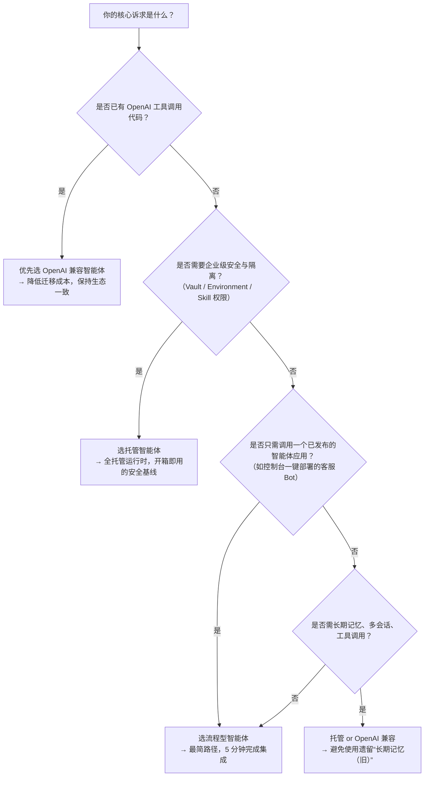

# 流程型智能体、托管智能体与 OpenAI 兼容智能体对比

## 背景与目的

百炼平台面向不同技术成熟度与业务需求的开发者，提供了三类定位清晰、能力分层的智能体服务接口：**流程型智能体（Flow Agent API）**、**托管智能体（Managed Agents API）** 和 **OpenAI 兼容智能体（OpenAI Compatible Agents API）**。三者在架构设计、抽象层级、模型支持、状态管理及生态适配等方面存在显著差异。本文旨在为开发者提供一份客观、可操作的技术选型参考，帮助其根据项目阶段（MVP 验证 / 生产部署 / 生态迁移）、团队能力（是否具备状态/内存/环境治理经验）、集成复杂度（是否已有 OpenAI 工具链）等维度，快速识别最匹配的方案。

---

## 关键维度对比

| 维度 | 流程型智能体（Flow Agent API） | 托管智能体（Managed Agents API） | OpenAI 兼容智能体（OpenAI Compatible Agents API） |
|------|------------------------------|----------------------------------|--------------------------------------------------|
| **核心定位** | 应用级调用 + 组件化管理（Prompt/旧记忆）的混合接口体系 | 全托管式 Agent 运行时平台，强调会话生命周期、安全隔离与技能编排 | OpenAI 标准协议兼容层，聚焦工具调用与多步推理的“无感迁移”体验 |
| **输入格式** | 支持 `prompt`（单轮文本）或标准 `messages` 数组（含 `system`/`user`/`assistant` 角色，支持[多模态](../concepts/multi-modal.md)）；`session_id` 控制上下文延续 | 严格结构化：`{ "input": { "text": "..." } }` 或 `{ "input": { "files": [...] } }`；必须显式传入 `session_id` | 完全兼容 OpenAI `chat.completions` 格式：`messages` 数组（角色同 OpenAI），支持 `tools`、`tool_choice`、`session_id` 等扩展字段 |
| **输出格式** | 同步返回 JSON（含 `output.text` / `output.choices[0].message.content`）；流式响应为 SSE，增量模式需 `incremental_output=true` | JSON 结构统一：`{ "output": { "text": "...", "session_id": "...", "memory_updated": true } }`；不支持原生流式 | 完全兼容 OpenAI 响应格式（`choices[0].message` 可含 `tool_calls`）；支持 `stream=true` 的 SSE 流式，但 `tool_calls` 分片需客户端按 `index` 合并 |
| **支持模型** | 不绑定具体模型，由所调用的**应用（App）** 内部配置决定（可为 Qwen 系列、自定义模型、多模型路由等） | 仅限平台托管模型：`qwen-max`、`qwen-plus`、`qwen-turbo`；**不支持自定义模型接入** | 仅限专用 Agent 模型：`qwen-plus-agent-v1`、`qwen-max-agent-v1`（后者已弃用）；**不支持通用大模型直接作为 Agent 后端** |
| **API 端点** | 双轨制： • 应用调用：`https://dashscope.aliyuncs.com/api/v1/apps/{app_id}/completion`（DashScope 网关） • 组件管理：`https://bailian.{region}.aliyuncs.com/...`（阿里云 OpenAPI） | 统一 RESTful 端点： `https://dashscope.aliyuncs.com/api/v1/agents/{agent_id}/session/{session_id}/chat` 等 | OpenAI 兼容端点： `https://dashscope.aliyuncs.com/api/v1/agents/chat/completions`（与 OpenAI `v1/chat/completions` 路径对齐） |
| **认证方式** | **双鉴权体系**： • 应用调用：`Authorization: Bearer <API Key>`（百炼 API Key） • 组件管理：`ACS3-HMAC-SHA256` 签名（阿里云 AccessKey） | 单一鉴权：`Authorization: Bearer <API Key>`，需 `managed_agents:full_access` 权限 | 单一鉴权：`Authorization: Bearer <API Key>`，需 `agents:run` 权限 |
| **计费方式** | 按调用次数 + 模型 token 消耗计费（与所调用 App 的计费策略一致）；Prompt 模板/记忆管理接口**免费** | 按 Agent 实例运行时长（秒）+ 记忆存储量（GB·月）+ [Token](../concepts/token.md) 消耗综合计费；Environment/Vault/Skill 等资源按用量计费 | 按请求次数 + Agent 模型 token 消耗计费；Session 存储、Vault 密钥管理等配套能力按用量计费 |
| **长期状态管理** | 提供“[长期记忆](../concepts/long-term-memory.md)（旧）”API（Memory/MemoryNode），但已标记为遗留；推荐使用新版会话状态（非此 API 直接提供） | 内置 **Memory Store**（向量+结构化混合索引），自动持久化会话历史与工具结果；支持 TTL 与批量操作 | Session 状态自动持久化（含 message history 与 tool call 缓存），TTL 默认 24 小时；需显式调用 `/sessions/{id}/extend` 延长 |
| **工具调用能力** | 无原生工具调用支持；需在应用（App）内部通过工作流编排或函数节点实现 | 通过 **Skill API** 注册与编排技能（Skill），支持参数校验、权限控制、异步执行；非 OpenAI `tools` 格式 | 原生支持 OpenAI `tools` / `tool_choice` 语义，自动解析、选择、调用并注入结果；与现有 OpenAI 工具生态无缝对接 |
| **典型场景** | • 快速上线预置智能体应用（如客服问答、报告生成） • 需要独立管理 Prompt 模板与旧版记忆的存量系统 • [多模态](../concepts/multi-modal.md)输入（图像/音频）驱动的应用调用 | • 构建高安全要求的自动化 Agent（如财务审批、HR 入职） • 需精细控制会话生命周期、环境隔离、密钥 Vault 的生产系统 • 长期运行、多技能协同的复杂工作流 | • 将现有 OpenAI `chat.completions` + `tools` 应用平滑迁移到百炼 • 快速验证 Agent 工具调用逻辑（无需重写 SDK） • 与 LangChain / LlamaIndex 等框架深度集成 |

---

## 适用场景建议

### ✅ 推荐选择 **流程型智能体（Flow Agent API）** 当：
- 你已通过百炼控制台发布了一个成熟的智能体应用（App），只需在业务系统中调用它；
- 你需要对 Prompt 模板进行版本化管理、A/B 测试，或复用旧版[长期记忆](../concepts/long-term-memory.md)能力；
- 项目处于早期验证阶段（PoC），追求最低接入成本，且不涉及复杂状态或工具链；
- 输入包含图片、语音等[多模态](../concepts/multi-modal.md)内容，且后端应用已配置对应处理节点。

> ⚠️ 注意：若需构建全新 Agent 并长期维护，不建议依赖“[长期记忆](../concepts/long-term-memory.md)（旧）”，应评估托管或 OpenAI 兼容方案。

### ✅ 推荐选择 **托管智能体（Managed Agents API）** 当：
- 你对 Agent 的安全性、可观测性、资源隔离有强要求（如金融、政务场景）；
- 需要将敏感凭证（数据库密码、API Key）通过 Vault 安全注入，并与 Skill 权限绑定；
- 业务逻辑高度依赖多轮会话状态、外部文件上下文、以及跨 Skill 的复杂编排；
- 团队具备较强的工程能力，愿意接受稍高的学习曲线以换取全托管的稳定性与扩展性。

### ✅ 推荐选择 **OpenAI 兼容智能体（OpenAI Compatible Agents API）** 当：
- 你正在将基于 OpenAI 的 Agent 应用（如使用 `openai>=1.0` SDK 的工具调用代码）迁移到百炼；
- 你使用 LangChain 的 `AgentExecutor`、LlamaIndex 的 `ReActAgent` 等框架，希望最小化代码改造；
- 你重视开发体验一致性，希望调试、日志、错误码与 OpenAI 生态保持对齐；
- 你当前主要使用 `qwen-plus-agent-v1` 等专用 Agent 模型，且暂无定制模型需求。

---

## 技术选型决策树（面向开发者）

> 💡 **最后建议**：  
> - 新项目**避免使用流程型智能体的“长期记忆（旧）”**，该能力已明确标记为遗留；  
> - 若未来计划接入自定义模型或私有化部署，**托管智能体**目前提供最灵活的底层控制能力；  
> - 若团队重度依赖 OpenAI 生态工具链，**OpenAI 兼容智能体**是现阶段最平滑的演进路径。  

---  
*文档更新时间：2024年10月*  
*依据百炼平台 v1.2.x 文档体系整理*

## 被对比主题页

- [flow agent api](../api/flow-agent-api.md)
- [managed agents api](../api/managed-agents-api.md)
- [openai compatible agents api](../api/openai-compatible-agents-api.md)

