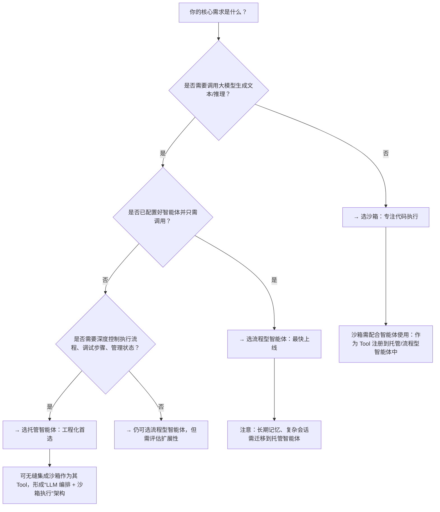

# 流程型智能体、托管智能体与沙箱环境对比

本文旨在帮助开发者清晰理解百炼平台三大核心执行环境——**流程型智能体（Flow Agent）**、**托管智能体（Managed Agents）** 与 **沙箱环境（Sandbox）** 的定位差异、能力边界与适用阶段，为技术选型提供结构化参考。随着智能体应用从原型验证走向生产级部署，不同场景对**可控性、隔离性、模型耦合度、状态管理能力及安全合规要求**存在显著差异。本文基于最新 API 文档（截至 2024 年 Q3）提炼关键维度，避免概念混淆，强调“什么场景该用什么方案”。

---

## 关键维度对比

| 维度 | 流程型智能体（Flow Agent API） | 托管智能体（Managed Agents API） | 沙箱环境（Sandbox API） |
|------|------------------------------|----------------------------------|--------------------------|
| **核心定位** | **应用级调用接口**：面向已发布、可复用的智能体/工作流，强调开箱即用与快速集成 | **运行时基础设施 API**：面向需深度编排 Agent 生命周期、会话状态、技能与记忆的工程化场景 | **隔离式代码执行环境**：面向需在受控 Linux 容器中运行任意用户代码（Python/Shell/JS 等）、处理文件或调用外部服务的可信计算场景 |
| **输入格式** | `prompt`（字符串） 或 `messages`（含 `system`/`user` 角色的数组）；支持 `session_id` 续写对话历史 | `input`（JSON 对象，结构由 Agent Schema 定义）；支持 `files` 数组引用已上传文件；`session_id` 必填且强绑定会话生命周期 | 无语义化输入；通过 `POST /sandboxes/{id}/connect` 获取连接凭证后，使用 E2B 协议（WebSocket/HTTP）发送命令、读取 stdout/stderr、上传/下载文件 |
| **输出格式** | `text` 字段（非流式） 或 SSE 流式 token（`incremental_output=true`）；含 `finish_reason`、`usage` 等元信息 | 结构化 JSON 响应：含 `output`（Agent 返回结果）、`events`（可选，含 `agent_step`/`tool_call` 等事件轨迹）、`session_status`；支持 Webhook 异步推送 | 原始进程 I/O：`stdout`、`stderr`、`exit_code`；文件操作返回 `file_id` 或二进制内容；无 AI 语义解析，纯执行层反馈 |
| **支持模型** | **直接绑定模型**：调用时隐式使用应用配置的模型（如 `qwen-max`），不暴露底层模型切换能力；仅支持百炼平台已接入的模型列表 | **模型解耦设计**：Agent 配置中显式声明 `model_id`（如 `"qwen-plus"`），支持运行时动态切换模型；模型选择权完全由开发者控制 | **不涉及大模型调用**：沙箱本身不调用 LLM；常作为工具函数（Tool）被托管智能体或流程型智能体调用，用于执行模型无法直接完成的计算任务（如数据清洗、PDF 解析、API 调用） |
| **API 端点与鉴权** | - 应用调用：`https://dashscope.aliyuncs.com/api/v1/apps/{app_id}/completion`，`Bearer <API Key>` - 组件管理（Prompt/Memory）：`https://bailian.aliyuncs.com/api/v1/...`，`ACS3-HMAC-SHA256`（AccessKey） | `https://bailian.aliyuncs.com/api/v1/agents` 等统一入口，全量接口使用 `Bearer <Token>`（通过 `/v1/tokens` 获取） | `https://{workspace_id}.cn-beijing.maas.aliyuncs.com/api/v1/agentstudio/sandbox/...`，`Bearer <API Key>`；Endpoint 与工作空间强绑定 |
| **计费方式** | - 按调用次数 + [Token](../concepts/token.md) 用量计费（应用调用类） - Prompt 模板/旧版 Memory 接口按请求次数计费（组件类） | 按 Agent 实例运行时长（秒）+ 内存规格（GB·秒）计费；Session、File、Memory Store 等配套资源按用量计费 | 按沙箱实例运行时长（秒）+ CPU/内存规格计费；文件存储按容量·天计费；模版构建不额外收费 |
| **状态与会话管理** | 依赖 `session_id` 实现轻量级云端对话续写（1 小时超时）；`messages` 优先级高于 `session_id`；[长期记忆](../concepts/long-term-memory.md)（旧）已标记为遗留 | **原生会话状态管理**：`Session` 为一级资源，支持 `status` 查询、强制终止、事件订阅；`Environment` 提供多租户/多版本隔离；`Memory Store` 支持键值对持久化（≤1 MB/value） | **无内置会话状态**：每个沙箱实例为独立容器；状态需由上层（如托管智能体）通过文件挂载、环境变量或外部数据库自行维护；实例最长存活 24 小时 |
| **安全与隔离** | 应用级隔离；Prompt/Memory 数据存储于百炼平台统一服务；不支持自定义网络策略 | `Environment` 提供逻辑隔离；`Vault` 安全托管密钥，通过模板语法注入；支持 `networkConfig` 白/黑名单控制出向流量 | **最强隔离**：Linux 容器级隔离；支持 `allow_internet_access` 开关、`denyOut` 域名/IP 黑名单；文件挂载路径严格限定（`/home/user/workspace/uploads/`）；支持暂停/恢复/释放全生命周期控制 |
| **典型场景** | - 客服机器人、知识库问答等标准化应用的前端集成 - 工作流编排（如“用户提问 → 检索 → 总结 → 发送邮件”）的 API 化调用 - 快速 A/B 测试不同 Prompt 模板效果 | - 需要调试 Agent 执行步骤、分析 `tool_call` 失败原因的开发场景 - 构建多步骤、带分支逻辑、需人工审核介入的复杂业务 Agent（如信贷审批助手） - 集成企业内部系统（ERP/CRM）并管理敏感凭证的生产级 Agent | - 运行用户上传的 Python 脚本进行数据可视化或模型微调 - 解析 PDF/Excel 文件并结构化提取信息 - 调用未封装为 Tool 的第三方 API（需临时网络访问） - 执行需要 GPU 或特定依赖库的计算任务 |

---

## 各方案适用场景建议

### ✅ 选择 **流程型智能体（Flow Agent）** 当：
- 你已通过百炼控制台完成智能体/工作流的配置、测试与发布，目标是**快速集成到现有业务系统（如 App、小程序、客服系统）**；
- 场景以**单轮问答或固定流程为主**，无需深度干预中间步骤，对响应延迟敏感（推荐[流式输出](../concepts/streaming-output.md)）；
- 团队以产品/业务人员为主，希望最小化开发成本，**避免管理基础设施细节**；
- ⚠️ 注意：若需[长期记忆](../concepts/long-term-memory.md)、复杂会话状态或自定义工具链，此方案能力受限，应转向托管智能体。

### ✅ 选择 **托管智能体（Managed Agents）** 当：
- 你需要**完全掌控 Agent 的行为逻辑、执行轨迹与资源依赖**，例如实现条件分支、循环重试、人工审核节点；
- 项目进入**工程化交付阶段**，要求可灰度发布、版本回滚、细粒度监控（通过 Session Events）；
- 必须集成企业内网系统或敏感服务，需通过 `Vault` 安全管理密钥，并精确控制网络出口；
- ⚠️ 注意：不适用于需运行任意代码或处理原始二进制文件的场景——此时应将沙箱作为其下游 Tool 调用。

### ✅ 选择 **沙箱环境（Sandbox）** 当：
- 核心需求是**在隔离环境中执行不可信或计算密集型代码**，而非调用大模型；
- 任务本质是**传统软件工程问题**：文件处理、API 调用、数据转换、轻量训练，且标准 Tool 无法覆盖；
- 你已具备容器/DevOps 基础，能接受**模版构建（Docker-like）、实例生命周期管理、网络策略配置**等运维复杂度；
- ⚠️ 注意：沙箱**不是智能体**，它不理解自然语言，也不生成文本；必须由上层智能体（托管或流程型）调度使用。

---

## 技术选型决策树（面向开发者）

> **关键提醒**：三者并非互斥，而是**分层协作关系**。最佳实践常为：  
> **托管智能体**（主控大脑） → 调用 **沙箱**（执行重任务） + 调用 **流程型智能体**（复用成熟工作流）  
> 例如：一个金融分析 Agent 可能用托管智能体协调流程，调用沙箱运行风险模型 Python 脚本，同时调用流程型智能体的“财报摘要”应用生成报告。

---  
*最后更新：2024年10月*

## 被对比主题页

- [flow agent api](../api/flow-agent-api.md)
- [managed agents api](../api/managed-agents-api.md)
- [sandbox api](../api/sandbox-api.md)

