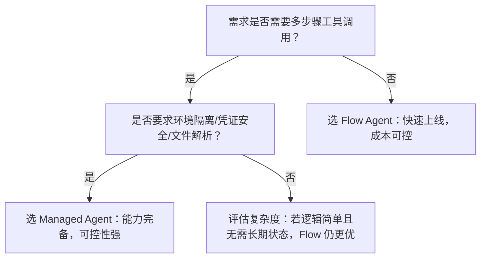

# 流程型智能体与托管型智能体对比

本文档面向百炼平台开发者，旨在清晰对比**流程型智能体（Flow Agent）** 与 **托管型智能体（Managed Agent）** 两类核心智能体范式的技术定位、能力边界与适用场景，帮助团队在架构设计初期做出合理技术选型。随着百炼平台能力演进，两类方案并非简单替代关系，而是在抽象层级、控制粒度和工程目标上形成互补：流程型侧重「应用级快速交付」，托管型聚焦「可编程智能体基础设施」。正确理解差异，可避免模型能力误用、API 混用导致的鉴权失败、地域限制报错或状态管理失控等问题。

---

## 关键维度对比

| 维度 | 流程型智能体（Flow Agent） | 托管型智能体（Managed Agent） |
|------|---------------------------|------------------------------|
| **核心定位** | 面向终端应用的**已发布工作流/智能体服务**，强调开箱即用、低代码集成 | 面向开发者的**可编程智能体运行时平台**，强调细粒度编排、环境隔离与生命周期自主管控 |
| **输入格式** | 支持两种模式： • 单轮 `input.prompt`（字符串） • 多轮 `messages` 数组（含 `system`/`user` 角色，OpenAI 兼容风格）；支持 `session_id` 自动加载历史上下文 | 严格结构化 `input` JSON 对象，Schema 由 Agent 定义时声明；**不接受原始 prompt 字符串或 messages 数组**；会话上下文通过 `session_id` + 内置 Memory Store 管理 |
| **输出格式** | • 同步响应：标准 JSON（含 `output.text` 或 `output.choices[0].message.content`） • 流式响应（SSE）：按 chunk 返回文本片段，支持 `incremental_output` 控制增量/全量追加 | • 同步响应：返回 `event` 流（如 `agent_started`, `tool_called`, `agent_finished`）及最终结果 • 流式响应（SSE）：按事件类型推送结构化事件流（含 `type`, `data`, `timestamp`），便于前端实时渲染与状态追踪 |
| **支持模型** | **不直接绑定模型**；能力由后端封装的智能体/工作流决定（如 Agent 2.0 或旧版 Workflow），实际调用底层 DashScope 模型（如 `qwen-max`） | **显式声明模型**：Agent 定义中必须指定 `model_id`（如 `"qwen-plus"`），运行时动态路由至对应模型服务；支持多模型混合编排（不同 Skill 可绑定不同 model） |
| **API 端点** | 分为两类不兼容接口： • **应用调用接口**（DashScope 网关）：  `https://dashscope.aliyuncs.com/api/v1/apps/{APP_ID}/completion` • **组件类接口**（OpenAPI）：  `https://bailian.{region}.aliyuncs.com/...`（需 AccessKey 签名） | 统一 RESTful 接口体系： `https://bailian.{region}.aliyuncs.com/v1/agents/{agent_id}/...` 所有资源（Session/File/Memory/Vault）均遵循 `/v1/` 前缀与标准 HTTP 方法 |
| **认证方式** | • 应用调用：`Authorization: Bearer <api_key>`（百炼 API Key） • 组件类：阿里云 AccessKey 签名（ACS3-HMAC-SHA256），**不支持 Bearer [Token](../concepts/token.md)** | 全链路统一：`Authorization: Bearer <access_token>`（通过百炼 OAuth2 流程获取） |
| **会话与状态管理** | • `session_id` 用于加载云端对话历史（1 小时 TTL） • [长期记忆](../concepts/long-term-memory.md)（旧）为独立组件（Memory/MemoryNode），需显式调用 API 创建与关联，**已标记为遗留方案** | • `session_id` 是核心上下文载体，自动绑定 Memory Store、Event History、File 引用等 • 内置 Memory Store（键值存储），支持结构化数据读写，Session 过期后数据不可恢复（TTL 60 分钟） • 无“[长期记忆](../concepts/long-term-memory.md)”概念，状态完全生命周期绑定于 Session |
| **扩展能力** | • Prompt 模板：全生命周期管理（Create/Update/List），供智能体配置复用 • 工具调用：隐式集成（由智能体内部定义），对外不可编程 | • Skill：可复用的功能单元（如搜索、计算、API 调用），支持参数化与组合 • Vault：安全凭证托管，支持动态注入 Credential 至 Skill • File：上传/引用文件（PDF/JSON/图片等），供 Agent 解析使用 • Webhook：事件回调，支持异步通知与外部系统集成 |
| **计费方式** | 按**调用量计费**： • 每次 `completion` 调用计为 1 次请求 • 流式响应按 token 量计费（同 DashScope 模型计费规则） • Prompt 模板、Memory 等组件调用单独计费 | 按**Agent 实例运行时长 + 调用量**计费： • Agent 部署后按小时计费（无论是否调用） • 每次 `/chat` 请求按 token 量计费 • File 存储、Vault 凭证等资源按用量计费 |
| **典型场景** | • 快速上线客服问答机器人（复用预置模板） • 企业知识库问答（对接 RAG 工作流） • 低代码集成到 App/Web 前端（仅需 APP_ID + API Key） • 需要 [OpenAI 兼容接口](../concepts/openai-compatible-interface.md)的迁移项目 | • 构建具备多步骤决策、工具调用、文件解析的复杂 Agent（如合同审查助手） • 需要严格环境隔离的多租户 SaaS 应用 • 需深度定制交互流程与状态反馈（如带进度条的分析报告生成） • 需与内部系统（ERP/CRM）通过 Webhook 或 Skill 深度集成 |

---

## 适用场景建议

### ✅ 推荐选择 **流程型智能体（Flow Agent）** 当：
- 业务需求明确、逻辑相对固定（如 FAQ、单轮信息提取、标准化报告生成）；
- 团队以产品/业务人员为主，希望最小化开发投入，通过控制台配置+简单 API 调用快速上线；
- 已有 OpenAI 风格应用，需平滑迁移至百炼（利用 Responses API 兼容模式）；
- 需要跨地域部署（如法兰克福客户），且能接受通过 `workspace` 参数显式指定地域 endpoint；
- 对会话状态要求不高，或可接受 1 小时 TTL 的轻量级上下文保持。

### ✅ 推荐选择 **托管型智能体（Managed Agent）** 当：
- 需构建具备**复杂决策链、多工具协同、文件理解、异步事件驱动**的智能体（如“自动处理报销单：OCR → 解析 → 核验 → 提交审批”）；
- 要求**强隔离性**：不同客户/部门需独立 Environment、独立 Memory Store、独立 Credential；
- 开发者需**完全掌控执行过程**：监听 `tool_called` 事件做中间处理、自定义错误降级策略、实现前端实时状态渲染；
- 需要将智能体作为**微服务组件**嵌入现有架构，通过 Webhook 与内部系统双向通信；
- 项目处于中长期演进阶段，需可持续维护、版本化（Agent YAML）、技能复用与可观测性（完整 Event 日志）。

> ⚠️ **重要提醒**：两类方案**不可混用**。例如：不能用 Flow Agent 的 `app_id` 调用 Managed Agent 的 `/v1/agents/...` 接口，反之亦然；鉴权方式、Base URL、参数结构均不兼容。选型应在项目启动阶段明确，并同步规划 API 管理、监控告警与成本预算。

---

## 技术选型参考（开发者视角）

| 评估项 | 流程型智能体 | 托管型智能体 | 建议动作 |
|--------|--------------|----------------|----------|
| **上手速度** | ⭐⭐⭐⭐⭐（控制台发布 → 记下 APP_ID → 3 行代码调用） | ⭐⭐☆（需学习 YAML Schema、Skill 编写、Session 生命周期） | 初创验证选 Flow；成熟团队可直接上 Managed |
| **调试体验** | 控制台提供「在线调试」界面，支持修改 prompt/messsages 实时测试 | 依赖 CLI 工具或 Postman 模拟 `/chat` 请求；推荐搭配 VS Code 插件与本地 mock server | Flow 更适合非技术人员协作；Managed 需 DevOps 工具链支持 |
| **可观测性** | 仅提供最终输出与基础耗时；无中间步骤日志 | 全事件流（`agent_started`, `memory_written`, `tool_result`...），支持审计与问题定位 | 高合规要求场景（金融/医疗）首选 Managed |
| **模型切换灵活性** | 依赖智能体重新发布；无法运行时动态切模型 | Agent 定义中可声明 `model_id`，支持灰度发布与 A/B 测试 | 需频繁模型迭代的算法团队倾向 Managed |
| **成本敏感度** | 无常驻成本，按需付费；适合流量波动大的场景 | 存在 Agent 实例小时费，空闲期仍计费；需配合 Auto-scaling 或按需启停 | 流量低频项目优先 Flow；高并发稳定服务可接受 Managed 固定成本 |

**最终决策树**：  

如仍有不确定，建议：  
1. 用 Flow Agent 在 1 小时内完成 MVP 验证核心业务价值；  
2. 同步用 Managed Agent 搭建一个最小可行 Skill 链（如 “用户提问 → 调用搜索 Skill → 返回摘要”），评估开发与运维成本；  
3. 基于实测数据（延迟、错误率、开发人天、月度账单）进行最终选型。

## 被对比主题页

- [flow agent api](../api/flow-agent-api.md)
- [managed agents api](../api/managed-agents-api.md)

