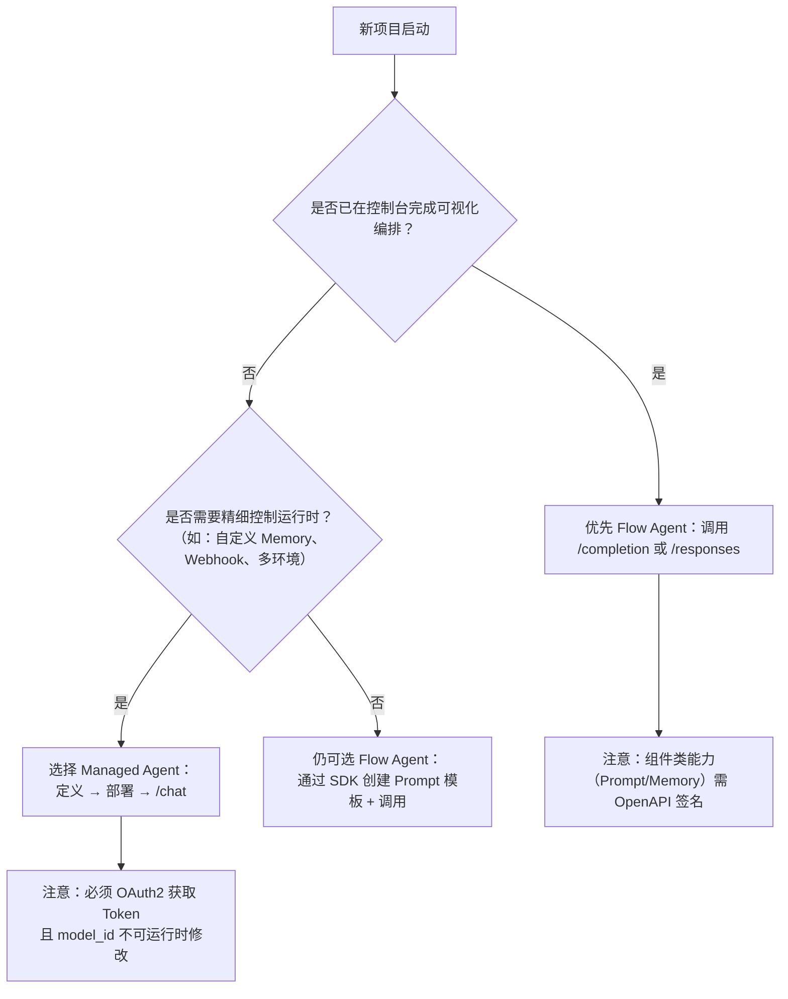

# 流程型智能体与托管智能体对比

本文旨在帮助百炼平台开发者清晰理解两类核心智能体能力——**流程型智能体（Flow Agent）** 与**托管智能体（Managed Agent）** 的技术定位、能力边界与适用场景，为架构设计与 API 选型提供客观、可落地的技术参考。随着百炼平台智能体能力持续演进，二者在抽象层级、控制粒度、运维模式及集成方式上已形成明确分工：流程型智能体面向“应用级快速交付”，强调开箱即用与低代码编排；托管智能体则面向“工程化深度定制”，强调运行时可控性、环境隔离与全生命周期管理。正确区分二者，可避免重复建设、降低维护成本，并提升系统稳定性与可扩展性。

## 关键维度对比

| 维度 | 流程型智能体（Flow Agent） | 托管智能体（Managed Agent） |
|------|---------------------------|------------------------------|
| **核心定位** | 应用/工作流的**发布态调用接口**，聚焦“执行”与“编排结果消费” | 智能体的**定义-部署-运行时管理接口**，聚焦“构建”与“可控执行” |
| **输入格式** | • 同步/异步/流式调用均支持 `prompt`（字符串）或 `messages`（标准角色消息数组：  `[{ "role": "system", "content": "..." }, { "role": "user", "content": "..." }]`） • 支持 `session_id` 恢复历史（1 小时有效期） | • 严格要求 `messages` 数组（含 `system`/`user`/`assistant` 角色），不接受单字段 `prompt` • 首次会话需先创建 `session`，后续请求通过 `session_id` 绑定上下文 • 支持事件驱动输入（如 `event: tool_call_result`） |
| **输出格式** | • 同步响应：标准 JSON，含 `output.text`、`output.choices[0].message.content` 等字段 • 流式响应（SSE）：按 chunk 返回增量文本（`incremental_output=false` 时为累计文本；`true` 时为纯增量） | • 同步响应：结构化 JSON，含 `response.type`（`text`/`tool_use`/`file` 等）、`response.content`、`response.tool_calls` 等语义化字段 • 流式响应（SSE）：严格按事件类型分块（`event: text_delta`, `event: tool_use`, `event: memory_update`），支持细粒度前端渲染与状态同步 |
| **支持模型** | • 由应用发布时绑定，调用侧**不可动态切换** • 实际可用模型取决于控制台中该应用所选模型（如 `qwen-max`, `qwen-plus`），API 层无显式 `model_id` 参数 | • **必须显式指定 `model_id`**（如 `"qwen-max"`、`"qwen-plus"`）作为 Agent 创建/更新参数 • 模型列表与兼容性以 [Model API 文档](../../raw/model-api-reference/model-list.md) 为准，支持运行时多模型共存（不同 Agent 可用不同模型） |
| **API 端点与协议** | • **双网关分离**：  – 应用调用：`https://dashscope.aliyuncs.com/api/v1/apps/{APP_ID}/completion`（DashScope 网关）  – 组件管理：`https://{workspaceId}.cn-beijing.maas.aliyuncs.com/{workspaceId}/...`（OpenAPI 网关） • HTTP/1.1，需区分鉴权方式 | • **统一 RESTful 端点**：  `https://dashscope.aliyuncs.com/api/v1/agents/{id}/chat` 等（全路径基于 DashScope 域名） • 完整支持 HTTP/1.1 与 HTTP/2（推荐流式场景启用 HTTP/2） |
| **鉴权方式** | • **应用调用类接口**：`Authorization: Bearer <API_KEY>`（百炼平台 API Key） • **组件类接口**（Prompt/Memory）：阿里云 AccessKey 签名（ACS3-HMAC-SHA256），**不兼容 Bearer [Token](../concepts/token.md)** | • **统一 Bearer [Token](../concepts/token.md) 认证**：  `Authorization: Bearer <access_token>` • [Token](../concepts/token.md) 通过 OAuth2 流程获取，支持短期有效、权限精细化控制（如仅限 `agent:read`） |
| **计费方式** | • 按**调用量计费**（每次 `/completion` 或 `/responses` 请求计为 1 次调用） • 模型推理费用另计（依据实际 tokens 消耗，与调用次数解耦） • Prompt 模板、[长期记忆](../concepts/long-term-memory.md)（旧）等组件操作**不单独计费** | • 按**Agent 实例运行时资源消耗计费**：  – 基础：Agent 部署实例时长（小时）  – 增量：Tokens 消耗、Memory Store 存储量、文件存储量 • API 调用本身（如 `/chat`, `/sessions`）**不产生额外调用费** |
| **典型场景** | • 快速上线客服机器人、FAQ 助手、营销文案生成等标准化应用 • 与现有业务系统（如 CRM、ERP）做轻量级 AI 能力嵌入（通过 APP_ID 直接调用） • 需要复用控制台已配置的工作流（Workflow）逻辑 | • 构建具备复杂工具调用链、多步骤决策、状态持久化的专业 Agent（如投研分析助手、IT 运维巡检 Agent） • 需要环境隔离（dev/staging/prod）与灰度发布的 SaaS 类产品 • 要求对会话状态、记忆更新、文件引用等进行编程式监听与干预（如 Webhook 回调） |
| **[长期记忆](../concepts/long-term-memory.md)能力** | • 仅支持已标记为“**旧**”的[长期记忆](../concepts/long-term-memory.md)（Legacy Memory），功能受限且**不推荐新项目使用** • 无原生 Memory Store 键值管理能力 | • 内置 **Memory Store**：支持键值对形式的持久化存储（单 key ≤1MB），自动关联 session/agent 粒度 • 支持 `memory_update` 流式事件，便于实时同步上下文变更 |
| **文件处理** | • 依赖外部临时文件上传许可（通过辅助接口申请），无原生文件管理能力 • 文件内容需预处理为文本后传入 `prompt`/`messages` | • 原生支持 `/v1/files` 上传（≤100MB，非分片） • 文件可直接在 `messages` 中以 `{"type": "file", "file_id": "xxx"}` 引用，Agent 自动解析内容 |

## 各方案的适用场景建议

### ✅ 推荐选用 **流程型智能体（Flow Agent）** 当：
- 你已通过百炼控制台完成智能体或工作流的可视化编排，并希望**快速对外提供 API 服务**；
- 集成方系统简单，只需“输入文本 → 获取回复”这一单向交互，**无需感知会话生命周期或内部状态**；
- 项目处于 PoC 或 MVP 阶段，追求**最低开发成本与最快上线速度**；
- 你使用的是标准 Prompt + 少量 Tools 的轻量级应用，且**无跨会话强状态依赖需求**。

### ✅ 推荐选用 **托管智能体（Managed Agent）** 当：
- 你需要**完全掌控 Agent 的定义、部署、版本迭代与运行时行为**（如动态加载 Skill、切换 Environment）；
- 应用逻辑复杂，涉及**多轮工具调用、条件分支、状态暂存与外部系统回调**（如支付确认后触发工单创建）；
- 要求**生产环境高可靠性**：需环境隔离、灰度发布、细粒度监控（Memory 使用率、Tool 调用成功率）及 Webhook 事件通知；
- 你正在构建一个**可复用、可组合、可治理的 Agent 平台或中间件层**，而非单点应用。

### ⚠️ 不建议混用或迁移的典型情况：
- 已上线的流程型智能体应用**不应强行迁移到托管智能体**，除非有明确的工程化治理诉求（如需 Memory Store 或环境隔离）；
- 托管智能体**不可直接复用流程型智能体的 Prompt 模板或 Legacy Memory**，二者数据体系不互通；
- 若仅需调用已有工作流（Workflow），请坚持使用 Flow Agent 的 `/responses` 接口，托管智能体不提供 Workflow 兼容模式。

## 面向开发者的技术选型参考

作为开发者，在启动新项目前，请按以下决策树进行判断：

**关键实践提示：**
- **调试阶段**：Flow Agent 推荐使用 DashScope SDK 的 `Completion` 方法；Managed Agent 推荐从 `cURL` 快速开始文档入手，验证基础链路；
- **流式体验**：二者均支持 SSE，但 Managed Agent 的事件类型更丰富（`tool_use`/`memory_update`），适合构建高级 UI；
- **错误排查**：Flow Agent 应用调用返回 `request_id`；Managed Agent 返回标准 `trace_id`，均需结合百炼控制台「调用日志」定位；
- **未来演进**：长期记忆（旧）已明确标记为“旧”，新项目请统一采用 Managed Agent 的 Memory Store；Prompt 模板能力在两者中并存，但托管智能体支持更灵活的变量注入与运行时覆盖。

选择没有绝对优劣，只有是否匹配你的**当前阶段目标**与**长期架构愿景**。百炼平台将持续增强两类能力的协同性（如未来支持托管智能体一键发布为 Flow Agent 应用），建议关注平台 Release Notes 获取最新集成能力。

## 被对比主题页

- [flow agent api](../api/flow-agent-api.md)
- [managed agents api](../api/managed-agents-api.md)

