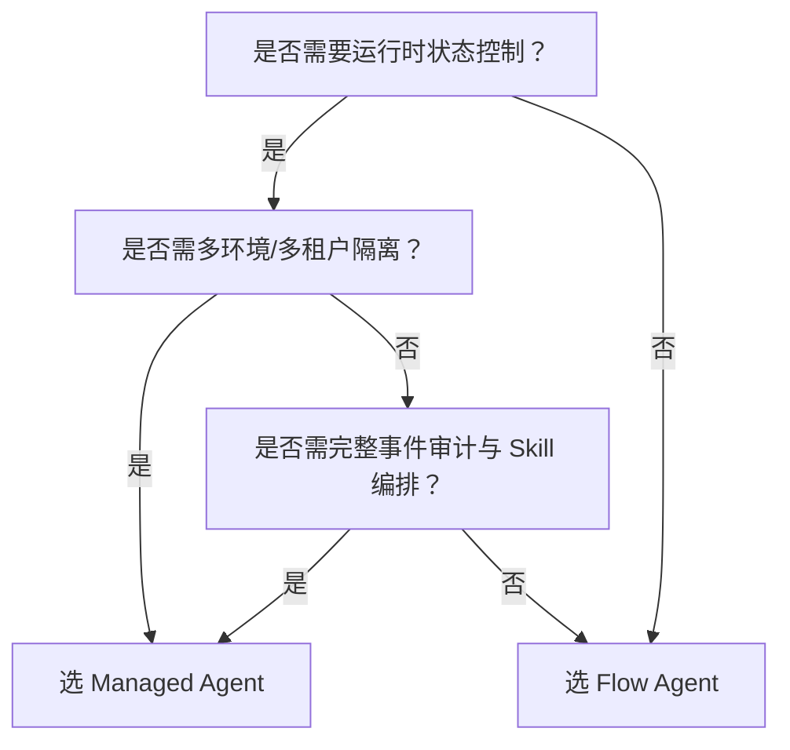

# 流程型 Agent 与托管型 Agent 对比

## 背景与目的  
在百炼平台智能体开发实践中，开发者常面临两种核心架构路径的选择：**流程型 Agent（Flow Agent）** 侧重于低代码/可视化编排与开箱即用的应用集成；而 **托管型 Agent（Managed Agent）** 则面向需要深度编程控制、运行时可观察性与多租户隔离能力的中高阶场景。本对比旨在帮助开发者基于技术目标、团队能力与业务需求，清晰识别二者在能力边界、使用范式与运维成本上的本质差异，避免因选型偏差导致后期重构或扩展瓶颈。

---

## 关键维度对比

| 维度 | 流程型 Agent（Flow Agent API） | 托管型 Agent（Managed Agents API） |
|------|-------------------------------|-----------------------------------|
| **定位与设计哲学** | 应用交付导向：以“发布即服务”为核心，聚焦快速上线预构建智能体与工作流 | 运行时基础设施导向：提供可编程 Agent 生命周期管理，强调细粒度控制与可观察性 |
| **输入格式** | 支持 `prompt`（字符串）或 `messages`（OpenAI-style 消息数组）；`session_id` 控制上下文加载 | 必须通过 `POST /v1/sessions` 发起会话，输入为结构化 JSON（含 `input`, `memory`, `files` 等字段），支持 Jinja2 模板变量注入 |
| **输出格式** | 同步返回 `output` 字段（含 `text` 或 `choices`）；流式响应为 SSE 格式，增量模式（`incremental_output=true`）返回连续 token 片段 | 异步事件驱动：通过 `/v1/sessions/{id}/events` 订阅 `agent_step`、`tool_call`、`agent_finish` 等结构化事件；支持 SSE 或轮询获取 |
| **支持模型** | 透明封装：调用时无需指定模型，由应用配置决定（如新版智能体绑定 `qwen-max`）；不支持运行时动态切换 | 显式声明：创建 Agent 时必须指定 `model` 字段（如 `"qwen-plus"`），且需在项目已开通模型列表内；支持 per-Agent 粒度模型隔离 |
| **API 端点与认证** | **双协议体系**： • 应用调用：DashScope 网关（`https://dashscope.aliyuncs.com/api/v1/...`），Bearer Token 鉴权 • 组件管理：阿里云 OpenAPI（`https://{workspace}.aliyuncs.com/...`），AccessKey 签名鉴权 | **统一协议**： 全量 RESTful 接口（`https://bailian.aliyuncs.com/api/v1/...`），统一 Bearer Token 鉴权（通过百炼平台 OAuth2 获取） |
| **[长期记忆](../concepts/long-term-memory.md)能力** | 提供“[长期记忆](../concepts/long-term-memory.md)（旧）”接口（`Memory`/`MemoryNode`），但文档明确标注为**遗留方案**，新项目不推荐使用 | 提供现代化 `Memory Store`：键值对存储 + TTL 自动过期 + 多 Session 共享/隔离策略，支持结构化查询（`GET /v1/memory_stores/{id}/keys`） |
| **技能（Skill）扩展** | 依赖工作流节点或智能体内置插件（如支付宝打赏），无标准 Skill 注册机制 | 原生支持 Skill 编排：可注册 Webhook 类 Skill（HTTP 回调），动态绑定至 Agent；支持事件透传与错误重试策略配置 |
| **环境与隔离** | 通过 `workspace` 参数实现业务空间隔离（如德国、新加坡子空间），但无运行时环境版本管理 | 内置 `Environment` 概念：支持多环境（dev/staging/prod）、配置灰度、版本快照与回滚，天然适配 CI/CD 流程 |
| **计费方式** | 按调用量计费（如每次 `application-call` 请求），与底层模型调用解耦；Prompt 模板/记忆等组件管理免费 | 按 Agent 实例运行时长 + 事件处理量计费；`Session` 存活期间持续计费（最长 24 小时），Skill 调用按 HTTP 请求计费 |
| **典型场景** | • 客服对话机器人（标准问答+工单跳转） • 内部提效工具（会议纪要生成、周报自动汇总） • 快速验证 MVP 的轻量级工作流 | • 金融风控决策引擎（多步骤推理+人工审核介入） • 企业级 AI 助手（跨系统凭证安全调用+审计日志） • 多租户 SaaS 应用（环境隔离+定制化 Skill 生态） |

---

## 适用场景建议

### ✅ 推荐选择 **流程型 Agent** 当：
- 业务逻辑相对固定，80% 场景可通过可视化工作流或 Prompt 工程覆盖；
- 团队以产品/运营为主导，开发资源有限，追求“天级上线”；
- 无需深度干预 Agent 内部执行链路（如跳过某一步骤、注入临时变量、拦截工具调用）；
- 已有大量历史 Prompt 模板或工作流资产，希望复用并快速迁移。

### ✅ 推荐选择 **托管型 Agent** 当：
- 需要完整掌控 Agent 的生命周期（启动/暂停/终止/状态诊断）；
- 业务涉及敏感数据流转，要求 `Vault` 加密凭证、`Environment` 级别配置隔离、完整事件审计；
- 存在复杂状态机逻辑（如“用户上传合同 → OCR 解析 → 法务规则校验 → 人工复核 → 归档”）；
- 计划构建可复用的 Skill 市场、支持第三方开发者接入，或需对接内部微服务网关。

> ⚠️ **重要提醒**：若当前使用“[长期记忆](../concepts/long-term-memory.md)（旧）”，请务必规划迁移至托管型 Agent 的 `Memory Store` 或百炼平台新推出的统一记忆服务（详见《记忆能力演进路线图》），该遗留接口未来将逐步下线。

---

## 技术选型参考（面向开发者）

| 评估项 | 流程型 Agent | 托管型 Agent | 选型建议 |
|---------|--------------|----------------|-----------|
| **学习成本** | 低：熟悉 DashScope 协议 + 控制台操作即可上手 | 中高：需理解 Environment/Session/Event 模型，掌握事件解析与错误处理 | 快速验证选 Flow；长期演进选 Managed |
| **调试能力** | 仅提供最终输出与基础错误码（如 `InvalidParameter`）；无中间步骤日志 | 全链路事件追踪：可精确查看每个 `agent_step` 的输入/输出、耗时、调用的 Skill 及返回结果 | 需要可观测性 → 必选 Managed |
| **扩展性** | 扩展依赖工作流节点或平台内置插件，自定义能力受限 | 支持 Webhook Skill、文件上传、结构化 Memory、多环境部署，扩展边界更广 | 有定制化集成需求 → 选 Managed |
| **地域支持** | 当前**仅限华北2（北京）**，暂不支持多地域部署 | 全地域可用（与百炼平台服务地域一致），`Environment` 可绑定指定地域资源 | 需海外合规部署 → 选 Managed |
| **SDK 支持** | DashScope SDK（通用大模型 SDK）可调用，但组件管理需额外接入阿里云 OpenAPI SDK | 提供专用 SDK（Python/Node.js），内置 Session 管理、事件流解析、重试逻辑 | 生产环境稳定性要求高 → 优先用 Managed SDK |

**最终决策树**：  

---  
*本文档依据百炼平台 v2.5 文档集编写，最新能力请以控制台实际功能及 [API 变更日志](https://help.aliyun.com/zh/bailian/release-notes) 为准。*

## 被对比主题页

- [flow agent api](../api/flow-agent-api.md)
- [managed agents api](../api/managed-agents-api.md)

