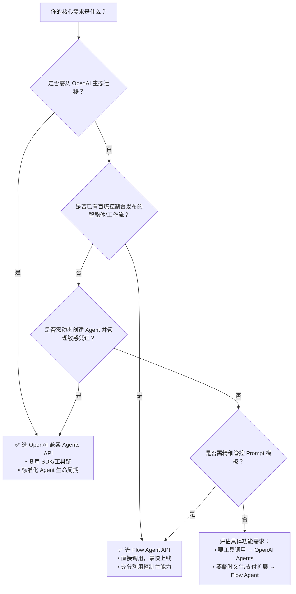

# Flow Agent 与 OpenAI 兼容 Agents API 对比

本文旨在为百炼平台开发者提供清晰、可落地的技术选型参考，系统对比 **Flow Agent API**（百炼原生智能体调用与组件管理体系）与 **OpenAI 兼容 Agents API**（遵循 OpenAI 接口规范的标准化 Agent 服务）两大能力路径。随着智能体应用从简单问答向复杂状态化、工具增强型系统演进，开发者需根据项目阶段、团队技术栈、集成成本及长期维护性，选择最适配的接口范式。本对比基于当前（2024年Q3）百炼平台正式发布的 API 文档与行为约束，聚焦实际开发中的关键决策点。

## 关键维度对比

| 维度 | Flow Agent API | OpenAI 兼容 Agents API |
|------|----------------|--------------------------|
| **设计定位** | 百炼平台原生、分层架构：应用调用（DashScope/Responses） + 独立组件管理（Prompt/Memory） | OpenAI 生态兼容层：统一资源模型（Agent/Session/Vault），语义与行为对齐 OpenAI `/v1/agents` 规范 |
| **输入格式** | • 应用调用：`prompt`（单轮）或 `messages`（多轮），嵌入 `app_id` 和 `session_id` • 组件类：RESTful 路径参数（如 `/{workspaceId}/promptTemplates`）+ JSON Body | 完全 OpenAI 兼容： • `POST /v1/agents`：`model`, `instructions`, `tools` • `POST /v1/sessions/{id}/messages`：`role`/`content`/`tool_calls` 标准消息数组 |
| **输出格式** | • DashScope API：流式响应（SSE）支持 `event: message` / `event: tool_call`；非流式返回 `output.text` 或 `output.tool_calls` • Responses API：同步返回 `result` 字段；异步返回 `task_id`，需轮询 • 组件类：阿里云 OpenAPI 标准（`Code`/`Message`/`Data`） | 严格遵循 OpenAI 格式： • 流式：`data: {"id":"msg_...","object":"thread.message","content":[{"text":"..."}]}` • 非流式：标准 `choices[0].message` 结构，含 `tool_calls` 数组；错误响应含 `error.type`/`error.message` |
| **支持模型** | **不暴露底层模型选择**：能力封装于预发布应用（Agent 2.0 / 工作流），模型由应用创建时绑定并固化 | 明确限定：仅支持 `qwen-plus` 和 `qwen-max`；`model` 字段为必填且校验严格，不可绕过 |
| **API 端点与协议** | • 应用调用：`https://dashscope.aliyuncs.com/api/v1/apps/{APP_ID}/completion`（DashScope） • Responses 兼容：`/v2/apps/agent/{APP_ID}/compatible-mode/v1/responses` • 组件类：阿里云 OpenAPI 域名（如 `https://bailian.aliyuncs.com`），路径含 `workspaceId` | 统一端点前缀：`https://dashscope.aliyuncs.com/v1/` • `/v1/agents`（CRUD Agent） • `/v1/agents/{id}/sessions`（启动 Session） • `/v1/sessions/{id}/messages`（发送消息） |
| **鉴权方式** | **双凭证体系**： • 应用调用：`Authorization: Bearer <百炼API Key>` • 组件类（Prompt/Memory）：**AccessKey 签名（ACS3-HMAC-SHA256）**，必须使用阿里云 SDK 或 OpenAPI Explorer | **单凭证体系**： `Authorization: Bearer <API Key>`，且该 Key 需显式授予 `agents:read` / `agents:write` 权限（控制台策略配置） |
| **[长期记忆](../concepts/long-term-memory.md)能力** | • 提供独立 `Memory` / `MemoryNode` 组件（文档标注为“旧”） • 需手动调用 `/memories` 系列接口管理，与应用解耦 • 有明确限流（≥1秒间隔），且新版应用未声明兼容性 | • 内建 `memory` 配置项（创建 Agent 时启用） • 记忆自动关联 Session 生命周期（默认 24 小时） • 无需独立接口，由 Agent 运行时透明管理，无额外限流 |
| **工具调用（Tool Calling）** | • 不直接提供通用工具注册与调度能力 • 工作流应用可通过节点编排调用内部服务，但无 OpenAI 风格 `function calling` 协议 | • 完整支持 OpenAI Tool Calling Schema • 工具需在 Vault 中注册并授权 • 单 Session 最多调用 5 次工具，强制串行执行（无 `parallel_tool_calls`） |
| **计费方式** | • 按**调用次数 + 输出 [Token](../concepts/token.md)** 计费（应用调用） • Prompt 模板、Memory 等组件操作按**请求次数**计费（低频，通常可忽略） • 所有费用计入对应 `workspace_id` 的百炼账单 | • 按**Session 消耗的总 [Token](../concepts/token.md)（input + output）** 计费 • 工具调用本身不额外计费，但工具执行产生的 LLM 调用计入 [Token](../concepts/token.md) |  
| **典型场景** | • 快速上线已配置好的智能体/工作流（如客服机器人、审批助手） • 需精细管理 Prompt 模板版本与 A/B 测试 • 遗留系统需复用历史 Memory 架构（谨慎评估） • 高代码场景：结合临时文件上传、支付宝打赏等扩展能力 | • 从 OpenAI 生态迁移 Agent 应用（如 LangChain / LlamaIndex 项目） • 构建需动态创建/销毁 Agent 的 SaaS 多租户服务 • 强依赖工具链（数据库查询、API 调用）与安全凭证管理（Vault） • 团队熟悉 OpenAI 接口，追求最小学习成本 |

## 各方案适用场景建议

### ✅ 优先选用 Flow Agent API 当：
- 你已通过百炼控制台完成智能体或工作流的可视化编排与发布，目标是**快速集成到现有业务系统**（如 Web 前端、企业微信机器人），且无需频繁变更 Agent 行为逻辑；
- 项目需对 Prompt 进行精细化治理（如多语言模板、灰度发布、效果追踪），并要求**独立于应用生命周期进行版本控制**；
- 技术栈深度绑定阿里云生态（如使用 RAM 角色、OSS、RDS），且团队已熟练使用阿里云 SDK 与 OpenAPI Explorer；
- 场景对**低延迟同步响应**有硬性要求（DashScope API 为首选），或需异步处理长耗时任务（Responses API `background=true`）。

### ✅ 优先选用 OpenAI 兼容 Agents API 当：
- 你正在将基于 OpenAI Agents 的已有项目（如 LangChain 的 `create_react_agent`、LlamaIndex 的 `AgentRunner`）**平滑迁移到百炼平台**，期望零修改或极小改造即可运行；
- 业务需要**动态生成 Agent 实例**（例如：为每个客户创建专属数据分析师 Agent），并依赖 Vault 安全注入数据库连接串、API Key 等敏感信息；
- Agent 的核心能力高度依赖**外部工具协同**（如实时查库存、调用内部 HR API），且要求工具调用过程符合 OpenAI 标准协议，便于调试与监控；
- 团队以 Python/JS 为主，习惯使用 `openai` 官方 SDK 或社区库，希望复用现有工具链、日志埋点和错误处理逻辑。

### ⚠️ 需谨慎评估或避免混合使用的场景：
- **[长期记忆](../concepts/long-term-memory.md)迁移**：Flow Agent 的“旧版 Memory”与 OpenAI Agents 的内建 memory **无互通机制**，数据无法共享。若新项目已采用 OpenAI Agents，不应再引入旧 Memory 组件。
- **模型灵活性需求**：两者均不支持运行时切换底层模型（Flow Agent 由应用固化，OpenAI Agents 的 `model` 字段创建后不可改）。若需 A/B 测试不同模型，必须创建多个 Agent 或应用实例。
- **跨地域部署**：Flow Agent 的 DashScope/Responses API **仅支持华北2（北京）地域**；OpenAI 兼容 API 同样受限于此——两地域外调用将失败，需确认业务部署区域。

## 技术选型决策树（面向开发者）

> **最后建议**：对于新项目，若无强 OpenAI 迁移需求，推荐以 **Flow Agent API 的 DashScope 调用路径**为起点（低延迟、功能全、文档成熟）；待业务稳定后，若出现动态 Agent、Vault 安全存储等高级需求，再通过 OpenAI 兼容 Agents API 补充能力。两者并非互斥，而是百炼平台面向不同抽象层级的互补接口。

## 被对比主题页

- [flow agent api](../api/flow-agent-api.md)
- [openai compatible agents api](../api/openai-compatible-agents-api.md)

