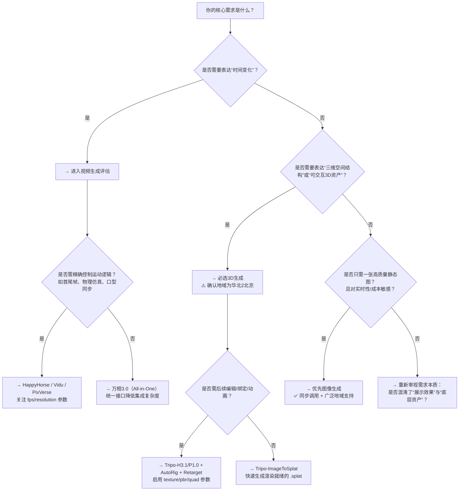

# 多模态内容生成能力对比：图像、视频与3D生成

本对比旨在为开发者提供清晰、可落地的技术选型参考，帮助在实际业务场景中快速判断：**何时该用图像生成？何时必须升级到视频或3D？各模态在输入灵活性、输出质量、工程集成成本、计费模型及地域约束等方面存在哪些关键差异？** 随着AIGC从“静态表达”向“动态交互”和“空间沉浸”演进，理解三者的能力边界与协同路径，是构建下一代多模态应用（如虚拟人、数字孪生、智能设计平台）的基础前提。

---

## 关键维度对比表

| 维度 | 图像生成（Image Generation） | 视频生成（Video Generation） | 3D生成（3D Generation） |
|------|------------------------------|------------------------------|--------------------------|
| **核心输入格式** | 文本（prompt）；单图/多图URL或Base64（最多14张，万相2.5）；支持涂鸦、局部掩码、风格参考图 | 文本；单图（首帧）/双图（首尾帧）URL；参考视频URL列表；音频URL（口型同步）；媒体数组（VideoRetalk） | 文本；单图/四视图（front/left/back/right）URL；GLB/FBX等3D模型URL；不支持Base64，仅限公网可访问URL |
| **核心输出格式** | PNG/JPEG（Base64或直链URL），支持透明通道（千问、Z-Image等）；部分模型输出含元数据JSON | MP4（H.264编码），直链URL；部分模型支持帧序列ZIP（需额外申请）；无原始帧像素级访问接口 | GLB/FBX（网格）、`.splat`（Gaussian Splatting）、PNG贴图、JSON分割标签；所有输出均为异步下载链接，有效期24小时 |
| **主流支持模型** | `qwen-image-3.0-pro`, `wan2.7-image-pro`, `kling-v3-omni-image-generation`, `vidu-image-pro_reference2image`, `z-image-turbo`, `facechain-finetune` | `happyhorse-t2v`, `kling-v3-omni-video-generation`, `pixverse-v6-t2v`, `viduq3-mix_reference2video`, `video-style-transform`, `wan2.2-s2v`（数字人） | `Tripo-H3.1`, `Tripo-P1.0`, `Tripo-ImageToSplat`, `Tripo-Texture`, `Tripo-AutoRig`, `Tripo-AnimationRetarget` |
| **API调用模式** | **同步为主**（千问、万相2.6+/Z-Image/Vidu多数场景）；异步可选（FaceChain训练、复杂编辑） | **强制异步**（统一两步流程：`POST /video-synthesis` → 轮询 `GET /tasks/{id}`）；无同步接口 | **强制异步**（统一两步流程：`POST /3d-generation` → 轮询 `GET /tasks/{id}`）；`X-DashScope-Async: enable` 必须显式声明 |
| **API端点（推荐）** | `https://{WorkspaceId}.{region}.maas.aliyuncs.com/api/v1/services/aigc/image-generation`（华北2/新加坡/美东） | `https://{WorkspaceId}.{region}.maas.aliyuncs.com/api/v1/services/aigc/video-generation/video-synthesis`（华北2/新加坡/美东） | `https://{WorkspaceId}.cn-beijing.maas.aliyuncs.com/api/v1/services/aigc/video-generation/3d-generation`（**仅华北2北京**） |
| **地域约束** | 支持华北2（北京）、新加坡、美国（弗吉尼亚）；Key/Endpoint/模型三者必须同地域 | 支持华北2（北京）、新加坡、美国（弗吉尼亚）；Key/Endpoint/模型三者必须同地域 | **严格限定华北2（北京）**；跨地域调用必然失败；API Key 必须为北京地域专属 |
| **典型响应时长** | 同步：3–8秒（T2I）；异步：10–60秒（复杂编辑/训练） | 30秒–5分钟（取决于分辨率、时长、模型负载）；首帧生成后持续流式渲染 | 1–15分钟（文生3D约2–5分钟；图生3D约1–3分钟；后处理任务通常<60秒） |
| **计费方式** | 按**调用次数**（如 `qwen-image-3.0-pro` 1次=1次）；部分模型按**输出分辨率/面数/功能模块**叠加计费（如 `facechain-finetune` 2.5元/次，`wan2.7-image-pro` 高清无水印需额外配额） | 按**任务成功执行次数**计费；高分辨率（4K）、高帧率（30fps）、长时长（>5s）触发阶梯单价；风格重绘、口型同步等子能力单独计费 | 按**任务类型+参数组合**计费：基础生成（H3.1/P1.0）按次；高级操作（`quad=true`, `texture_size=8192`, `face_limit=2000000`）触发“高级转换”费用；后处理任务独立计费 |
| **输入长度/规模限制** | 文本≤2500字符（千问/万相）；≤5000字符（Vidu）；图像≤20MB，禁止透明通道（可灵） | 文本≤1000字符（多数模型）；图像/视频URL需公网可访问，单文件≤200MB（建议≤50MB）；参考视频时长≤10秒 | 文本≤500字符；图像≤20MB；3D模型≤150MB；多图输入**严格顺序要求**（front/left/back/right） |
| **关键扩展能力** | 局部重绘、风格迁移、文字渲染（书法/水墨）、人物LoRA微调、虚拟模特生成 | 动作迁移、口型同步、首尾帧控制、物理运动建模（HappyHorse）、多模态参考融合（MiniMax） | Gaussian Splatting生成、自动绑骨（AutoRig）、动画重定向（Retarget）、智能网格分割、PBR材质贴图生成 |

---

## 各方案适用场景建议

### ✅ 图像生成 —— 适合「静态视觉表达」与「轻量交互」场景  
- **首选场景**：营销海报生成、UI/UX设计稿渲染、电商商品图批量生成、社交媒体配图、个性化头像/壁纸、文档插图、AIGC辅助绘画。  
- **技术信号**：需求明确指向“一张高质量图”，无需时间维度或空间深度；对实时性要求高（需同步返回）；输入以文本或单图为主；预算敏感且需快速验证创意。  
- **避坑提示**：避免用图像生成替代视频——若需展示产品使用过程、人物动作或镜头运镜，务必升级至视频方案；对中文文字渲染有强需求时，优先选 `vidu-image-pro_reference2image` 或 `qwen-image-3.0-pro`。

### ✅ 视频生成 —— 适合「动态叙事」与「行为模拟」场景  
- **首选场景**：短视频广告创作、数字人直播脚本驱动、教育动画制作、游戏过场预演、AI口播视频生成、产品功能演示视频、社交媒体竖屏内容批量生产。  
- **技术信号**：需要表达**时间连续性**（如动作、转场、节奏）、**多模态协同**（画面+语音+字幕）、或**可控运动逻辑**（如首尾帧约束、物理真实感）；接受1分钟内异步交付；输入含视频/音频/多图等复合介质。  
- **避坑提示**：勿将视频生成用于高精度3D建模需求（如工业零件可视化）；对超长视频（>10秒）或超高帧率（60fps）有硬性要求时，需提前压测并确认模型支持；数字人驱动类任务（`wan2.2-s2v`）仅限华北2，且需前置检测。

### ✅ 3D生成 —— 适合「空间建模」与「可交互资产」场景  
- **首选场景**：游戏/AR/VR资产快速生成（角色、道具、场景）、电商3D商品展示、建筑可视化初稿、工业设计概念建模、AI驱动的3D动画管线（绑定→重定向→渲染）、数字孪生体构建。  
- **技术信号**：输出需被下游引擎（Unity/Unreal/Three.js）直接加载；需支持后续编辑（拓扑优化、贴图调整、骨骼绑定）；输入含多视角图像或已有3D模型；对几何精度、面数控制、PBR材质有明确要求。  
- **避坑提示**：**绝不适用于纯2D内容需求**；因仅支持华北2地域，跨区域部署需额外规划；多图输入顺序错误（如未提供front图）将直接失败；Gaussian Splatting（`.splat`）不可编辑，仅适用于渲染展示，不可替代网格生成。

---

## 面向开发者的选型决策树

> **最后提醒**：  
> - **不要混合地域调用**：图像/视频/3D虽同属百炼平台，但地域隔离策略不同，混用Key/Endpoint将导致`401`或`403`错误；  
> - **异步任务需健壮轮询**：视频与3D必须实现带退避策略的轮询（建议指数退避：3s→5s→10s→15s），并设置超时（24小时）；  
> - **免费额度谨慎使用**：`wanx-x-painting`、`wanx-virtualmodel`等模型仅限免费体验，额度耗尽即停用，新项目请直接选用千问或万相2.7+；  
> - **生产环境务必迁移至业务空间专属域名**：`https://{WorkspaceId}.{region}.maas.aliyuncs.com`，旧域名 `dashscope.aliyuncs.com` 已不推荐用于新接入。

## 被对比主题页

- [image generation](../api/image-generation.md)
- [video generation api](../api/video-generation-api.md)
- [3d generation](../api/3d-generation.md)

