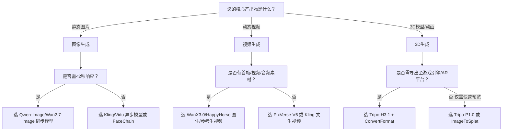

# 图像、视频与3D内容生成能力对比

为帮助开发者快速理解百炼平台在多模态内容生成领域的技术布局与能力边界，本文系统对比图像生成（Image Generation）、视频生成（Video Generation）与3D生成（3D Generation）三大核心能力模块。对比聚焦于**工程落地关键维度**——包括输入/输出规范、模型生态、调用机制、地域约束、计费逻辑及典型适用场景，旨在为技术选型提供客观、可操作的决策依据。

> ⚠️ 重要前提：三类能力均基于百炼平台统一认证体系（DashScope），但存在严格的**地域隔离、协议差异与服务生命周期约束**。跨类型混用参数、Endpoint 或 Key 将导致鉴权失败或不可预期行为。

---

## 关键能力维度对比

| 维度 | 图像生成（Image Generation） | 视频生成（Video Generation） | 3D生成（3D Generation） |
|------|------------------------------|------------------------------|--------------------------|
| **核心输入格式** | 文本（prompt）、单图（JPG/PNG）、多图参考（≤14张）、局部掩码（mask_url）； • 支持透明通道输入（部分模型除外，如 Kling 明确不支持） • 参考图分辨率：300–8000px（Kling），宽高比自适应（WanX 2.5） | 文本（prompt）、首帧图、首尾帧图、参考视频/音频/图像数组； • 图像：JPG/JPEG/PNG/BMP/WEBP（400–7000px） • 视频：MP4/AVI/MOV（≤30s，≤100MB） • 音频：WAV/MP3（<20s，人声清晰） | 文本（prompt）、单图（JPEG/PNG/WebP）、四视角图数组（前/左/后/右）； • 输入图像：≤20 MB，[20, 6000]px • 后处理输入：GLB/GLTF/FBX/OBJ/STL（≤150 MB） |
| **核心输出格式** | JPG/PNG（含透明通道支持）、WebP； • 分辨率：支持 `1024*1024`、`2K`/`4K` 等语义值或预设档位（Kling/Vidu） • 多图输出：`n=1–9`（Qwen/Kling），`series_amount=2–9`（Wan2.7） | MP4（H.264 编码）； • 分辨率：720P / 1080P / 4K • 宽高比：16:9 / 9:16 / 1:1（Kling） • 帧率：24/30 fps（可配置） | GLB（默认）、GLTF、FBX、OBJ、STL、USDZ、3MF； • Gaussian Splat：`.splat` • 面数控制：Tripo-H3.1 ≤200万面，Tripo-P1.0 ≤2万面 |
| **主流支持模型** | • 通用：`qwen-image-3.0-pro`, `wan2.7-image-pro`, `z-image-turbo` • 专业：`kling/kling-v3-omni-image-generation`, `vidu/viduq2-pro_reference2image` • 垂直工具：FaceChain（人像训练+写真）、虚拟模特、海报生成等 | • 全栈：`wanx3.0-video-generation`, `wan2.7-videoedit` • 场景优化：`pixverse/pixverse-v6-t2v`, `vidu/viduq3-pro_text2video`, `kling/kling-v3-omni-video-generation` • 物理真实：`happyhorse/happyhorse-t2v` • 多模态：`minimax/minimax-v2-t2v` | • 生成：`Tripo/Tripo-H3.1`（高精网格）、`Tripo/Tripo-P1.0`（快速低模）、`Tripo/Tripo-ImageToSplat`（Gaussian） • 后处理：`Tripo-Segmentation`, `Tripo-Texture`, `Tripo-Retopology`, `Tripo-ConvertFormat` • 动画：`Tripo-AutoRig`, `Tripo-AnimationRetarget` |
| **API 端点（统一路径）** | `POST /api/v1/services/aigc/image-generation/image-synthesis` • 同步/异步双模式（依模型而定） | `POST /api/v1/services/aigc/video-generation/video-synthesis` • **强制异步**（必须带 `X-DashScope-Async: enable`） | `POST /api/v1/services/aigc/video-generation/3d-generation` • **强制异步**（必须带 `X-DashScope-Async: enable`） |
| **调用模式** | • **同步为主**：Qwen-Image、Wan2.7-image、Z-Image、Wan2.6-image 等低延迟模型 • **异步为辅**：Kling、Vidu、FaceChain、擦除补全等耗时任务（1–2分钟） | • **全部强制异步**：   创建任务 → 轮询 `task_id`（有效期 24 小时）→ 获取 `output.video_url` | • **全部强制异步**：   创建任务 → 轮询 `task_id`（有效期 24 小时）→ 获取 `output.model_url` 或 `output.splat_url` |
| **地域支持** | 华北2（北京）、新加坡、弗吉尼亚等多地域； • **Key/Endpoint/WorkspaceId 必须同地域**，不可混用 | 华北2（北京）：全模型支持 新加坡/德国/日本：仅 HappyHorse、WanX 3.0/2.7 支持 • **多数模型（Vidu/可灵/爱诗/MiniMax/数字人）仅限北京** | **仅支持华北2（北京）地域**； • API Key、Endpoint、WorkspaceId 必须为北京地域开通并绑定 |
| **计费方式** | • 按**调用次数 + 输出分辨率/张数**计费 • 高清（4K）、多图（n>1）、启用 `thinking_mode` 等高级参数触发溢价 • 免费体验模型（如 `wanx-v1`）额度用尽即停服，**无付费通道** | • 按**任务成功执行次数 + 分辨率/时长/帧率**计费 • 首尾帧、参考视频、超清增强（4K）、高帧率（30fps）显著提升积分消耗 • 数字人检测类（`wan2.2-s2v-detect`）**即使失败也计费** | • 按**任务成功执行次数 + 面数/精度/后处理复杂度**计费 • `geometry_quality=ultra`、`quad=true`、`face_limit` 非默认值、非 JPEG 贴图等触发高积分消耗 • 后处理任务依赖前序任务，**仅当上游成功才计费下游** |
| **典型端到端场景** | • 实时海报生成（电商营销） • 虚拟模特换装（服装零售） • FaceChain 人物写真批量生产（社交/摄影） • 局部重绘与图像擦除（设计协作） | • 广告短视频自动成片（文生视频+首帧优化） • 产品演示动画（图生视频+指令编辑） • 数字人播报（VideoRetalk + 首帧驱动） • 剧集分镜动态化（Kling 多图参考+组图） | • 游戏资产快速建模（文/图生3D + 重拓扑 + 贴图） • AR 商品展示（单图生成 Gaussian Splat + 格式转换为 USDZ） • 工业零件逆向重建（四视角图 → 精密网格 → STL 导出） • 角色动画管线（AutoRig → AnimationRetarget） |

---

## 各方案适用场景建议（面向开发者）

### ✅ 推荐选择图像生成，当您的需求满足以下任一条件：
- **低延迟交互要求高**：需在 <2 秒内返回结果（如设计工具实时预览、AIGC插件即时响应）；
- **轻量级内容为主**：以静态视觉表达为核心（海报、Banner、头像、商品主图）；
- **垂直场景成熟**：明确需要虚拟模特、鞋靴试穿、人脸写真等开箱即用能力；
- **多地域部署必要**：业务覆盖东南亚、北美，需就近接入新加坡/弗吉尼亚节点。

> ⚠️ 注意规避：避免在生产环境依赖已标注“仅供免费体验”的旧模型（如 `wanx-poster-generation-v1`），其无续费路径且随时下线。

---

### ✅ 推荐选择视频生成，当您的需求满足以下任一条件：
- **动态叙事是刚需**：需生成 3–30 秒短视频用于营销、教育、社交媒体传播；
- **多模态驱动明确**：已有高质量首帧图、产品视频片段或配音音频，需保留物理一致性；
- **专业领域适配性强**：如广告行业选用 `viduq3-ad_reference2video`，剧集制作选用 `kling-v3-omni-video-generation`；
- **接受异步工作流**：可集成轮询逻辑与失败重试机制，容忍 30 秒至 2 分钟生成延迟。

> ⚠️ 注意规避：勿在非北京地域调用 Vidu/可灵/爱诗/MiniMax 等模型；勿省略 `X-DashScope-Async: enable` 请求头（否则直接报错）。

---

### ✅ 推荐选择3D生成，当您的需求满足以下任一条件：
- **三维资产是交付目标**：需生成可导入 Unity/Unreal/Blender 的标准格式模型（GLB/FBX/STL）；
- **管线化生产明确**：需串联“生成 → 分割 → 贴图 → 重拓扑 → 绑骨 → 动画”完整流程；
- **对几何精度有硬性要求**：如工业仿真（≥100万面）、AR商品（Gaussian Splat 实时渲染）；
- **输入资源可控**：能提供高质量单图或规范四视角图（前/左/后/右），且接受北京地域强绑定。

> ⚠️ 注意规避：勿将 `spec=mixamo` 的绑骨结果作为 `Tripo-AnimationRetarget` 输入；勿对非 Tripo 生成的模型调用 `Tripo-Texture` 而不传 `texture_prompt`（必失败）。

---

## 技术选型决策树（简版）

> 💡 提示：所有能力均支持通过百炼平台 **业务空间专属域名**（如 `https://{WorkspaceId}.cn-beijing.maas.aliyuncs.com`）调用，强烈推荐迁移以获得更优性能与稳定性。请始终确保 API Key、Endpoint、WorkspaceId 三者地域一致。

---  
*最后更新：2025年4月*

## 被对比主题页

- [image generation](../api/image-generation.md)
- [video generation api](../api/video-generation-api.md)
- [3d generation](../api/3d-generation.md)

