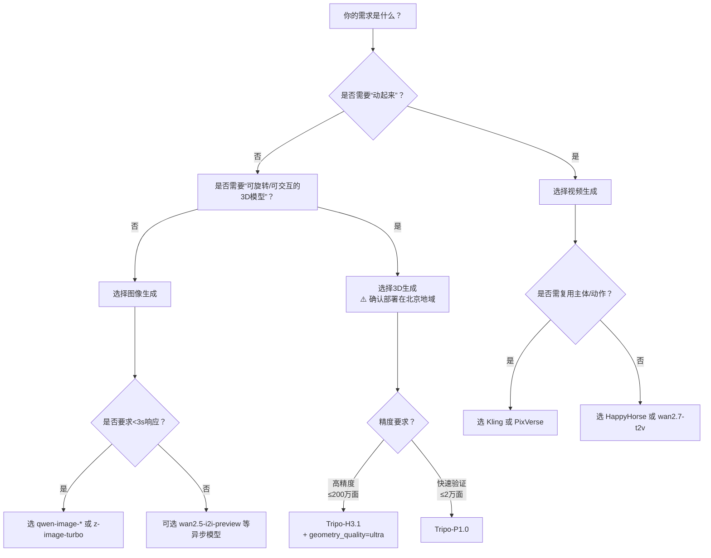

# 图像生成、视频生成与3D生成对比

本对比旨在为百炼平台开发者提供清晰、可落地的技术选型参考，帮助在实际业务场景中快速判断：**何时该用图像生成？何时必须升级到视频或3D生成？三者在接入成本、能力边界、资源约束与工程适配性上存在哪些本质差异？**  
随着AIGC从静态内容向动态化、空间化演进，图像（2D）、视频（2D+时序）、3D（3D+空间）已构成内容生成的三层技术栈。理解其底层范式差异，是构建高性能、低成本、可扩展AI应用的前提。

---

## 关键维度对比表

| 维度 | 图像生成 | 视频生成 | 3D生成 |
|------|----------|----------|--------|
| **输入格式** | 文本（`prompt`） 可选单张/多张参考图（URL列表，支持JPG/PNG/WEBP） 支持局部掩码（`image_url` + `mask_url`） | 文本（`prompt`） 首帧图 / 首尾帧图（`first_frame` + `last_frame`） 参考视频/音频/图像（`media`数组） 目标视频（编辑类任务） | **三者互斥**： • 文本（`input.prompt`，≤1024字符） • 单图（`input.image`，JPEG/PNG URL） • 多图（`input.images`，严格 `[前, 左, 后, 右]` 顺序，4元素数组） |
| **输出格式** | PNG（默认，含透明通道） `qwen-mt-image-2.0` 固定输出 JPG 分辨率：512×512 至 2048×2048（部分模型支持 4K） | MP4（H.264 编码） 分辨率：720P / 1080P / 4K（依模型而定） 时长：通常 2–8 秒（可配置） 帧率：15–25 FPS | GLB（glTF 2.0 格式，含几何+材质） • `pbr_model_url`：带PBR贴图的完整模型 • `base_model_url`：无贴图基础网格（需显式禁用 `texture` & `pbr`） • `rendered_image_url`：WebP预览图（2小时有效） |
| **支持模型（主力系列）** | • 千问（Qwen-Image）：`qwen-image-3.0-pro` 等 • 万相（WanX）：`wan2.7-image-pro`、`wan2.6-t2i` 等 • 专业工具：`vidu/vidu-image-pro_reference2image`、`z-image-turbo`、`qwen-mt-image-2.0` | • HappyHorse：文生/图生/参考生/编辑全链路 • 万相（WanX）：`wan2.7-t2v`（All-in-One） • 爱诗（PixVerse）：`pixverse/pixverse-v6-t2v` 等细分型号 • Vidu / 可灵（Kling） / MiniMax：差异化场景优化 | • `Tripo/Tripo-H3.1`：高精度（≤200万面，支持 `ultra` 几何质量） • `Tripo/Tripo-P1.0`：快速原型（≤2万面，轻量低延迟） |
| **API 端点（标准路径）** | `POST /api/v1/services/aigc/image-generation/generation` （同步调用为主；异步模型如 `kling/kling-v3-image-generation` 使用 `/tasks`） | `POST /api/v1/services/aigc/video-generation/video-synthesis` （**强制异步**；数字人 `wan2.2-s2v` 等少数模型路径不同） | `POST /api/v1/services/aigc/video-generation/3d-generation` （**强制异步**；注意：路径含 `video-generation` 是历史兼容命名，实际为3D服务） |
| **调用模式** | **混合模式**： • 同步：`qwen-image-*`、`wan2.7-image-*`、`z-image-turbo`（秒级返回） • 异步：`wan2.5-i2i-preview`、`kling` 等（需轮询 `GET /tasks/{id}`） | **强制异步**： ① `POST` 创建任务 → 获取 `task_id` ② 定期 `GET /tasks/{id}` 轮询状态 （`X-DashScope-Async: enable` 必填头） | **强制异步**： ① `POST` 创建任务 → 获取 `task_id` ② `GET /tasks/{id}` 轮询（建议 ≥15s 间隔） （`X-DashScope-Async: enable` 必填头） |
| **地域约束** | **强地域绑定**： API Key、Endpoint、Workspace ID 必须同地域（华北2/北京、新加坡、弗吉尼亚等） 跨地域调用必然失败 | **强地域绑定**： 同图像生成，三者必须严格一致 控制台开通模型时需指定地域 | **超严格单地域**： **仅支持华北2（北京）** Endpoint、API Key、Workspace ID 均须为北京地域 其他地域调用直接报错 |
| **计费方式** | • 按次计费（主流图像模型） • 部分创意工具模型（如 `wanx-x-painting`）提供 **500张免费额度，用尽即停，不可续费** • 分辨率/张数影响单价（如 4K > 1K） | • **按秒计费**（主流，如 `wan2.2-s2v`：0.5元/秒） • 部分模型按任务/时长阶梯计费 • 存在 RPS 与并发任务数硬限制（如 VideoRetalk 限1并发） | • 按任务计费（非按面数/时长） • `Tripo-H3.1` 与 `Tripo-P1.0` 单价不同（H3.1 更高） • 无免费额度，需预充值或开通后付费 |
| **典型场景** | • 电商主图/详情页生成 • 社媒配图、营销海报 • UI设计稿辅助、图标生成 • 局部重绘（擦除水印、换背景） • 多语言图像翻译（`qwen-mt-image-2.0`） | • 短视频广告（文生/图生） • 数字人播报（首帧驱动） • 影视分镜动态化（参考生视频） • 口型同步（音频驱动唇动） • 动作迁移（参考视频复刻动作） | • 游戏3D资产快速建模（概念→网格） • 电商商品3D展示（单图转3D模型） • AR/VR内容生产（GLB直连引擎） • 工业设计可视化（多视角精准重建） |

---

## 各方案适用场景建议（面向开发者）

### ✅ 优先选择**图像生成**当：
- 需求为**静态视觉表达**（如Banner、海报、头像、插画），无需时间维度；
- 对响应延迟敏感（需 <3s 内返回结果），且选用 `qwen-image-3.0-pro` 或 `z-image-turbo` 等同步模型；
- 输入简单（纯文本 or 单图），且输出尺寸可控（≤2048×2048）；
- 成本敏感，需利用免费额度（如小批量创意实验）；
- 需要 [OpenAI 兼容接口](../concepts/openai-compatible-interface.md)快速迁移现有代码（仅 `qwen-image-*` 支持）。

### ✅ 优先选择**视频生成**当：
- 核心诉求是**动态叙事或行为表达**（如产品演示、角色动画、广告片头）；
- 输入具备时序线索（首尾帧、参考视频、音频）或需生成连续运动；
- 接受 10–120 秒端到端延迟（含排队+生成+轮询），并能实现健壮轮询逻辑；
- 需要精细控制运动属性（帧率、风格ID、表情强度）或复用主体ID（如可灵 Kling）；
- 场景强依赖物理真实感（选 HappyHorse）或强动态表现力（选 PixVerse c1系列）。

### ✅ 优先选择**3D生成**当：
- 目标是**三维空间交互**（如WebGL渲染、Unity/Unreal导入、AR试穿）；
- 输入为**单视角照片或正交多图**，需重建几何结构（非渲染效果）；
- 业务对模型拓扑质量有明确要求（如游戏需 ≤5万面，工业设计需 ≤200万面）；
- 可接受北京地域专属部署（所有服务、Key、Endpoint均锁定华北2）；
- 需要 PBR 材质支持（设 `pbr=true`）或轻量无贴图网格（显式设 `texture=false && pbr=false`）。

### ⚠️ 明确不推荐替代的场景：
- **勿用图像生成替代视频**：无法表达运动、时序、镜头语言；强行拼接GIF质量差、体积大、无音轨；
- **勿用视频生成替代3D**：视频是2D投影，无法旋转/缩放/交互；无法导出网格供引擎使用；
- **勿用3D生成替代图像**：无UI/海报级渲染控制；不支持文字叠加、风格迁移、局部编辑等图像特有能力。

---

## 技术选型决策树（开发者速查）

> **最后提醒**：所有生成类API均强制要求 **API Key、Endpoint、Workspace ID 三者地域一致**。新项目务必通过百炼控制台（对应地域）开通服务并获取专属Key，避免因地域混用导致的静默失败。调试阶段建议启用日志记录 `task_id` 与完整请求体，便于问题定位。

## 被对比主题页

- [image generation](../api/image-generation.md)
- [video generation api](../api/video-generation-api.md)
- [3d generation](../api/3d-generation.md)

