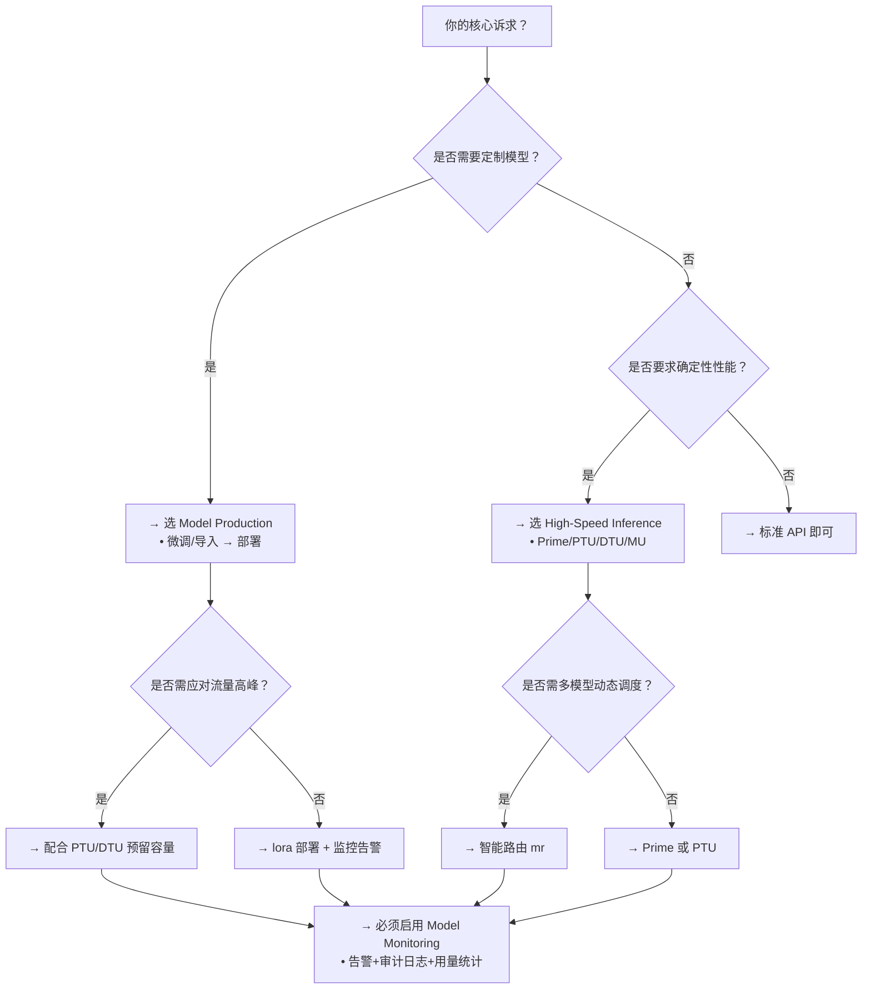

# 模型生产部署、高速推理与模型监控方案对比

为帮助开发者在百炼平台上高效完成模型从训练、上线到长期运维的全生命周期管理，本文对三大核心能力模块——**模型生产部署（Model Production）**、**高速推理（High-Speed Inference）** 和 **模型监控（Model Monitoring）** 进行系统性对比分析。三者定位不同：  
- **模型生产部署** 是模型“上线”的入口，聚焦**定制化模型的构建、封装与服务化**；  
- **高速推理** 是模型“运行”的加速器，聚焦**性能确定性、吞吐保障与成本优化**；  
- **模型监控** 是模型“健康”的守门人，聚焦**可观测性、异常诊断与稳定性治理**。  

本对比面向企业级 AI 应用开发者，旨在提供清晰的技术选型依据，避免因能力边界混淆导致架构返工、资源浪费或运维盲区。

---

## 关键维度对比表

| 维度 | 模型生产部署（Model Production） | 高速推理（High-Speed Inference） | 模型监控（Model Monitoring） |
|------|-------------------------------|------------------------------|---------------------------|
| **核心目标** | 实现模型全生命周期交付：微调 → 导入 → 压缩 → 部署 → 路由 | 保障推理服务性能：低延迟、高吞吐、稳响应、优成本 | 保障模型服务可观测：实时洞察调用质量、健康状态与资源消耗 |
| **输入格式** | - 微调：JSON 格式训练数据（含 `messages`/`images`/`video_urls` 等） - 部署：OpenAPI 请求体（含 `model_name`, `plan`, `capacity`, `ptu_capacity` 等结构化参数） | - 标准 OpenAI 兼容请求（`/chat/completions`） - Prime/PTU/DTU/MU/智能路由均通过 `model` 字段标识后端实例 - 批量推理：JSONL 文件上传 | - 无主动输入；所有数据自动采集自平台 API 调用链路 - 审计日志：自动记录 Request ID、status_code、input_tokens、output_tokens、latency 等元信息 - 推理日志：需手动开启并投递至 SLS，含完整 prompt/response |
| **输出格式** | - 微调任务返回 `finetuned_output`（模型 ID） - 部署接口返回 `deployment_id`、`endpoint`、`model_code` 等服务元信息 | - 与标准 OpenAI 接口完全一致（含 `choices[0].message.content`、`usage`、`stream` 支持） - PTU/DTU/MU 返回专属 `model_code`，用于后续调用 | - 控制台图表：分钟级聚合指标（失败率、首 Token 延时、TPM 等） - 日志查询：结构化审计日志（含 trace_id）、原始推理日志（含 prompt/response） - 告警通知：短信/邮件/钉钉/Webhook |
| **支持模型类型** | ✅ 全模态：文本生成、图像生成、视频生成、语音合成 ⚠️ 微调/导入/压缩仅限华北2（北京）地域；部分部署方式（如 PTU）图像/语音暂未开放新加坡 | ✅ 文本生成为主（Qwen/GLM/DeepSeek/Kimi 等） ✅ Prime/PTU/DTU/MU 支持基础模型 + LoRA 微调模型 ✅ 智能路由支持十余个文本模型 ❌ 不支持语音/视频类模型的 Prime 或 PTU 加速 | ✅ 文本生成、深度思考、视觉理解、全模态、向量模型 ❌ 语音生成、图片生成、视频生成、三方直连模型**部分不支持**（以控制台实际展示为准） |
| **API 端点** | 主要统一入口： `POST /api/v1/deployments`（部署） `POST /api/v1/fine-tunes`（微调） `POST /api/v1/custom_models/import`（导入） | - Prime/智能路由：直接调用标准 `/compatible-mode/v1/chat/completions`（替换 `model`） - PTU/DTU/MU：调用 `/api/v1/deployments` 创建后，使用专属 `model_code` 调用标准接口 - 批量推理：`POST /api/v1/batch/jobs` | 无独立调用 API；全部通过控制台交互： - 监控概览：`/cn-beijing/model/monitoring` - 告警配置：`/cn-beijing/model/alert` - 日志查询：集成 SLS 控制台 |
| **计费方式** | - `lora`：按 Token 后付费 - `mu`/`dtu`/`ptu_v2`：预付费（创建即扣费） - `mr`（智能路由）：后付费 - 微调/导入/压缩：按任务时长/存储用量计费 | - Prime：按 Token 后付费（同标准 API，但单价可能略高） - PTU/DTU/MU：**刚性预付费**（创建即计费，无论是否调用） - 批量推理：按 Token 后付费（成本降低约 50%） | ✅ **监控功能本身免费** ⚠️ 数据投递依赖云产品： - SLS 日志投递：按写入/存储/读取计费 - 云监控/Prometheus：按指标数/采集频率计费 |
| **典型场景** | - 企业私有知识库问答模型微调与上线 - 多 LoRA 插件共享部署（如客服多意图分支） - 视频生成工作流中定制化模型导入与调度 | - AI 编程助手（要求首 Token < 300ms） - 内容安全实时审核（高并发、低 P99 延迟） - 批量数据标注（非实时、成本敏感） - A/B 测试或多模型效果比对（智能路由） | - 生产环境故障快速定界（如突增失败率/限流） - SLA 合规审计（首 Token 延时达标率） - 成本异常预警（Token 消耗突增） - Prompt 工程效果回归分析（结合推理日志） |

---

## 适用场景建议（面向开发者）

| 开发者角色 | 推荐优先启用的能力 | 理由说明 |
|------------|------------------|----------|
| **算法工程师（模型研发）** | ✅ 模型生产部署（微调 + 导入 + `lora` 部署） ✅ 模型监控（开启推理日志） | 微调是模型定制核心路径；`lora` 部署成本低、迭代快；推理日志可验证 prompt 效果与输出质量，支撑模型优化闭环。 |
| **SRE / 平台工程师（服务运维）** | ✅ 高速推理（PTU/DTU + 智能路由） ✅ 模型监控（告警 + 审计日志） | PTU/DTU 提供确定性性能基线，规避公共池抖动；智能路由实现自动降级与成本调控；监控告警是故障发现第一防线，审计日志满足合规审计要求。 |
| **全栈开发者（应用集成）** | ✅ 高速推理（Prime 模式 + `ptu_v2`） ✅ 模型监控（概览 + 失败率告警） | Prime 模式零改造接入，立竿见影提升用户体验；`ptu_v2` 在北京/新加坡双地域可用，适配全球化部署；监控概览可快速验证集成效果，失败率告警防止线上雪崩。 |
| **成本与效能负责人** | ✅ 高速推理（批量推理 + 智能路由） ✅ 模型监控（用量统计 + Token 消耗告警） | 批量推理降低 50% 成本；智能路由按效果/成本策略自动选优；用量统计与 Token 告警精准识别资源浪费点，驱动模型汰换与精简。 |

> 💡 **关键协同提示**：  
> - **部署是监控的前提**：只有通过 `model production` 或 `high-speed inference` 创建的正式部署实例（含 `lora`/`ptu_v2`/`mr` 等），其调用才会被 `model monitoring` 系统自动采集；直连公有模型（如 `qwen3.8-max`）的调用**不计入监控范围**。  
> - **高速推理依赖部署能力**：`ptu_v2`、`dtu`、`mr` 等高速模式本质是 `model production` 中定义的 `plan` 类型，其创建必须通过 `/api/v1/deployments` 接口完成。  
> - **监控驱动部署优化**：若监控发现某 `lora` 部署实例持续高失败率或高延时，应立即检查是否需升级为 `ptu_v2` 或切换至 `mr` 智能路由兜底。

---

## 技术选型决策树（快速参考）

> ✅ **一句话总结选型原则**：  
> **先用 `model production` 把模型“做出来”，再用 `high-speed inference` 把服务“跑起来”，最后用 `model monitoring` 把系统“管起来”。三者不是替代关系，而是递进式能力组合。**

---  
*文档最后更新时间：2025年7月*  
*注：所有地域、模型支持列表及计费规则以百炼控制台实时信息为准。*

## 被对比主题页

- [model production](../api/model-production.md)
- [model high speed inference](../guides/model-high-speed-inference.md)
- [model monitoring](../guides/model-monitoring.md)

