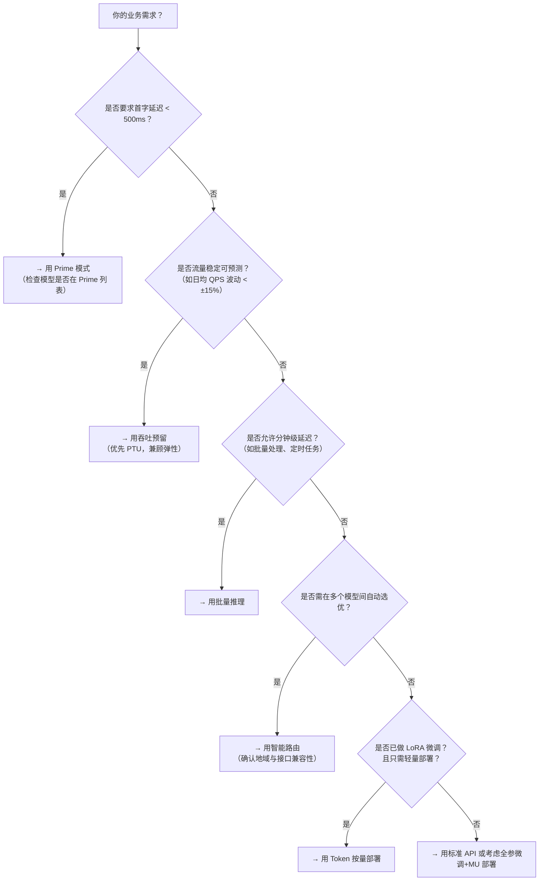

# 模型部署与推理方案对比

为帮助开发者在百炼平台上高效、稳定、经济地将模型投入生产，本文系统对比平台当前主流的模型部署与推理方案。对比聚焦于**实际可用性、技术约束、成本结构与业务适配性**，覆盖从实时交互到离线批量处理的全场景需求。所有方案均基于百炼平台 2024 年底至 2025 年初正式发布的功能（v2.6+），不包含实验性或灰度中能力。

以下表格从 7 个关键维度对五类核心方案进行横向对比。方案命名严格遵循平台控制台与 API 文档术语，避免歧义：

| 维度 | Prime 模式 | 吞吐预留（含 PTU/DTU） | 批量推理（Batch） | 智能路由（Model Router） | Token 按量部署（LoRA 共享） |
|------|------------|--------------------------|---------------------|----------------------------|------------------------------|
| **输入格式** | 标准 OpenAI 兼容 JSON（`model`, `messages`, `stream` 等）；支持 `input_tpm` 隐式触发缓存优化 | 标准 OpenAI 兼容 JSON；`model` 必须为专属部署生成的 `model code`；PTU/DTU 支持 `ptu_capacity` 动态扩缩容字段 | JSONL 文件（UTF-8 编码，每行一个完整请求对象，含 `custom_id`, `method`, `url`, `body`；`body` 内嵌标准参数） | 仅支持 [OpenAI 兼容接口](../concepts/openai-compatibility.md)（`/v1/chat/completions`）；`model` 固定为 `auto-model-xxxxxx`；支持 `response_format`（JSON Schema） | 标准 OpenAI 兼容 JSON；`model` 为 LoRA 微调后生成的专属 `deployed_model` ID；必须指定 `plan="lora"` |
| **输出格式** | 流式响应含 `delta.reasoning_content` 与 `delta.content` 分离字段；非流式返回 `reasoning_content` 和 `content` 同级 | 同标准推理；支持 `enable_thinking`，返回完整思考链与最终结果 | **仅同步返回结果文件 URL**；响应体为 JSON，含 `output_file_url`；结果文件为 JSONL，每行含 `custom_id` 与 `response`（含 `choices[0].message.content` 等） | 同标准推理；响应头 `x-dashscope-resolved-model` 明确标识实际执行模型；支持 `response_format` 结构化输出 | 同标准推理；支持 `enable_thinking`；但**不支持前缀缓存与长上下文优化** |
| **支持模型** | 仅限高性能定制模型： • `glm-5.2-fast-preview` • `glm-5.3-prime` • `wan3.0-video-prime` | 广泛支持主流商用及自研模型： • `qwen3.8-max`, `qwen3.7-plus` • `glm-5.2`, `deepseek-v4-flash` • `kimi-3.5-pro` 等 （需已获 Workspace 授权） | 限定于高吞吐优化模型： • `qwen3.8-max`, `qwen3.7-plus` • `qwen3-vl-plus`, `text-embedding-v1` • **不支持语音/视频生成模型** | 仅限预置路由池模型（当前 v2026-0908）： • `qwen3.8-max`, `qwen3.7-flash` • `deepseek-v4-pro-0813`, `glm-5.2` 等共 8 款 （需 RAM 用户具备各备选模型调用权限） | **仅支持 LoRA 微调模型**： • 文本：`qwen3-14b-lora`, `qwen3-32b-lora` • 图像/视频/语音：对应 `efficient_sft` 微调产出 |
| **API 端点** | 专用域名： `https://{workspace_id}.cn-beijing.maas.aliyuncs.com/compatible-mode/v1` | 通用 DashScope 域名： `https://dashscope.aliyuncs.com/api/v1` （使用专属 `model code`） | 控制台上传或调用 `/api/v1/batch/jobs` 提交任务；结果通过 OSS URL 下载 | **仅限北京（`cn-beijing`）与新加坡（`ap-southeast-1`）地域**； 端点同 [OpenAI 兼容接口](../concepts/openai-compatibility.md)： `https://dashscope.aliyuncs.com/api/v1` | 通用 DashScope 域名： `https://dashscope.aliyuncs.com/api/v1` （使用 `deployed_model` ID） |
| **计费方式** | **按 Token 实时计费**（同标准 API），无额外费用；性能提升为平台侧优化 | **预付费**： • 吞吐预留：按购买的 `input_tpm` / `output_tpm`（单位：kTPM）月度包年包月 • PTU/DTU：按基准 TPM 整数倍购买，支持弹性扩缩容（需人工审核） | **按 Token 计费，成本约为实时推理的 50%**；按实际完成请求数与 token 数结算 | **按 Token 实时计费**（同标准 API）；路由决策本身不产生额外费用 | **按 Token 实时计费**；无资源预留成本；适合低频、多租户轻量场景 |
| **典型场景** | • 首字延迟敏感型应用（如智能客服首句响应、代码补全） • 高并发但单次请求较短的 Web 应用 | • 业务流量可预测的 SaaS 服务（如企业知识库问答） • 需保障 SLA 的金融/政务类应用 • 长文本处理（PTU 支持前缀缓存与阶梯系数） | • 离线数据清洗与标注 • 批量内容生成（营销文案、报告摘要） • 向量库构建（Embedding 批量计算） | • 多模型 A/B 测试与效果兜底 • 输入质量波动大、需动态选择最优模型的场景（如用户提问模糊时降级至更鲁棒模型） | • 内部工具链中的个性化模型（如销售话术微调版） • 多团队共享同一基础模型的轻量定制需求 • 快速验证微调效果（无需预留资源） |
| **关键限制** | • 仅支持特定 Prime 模型 • 不支持 `max_tokens` 超长生成（受模型自身限制） | • 预付费，退费按 1.2 倍系数结算 • DTU 要求 `input_tpm`/`output_tpm` 为整数倍 • PTU 部署需控制台或 API 显式操作 | • 单文件 ≤ 50,000 请求 或 ≤ 500 MB • **不返回 `reasoning_content` 字段**（即使 `enable_thinking=true`） • 不支持语音输出模型 | • **仅限 [OpenAI 兼容接口](../concepts/openai-compatibility.md)**；不支持 DashScope 原生协议 • **不支持显式缓存参数**，缓存命中率不可控 • `max_tokens` 自动转为 `max_completion_tokens`，限制路由范围 | • **不支持自助扩缩容**；需提交工单申请 • 仅支持 LoRA，不支持全参微调部署 • 无 `rpm_limit`、`max_context_length` 等高级部署配置 |

## 各方案适用场景建议

面向开发者的技术选型，应以**业务 SLA 要求、流量特征、成本模型与运维复杂度**为四大决策支柱：

- ✅ **首选 Prime 模式**：当你的应用对「首字延迟」（Time to First Token, TTFT）有硬性要求（如 < 300ms），且请求长度中等（≤ 4K tokens）、模型固定为 `glm-5.3-prime` 等 Prime 专属型号时。**无需改造代码，仅替换 `model` 参数与域名即可生效，是零成本提速方案。**

- ✅ **首选吞吐预留（PTU/DTU）**：当业务流量高度可预测（如日均稳定 500 QPS），且对「稳定性」和「确定性成本」要求高于灵活性时。特别适合需要长上下文（> 32K）与前缀缓存的文档分析、法律合同审查等场景。**注意：务必在控制台「吞吐预留」页面统一管理，避免术语混淆。**

- ✅ **首选批量推理（Batch）**：当你有大量非实时、可离线执行的推理任务（如每日凌晨处理 10 万条用户评论情感分析），且能接受分钟级延迟与异步结果获取流程时。**成本优势显著，是 ETL 类任务的默认选择。**

- ✅ **首选智能路由**：当你需要在多个模型间实现「效果-成本-延迟」的动态平衡，且能接受路由决策带来的轻微不确定性（如 5% 请求可能被路由至次优模型）时。**典型用于构建模型能力网关（Model Gateway），替代自建路由逻辑。**

- ✅ **首选 Token 按量部署（LoRA）**：当你已完成 LoRA 微调，目标是快速上线一个轻量、低成本、免运维的定制模型，且无高并发或低延迟硬性指标时。**适合 PoC、内部工具、多租户 SaaS 中的个性化插件。**

## 技术选型决策树（开发者速查）

> **重要提醒**：  
> - 所有方案均需确保模型已在 Workspace 中获得 `inference` 权限（通过 `/api/v1/models/permissions` 设置）；  
> - 地域强约束：`model production` 全流程（微调/部署/吞吐预留）**仅支持华北2（北京）**；智能路由与 Prime 模式支持北京与新加坡；  
> - 生产环境强烈建议配合 `/api/v1/models/limits` 设置 QPM/TPM 配额，防止突发流量冲击。  

本对比持续更新，最新信息请以百炼控制台「模型服务」模块及官方 API 文档为准。

## 被对比主题页

- [model high speed inference](../guides/model-high-speed-inference.md)
- [model production](../api/model-production.md)
- [model management](../api/model-management.md)

