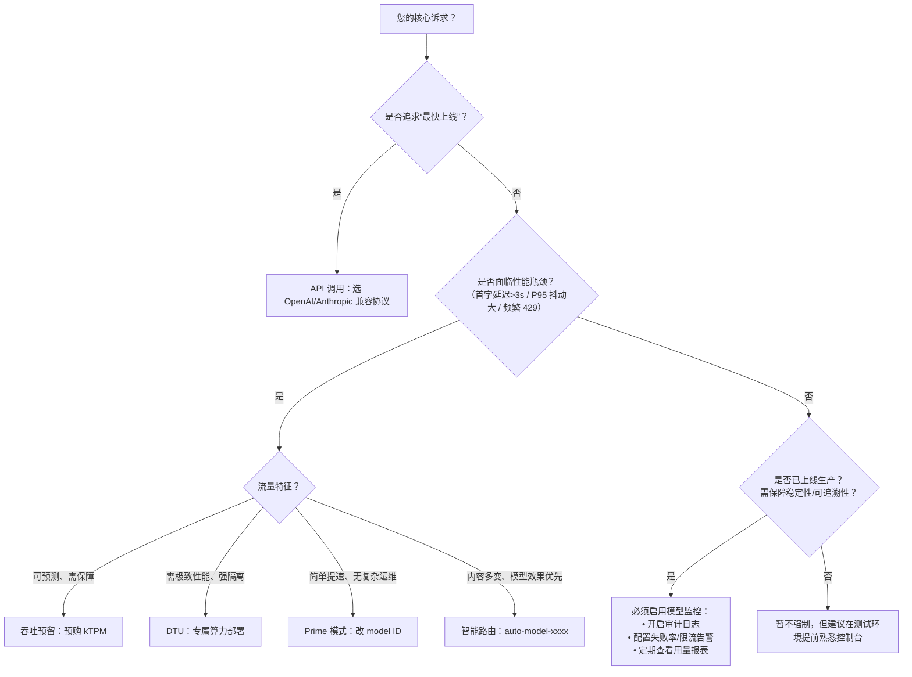

# 模型部署方式对比：API 调用、高并发推理与模型监控

## 背景与目的  
在百炼平台构建生产级 AI 应用时，开发者需在**快速集成、性能保障、可观测治理**三者间做出技术权衡。API 调用提供开箱即用的接入能力；高并发推理（含 Prime、吞吐预留、DTU、智能路由）聚焦于低延迟、高吞吐与容量确定性；模型监控则支撑服务稳定性、成本优化与故障根因分析。本页旨在从技术实现、适用边界与运维特征三个维度，系统对比这三类核心部署能力，帮助开发者基于业务 SLA、流量特征与团队运维能力，完成理性选型。

---

## 关键维度对比表

| 维度 | API 调用（标准模式） | 高并发推理（加速部署） | 模型监控（可观测性） |
|------|----------------------|--------------------------|------------------------|
| **本质定位** | 通用模型服务能力入口，面向功能快速验证与中小规模调用 | 性能增强型部署形态，面向高负载、低延迟、强确定性生产场景 | 运维治理能力层，面向服务健康度、成本透明化与问题诊断 |
| **输入格式** | 标准 `messages` 数组（OpenAI/Anthropic/DashScope 协议），支持 `stream=true` 流式 | 完全兼容 API 调用的输入格式（`messages`、`temperature` 等），**无需修改请求体结构** | 无直接输入；自动采集所有经百炼平台发起的模型调用请求与响应元数据（含 Request ID、状态码、Token 数、延时等） |
| **输出格式** | 标准协议响应（`choices[0].message.content` 或 `content` 字段），含 `usage` 对象 | 输出结构与对应协议完全一致；**额外返回 `service_tier`、`provisioned_tokens`、`cached_tokens` 等加速上下文字段** | 无业务响应输出；提供控制台图表、告警通知、结构化日志（审计日志含请求头/用量/延时；推理日志含完整 Prompt/Response） |
| **支持模型** | 全量上线模型（`qwen-max`、`qwen-plus`、`qwen-turbo`、`qwen2.5` 等），能力取决于所选协议（如 Responses 接口支持联网搜索） | **按加速类型差异化支持**： • Prime：`glm-5.2-fast-preview`、`glm-5.3-prime` 等专用 ID • 吞吐预留：`qwen3.8-max`、`glm-5.2`、`deepseek-v4-flash-0731` 等（需控制台开通） • DTU：`qwen3.8-flash`、`glm-5.3-flash` 等新发布模型 • 智能路由：预设模型池（如 `qwen3.8-flash`、`glm-5.2`） | 全量百炼平台上线模型（文本生成为主），语音/图像/视频模型部分指标受限；**不依赖模型部署方式，只要调用走百炼网关即被监控** |
| **API 端点** | • OpenAI 兼容：`https://dashscope.aliyuncs.com/compatible-mode/v1/chat/completions` • Anthropic 兼容：`https://dashscope.aliyuncs.com/compatible-mode/v1/messages` • DashScope 原生：`https://dashscope.aliyuncs.com/api/v1/services/aigc/text-generation/generation` | • Prime / 吞吐预留 / DTU：使用专属域名 `https://{workspace_id}.{region}.maas.aliyuncs.com/compatible-mode/v1/...` • 智能路由：仅支持 `maas.aliyuncs.com` 域名 • **关键约束**：吞吐预留不支持 `/v1/responses` 协议；DTU 使用标准 SDK 调用 | 无独立 API 端点；通过控制台访问（运维管理 > 模型监控/模型告警），或通过云监控 OpenAPI 查询指标 |
| **计费方式** | **按量计费**：按实际消耗 Token 数计费（输入+输出），支持免费额度抵扣 | • Prime：按 Token 计费，费率与标准 API 一致 • 吞吐预留：预付费购买 kTPM（千 Token/分钟）额度，未用完不退；超用部分按量计费 • DTU：预付费购买专属算力（按 TPM × 时长），资源独占 • 智能路由：按实际 Token 计费，不额外收费 | **不参与计费**：监控数据为纯运维数据，不作为计费依据；但开启 SLS 日志投递、云监控等依赖服务将产生独立费用 |
| **典型场景** | • 快速原型验证 • 内部工具、低频客服机器人 • 小流量实验性应用 • 需要灵活切换模型/参数的开发调试 | • AI 编程助手（毫秒级首字延迟要求） • Agent 多步链式推理（高并发、低 P99 延迟） • 实时对话服务（SLA 严格保障） • 批量评测（稳定吞吐需求） | • 生产环境 SLA 监控（失败率 >1% 告警） • 成本异常分析（TotalToken 突增告警） • 故障排查（按 Request ID 追踪完整链路） • 容量规划（基于历史 TPS/TPM 数据） |

---

## 适用场景建议（面向开发者的技术选型参考）

### ✅ 优先选择 **API 调用（标准模式）** 当：
- 项目处于 PoC 或 MVP 阶段，需快速验证模型效果与业务逻辑；
- 日均调用量 < 10,000 次，且对首字延迟无严苛要求（可接受 2–5 秒）；
- 需频繁切换模型（如 A/B 测试 `qwen-max` vs `qwen-plus`）或调整高级参数（`top_k`、`stop`）；
- 团队无专职运维，希望“零配置”开箱即用；
- **避坑提示**：避免在高并发场景（如万级 QPS）下直接使用标准 API，易触发限流（HTTP 429）且无容量保障。

### ✅ 优先选择 **高并发推理（加速部署）** 当：
- **明确存在性能瓶颈**：实测标准 API 首字延迟 > 3 秒，或 P95 延迟抖动剧烈；
- **流量可预测且集中**：如企业内部 AI 助手工作日 9:00–18:00 高峰期稳定 500 QPS；
- **SLA 要求严格**：合同约定“99.9% 请求首字延迟 ≤ 1.5 秒”，需容量锁定；
- **成本敏感型规模化**：月用量超百万 Token，通过吞吐预留可降低单位 Token 成本（相比纯按量）；
- **技术栈适配性考量**：
  - 追求极简：选 **Prime 模式**（改 `model` ID + 切域名，无额外配置）；
  - 需容量保障与精细控制：选 **吞吐预留**（预购 kTPM，支持高速/标准双模式）；
  - 要求物理隔离与极致性能：选 **DTU**（适合金融、政企等强合规场景）；
  - 输入内容差异大、模型效果优先：选 **智能路由**（自动匹配最优模型，免人工选型）；
- **避坑提示**：吞吐预留/DTU 为预付费，创建即扣款；务必用 [TPM 容量计算器](../../raw/model-user-guide/model-high-speed-inference/tpm-reservation-index/tpm-reservation-long-input.md) 评估长输入放大系数，避免额度不足。

### ✅ 优先启用 **模型监控** 当：
- 服务已上线生产环境，需建立基础可观测性基线；
- 出现过因模型失败、延迟飙升导致的用户投诉，但缺乏根因证据；
- 团队需向管理层汇报 AI 服务健康度（如“本月平均失败率 0.3%，低于 SLA 1%”）；
- 计划进行资源优化（如发现某 API Key 占比 80% Token 消耗，可针对性治理）；
- **关键配置建议**：
  - **必开告警**：失败率（>1%）、限流错误次数（>10 次/分钟）、首 Token 延时（>10 秒）；
  - **推荐开启**：审计日志投递（免费，保留 30 天），用于快速定位问题请求；
  - **按需开启**：推理日志（北京/新加坡地域可用，SLS 费用另计），用于 Prompt 工程调优与安全审计；
- **避坑提示**：监控数据有 1–10 分钟延迟，不可用于实时熔断；免费额度耗尽返回 `403 AllocationQuota.FreeTierOnly`，**该错误不触发任何告警**，需单独监控额度页面。

---

## 总结：技术选型决策树

> **最后提醒**：三者非互斥关系，而是**分层协作**——  
> **API 调用是能力底座**，**高并发推理是性能增强插件**，**模型监控是运维操作系统**。  
> 生产环境推荐组合：`API 调用（标准协议） + 吞吐预留（保障高峰） + 全面模型监控（保障健康）`。

## 被对比主题页

- [qwen api reference](../api/qwen-api-reference.md)
- [model high speed inference](../guides/model-high-speed-inference.md)
- [model monitoring](../guides/model-monitoring.md)

