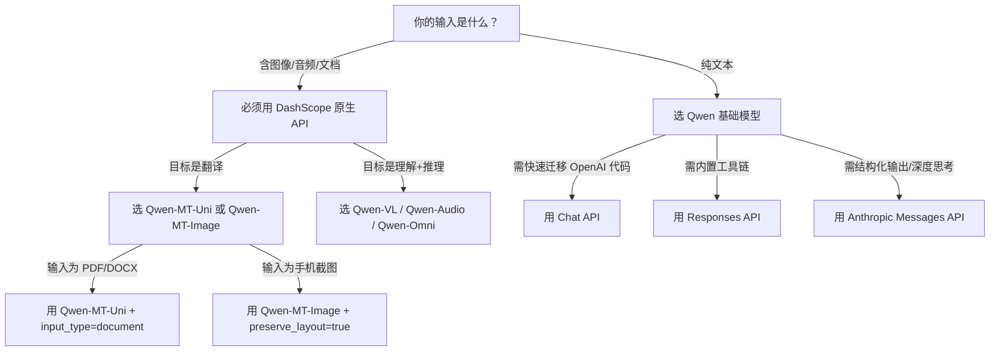

# Qwen 系列模型能力对比（基础、[多模态](../concepts/multi-modal.md)、翻译）

## 背景与目的  
Qwen 系列模型是阿里云百炼平台核心大模型能力矩阵，覆盖文本理解与生成、[多模态](../concepts/multi-modal.md)感知、专业领域任务（如翻译、代码、数学）及世界建模等方向。随着模型谱系持续扩展，开发者在实际选型中常面临以下关键问题：  
- 同一任务（如图片翻译）应调用 `Qwen-VL` + Prompt 工程，还是直接使用专用 `Qwen-MT-Image`？  
- [多模态](../concepts/multi-modal.md)输入（含图像+音频+文本）是否必须切换至 DashScope 原生协议？  
- Agent 场景下，OpenAI 兼容的 Chat API 与 Responses API 的能力边界与成本差异如何？  

本文聚焦 **基础语言能力（Qwen 文本大模型）、多模态理解（VL/Audio/Omni）与翻译专项（MT 系列）** 三大能力维度，系统对比各模型在接口协议、输入输出、功能支持、计费与适用场景等方面的差异，为开发者提供可落地的技术选型决策依据。

---

## 关键维度对比表

| 维度 | Qwen 基础文本模型（如 `qwen3.8-max`, `qwen3.7-plus`） | Qwen 多模态模型（`Qwen-VL`, `Qwen-Audio`, `Qwen-Omni`） | Qwen 翻译专项模型（`Qwen-MT`, `Qwen-MT-Image`, `Qwen-MT-Uni`） |
|------|--------------------------------------------------------|----------------------------------------------------------|----------------------------------------------------------------|
| **核心定位** | 通用文本生成、推理、对话、Agent 基座 | 视觉-语言联合理解（VL）、语音理解（Audio）、全模态融合（Omni） | 面向翻译任务深度优化：文本→文本、图→文、文档/音→文端到端翻译 |
| **支持模型（典型）** | `qwen3.8-max`, `qwen3.7-plus`, `qwen3-vl-plus`（文本版） | `Qwen-VL`, `Qwen-Audio`, `Qwen-Omni`, `qwen3-vl-plus`（多模态版） | `qwen-mt`, `qwen-mt-image`, `qwen-mt-uni` |
| **推荐 API 协议** | ✅ OpenAI Chat API ✅ Anthropic Messages API ✅ Responses API（Agent 场景） ✅ DashScope 原生 API | ✅ DashScope 原生 API（**唯一支持 Qwen-Audio 的路径**） ✅ OpenAI Chat API（`Qwen-VL`/`Qwen-Omni` 支持图像/视频；**Qwen-Audio 不支持**） ✅ Anthropic Messages API（`qwen3-vl-plus` 等支持 image/video） | ✅ DashScope 原生 API（`/v1/services/aigc/mt`）——**全系列唯一支持路径** ⚠️ OpenAI Chat API：**仅 `qwen-mt`（纯文本）可用**；`qwen-mt-image`/`qwen-mt-unii` 不兼容 |
| **输入格式支持** | • `messages` 数组（text only） • `system`/`user`/`assistant` 角色 • 支持 `cache_control`、`reasoning.effort`（Anthropic/Responses） | • Chat API：`content` 支持 `string` 或 `[{type:"image_url", image_url:{url:...}}]` • DashScope：支持 `input_audio`, `input_video`, `input_file`（PDF/DOCX）等原生类型 • Anthropic：`content` 支持 `image`/`video`（`source.type: "url"` or `"base64"`） | • `input` 字段：支持 `string`（文本）、`base64`/`OSS URL`（图片/文档/音频） • 必填 `source_language`/`target_language`（ISO 639-1） • `qwen-mt-uni` 需显式指定 `input_type`（`"text"`/`"image"`/`"document"`/`"audio"`） |
| **输出格式特点** | • 标准 `choices[].message.content`（text） • Anthropic 支持结构化 `format` 输出 • Responses API 返回 `tool_calls`、`previous_response_id` 等 Agent 上下文字段 | • DashScope：返回 `output.results[]`，含 `text`, `boxes`（坐标）, `audio_transcript` 等模态专属字段 • Chat API：统一返回 `content` 字符串，多模态信息需解析嵌入文本或 JSON | • `response_format="text"`：纯翻译结果（默认） • `response_format="json"`：含原文位置、置信度、排版坐标（`qwen-mt-image`/`qwen-mt-unii`） • **不支持流式响应（`stream=true` 无效）** |
| **关键控制参数** | • `temperature`, `top_p`, `max_tokens` • `output_config.effort`（Anthropic） • `reasoning.effort`（Responses） | • `min_pixels`/`max_pixels`/`total_pixels`（图像/视频缩放） • `fps`, `max_frames`（DashScope 专有） • `cache_control`（Chat/Anthropic） | • `preserve_layout`（布尔值，默认 `true`，仅 `qwen-mt-image`/`qwen-mt-unii` 支持） • 无 `effort`/`cache` 类高级参数 |
| **计费方式** | 按 **输入 token + 输出 token** 计费（单位：千 tokens） 不同模型单价不同（如 `qwen3.8-max` > `qwen3.7-plus`） | 按 **输入 token + 输出 token + 模态附加费** 计费： • 图像：按 `total_pixels` 分档计费 • 音频：按秒长 + 采样率折算 token • 视频：按 `fps × duration × frame_cost` 计费 | 按 **请求次数 + 输入内容复杂度** 计费： • `qwen-mt`：按文本 token 计费 • `qwen-mt-image`：按图像分辨率（`total_pixels`）分档 • `qwen-mt-unii`：按输入类型动态计费（文档页数、音频时长、图像像素） |
| **典型场景** | • 智能客服对话 • 内容创作与摘要 • 复杂逻辑推理（数学/代码） • 工具调用型 Agent | • 商品图多模态搜索 • 会议录像语音+画面联合分析 • 教育场景图文问答（教材扫描件+问题） • 实时音视频字幕生成 | • 跨境电商商品页批量翻译（HTML/PDF） • 手机截图实时翻译（保留按钮/图标位置） • 多语种会议录音转译（含发言人分离） |

> **注**：`Qwen-Audio` 仅可通过 DashScope 原生 API 调用，[OpenAI 兼容接口](../concepts/openai-compatible-api.md)明确不支持；`Qwen-MT-Uni` 当前**不支持视频输入**，文档中“全模态”指文本/图像/文档/音频四类，不含视频。

---

## 适用场景建议（面向开发者）

### ✅ 优先选择 Qwen 基础文本模型（`qwen3.x` 系列）
- **你的需求是纯文本交互**：如聊天机器人、知识问答、文案生成、API 接口文档解析。
- **你已使用 OpenAI 生态**：希望零改造迁移现有 `chat/completions` 代码，且无需音视频处理。
- **你需要强 Agent 能力**：依赖内置 `web_search`、`code_interpreter` 等工具链，且要求多轮 Session 上下文管理（选 Responses API）。
- **你追求高性价比推理**：相比多模态模型，文本模型 token 成本更低，响应延迟更优。

### ✅ 优先选择 Qwen 多模态模型（`Qwen-VL`/`Qwen-Audio`/`Qwen-Omni`）
- **输入含非文本模态**：必须处理图像（截图/商品图）、音频（会议录音）、视频（教学录像）或本地文件（PDF 报告）。
- **你需要模态原生理解**：例如从视频中识别动作序列、从音频中提取情感倾向、从 PDF 表格中抽取结构化数据。
- **你构建沉浸式应用**：如 AR 导航（视觉+地理文本）、无障碍辅助（语音→文字+图像描述）、教育智能批改（手写题图+题目文本）。
- **技术栈允许协议切换**：可接受使用 DashScope 原生 SDK 或手动构造 `/api/v1/services/aigc/multimodal-generation/generation` 请求。

### ✅ 优先选择 Qwen 翻译专项模型（`Qwen-MT` 系列）
- **核心目标是高质量翻译**：而非通用多模态理解。例如将产品说明书 PDF 翻译为西班牙语并保持表格对齐。
- **输入格式复杂多样**：需统一处理用户上传的 JPG 截图、Word 文档、MP3 录音，且要求输出带原文位置信息（用于前端高亮）。
- **你重视翻译领域性能**：`Qwen-MT` 在 BLEU/COMET 指标上显著优于通用 `Qwen-VL` 的 [prompt](../guides/prompt.md)-based 翻译，尤其在术语一致性、长句逻辑连贯性方面。
- **你接受专用接口**：愿意适配 `/v1/services/aigc/mt` 路径及 `input_type`/`preserve_layout` 等翻译专属参数。

### ⚠️ 避免混用的典型误区
- **误用 `Qwen-VL` 替代 `Qwen-MT-Image`**：虽能完成 OCR+翻译，但无法保证排版还原精度，且无 `preserve_layout` 控制能力，成本更高。
- **尝试用 OpenAI Chat API 调用 `Qwen-Audio`**：必然失败，服务端返回 `400 Unsupported model for this endpoint`。
- **在 Responses API 中调用 `Qwen-MT-Uni`**：该 API 未开放翻译模型支持，仅限 `qwen3.x` 及部分第三方文本模型。

---

## 技术选型决策树（快速参考）

> **最后建议**：首次集成请始终通过 [百炼控制台「模型服务」](https://bailian.console.aliyun.com) 开通对应模型权限，并使用官方 SDK（Python/Java/Node.js）自动处理认证、重试与错误码映射。所有模型均支持多地域部署，生产环境务必指定低延迟地域（如 `cn-beijing` 或 `ap-southeast-1`）。

## 被对比主题页

- [qwen api reference](../api/qwen-api-reference.md)
- [qwen mt translation models](../api/qwen-mt-translation-models.md)
- [world model api reference](../api/world-model-api-reference.md)

