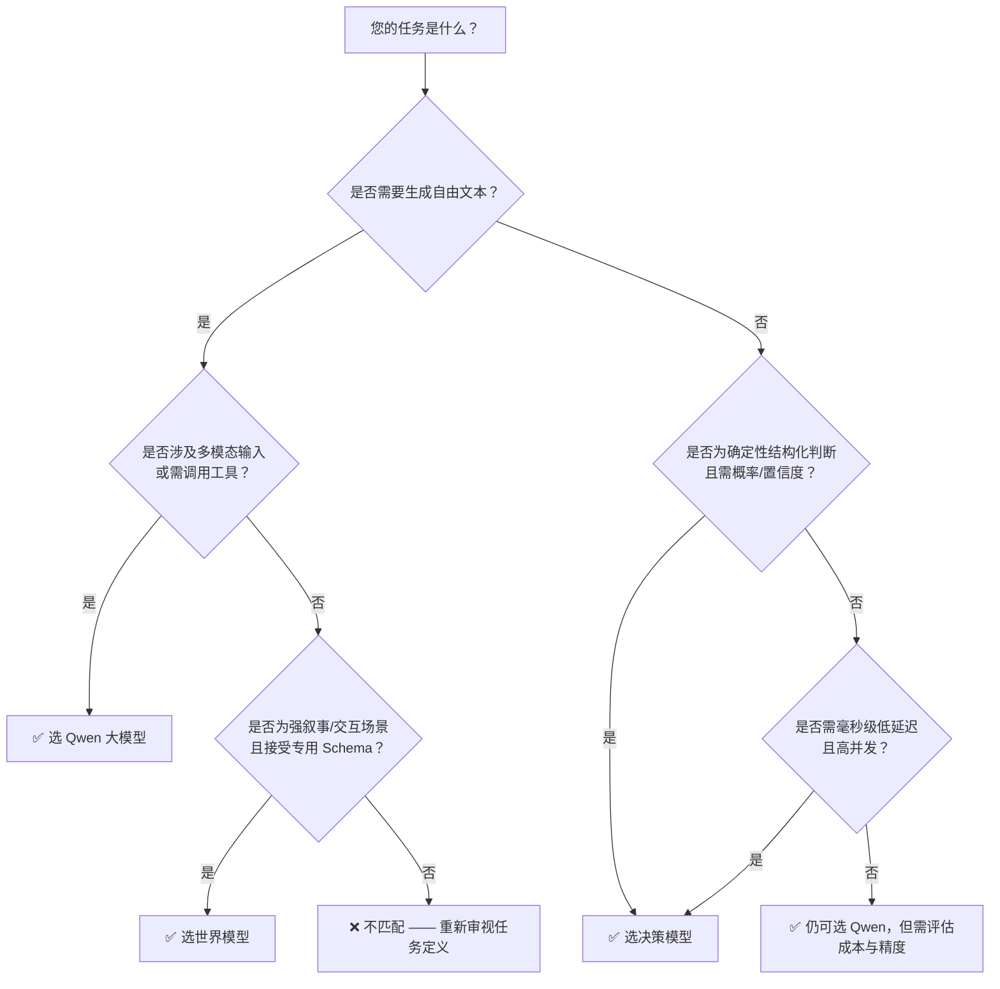

# Qwen 大模型、决策模型与世界模型能力对比

为帮助开发者在百炼平台上高效选型，本文系统对比 **Qwen 系列大语言模型（LLM）**、**决策模型（Decision Model）** 与 **世界模型（World Model）** 三类核心 AI 能力。三者定位迥异：Qwen 是通用认知引擎，面向开放式文本生成与多模态理解；决策模型是确定性结构化判断引擎，面向高频、低延迟、可度量的业务规则替代；世界模型则是叙事与交互式内容生成专用引擎，面向游戏、影视、虚拟角色等强创作导向场景。本对比聚焦实际工程落地维度，涵盖接口协议、输入输出范式、能力边界与典型适用场景，助力技术团队基于任务本质而非模型名称做出精准选型。

## 关键能力维度对比

| 维度 | Qwen 大模型（如 `qwen4-max`、`qwen3.8-flash` 等） | 决策模型（`decision-model-preview`） | 世界模型（`happyoyster/adventure` 等） |
|------|-----------------------------------------------|-------------------------------------|----------------------------------------|
| **核心定位** | 通用大语言模型：支持开放式文本生成、推理、多模态理解与工具调用 | 专用结构化决策引擎：执行确定性分类、是非判断、有序评分等可计量判断任务 | 专用叙事与交互生成引擎：面向冒险剧情、导演调度、角色表演的结构化内容创作 |
| **输入格式** | 多样化： • 文本（`messages`/`input`） • 图像/视频/音频/PDF（URL/Base64/文件流） • 支持 `system`/`user`/`assistant` 角色消息与工具调用声明 | 结构化单一 `state` + 显式 `questions`： • `state`: 字符串/JSON 对象/数组（≤65536 token） • `questions`: 键值对对象，每个 question 指定 `type`（`choice`/`noul`/`score`）与判定标准 | 强结构化 JSON `input`： • 格式严格依模型类型而异（Adventure/Directing/Acting 各有 Schema） • 不支持 `system` prompt，全部上下文需内嵌于 `input` 字段 • 总长度 ≤8192 字符 |
| **输出格式** | 自由文本为主，支持流式（`stream: true`）与非流式响应；含 `content`、`tool_calls`、`usage`、`reasoning_trace`（若启用深度思考）等字段 | 纯结构化 JSON： • `answers`: 按 question ID 组织，含 `value`、`probabilities`、`confidence` 等确定性字段 • `latency_ms`: 毫秒级延迟指标 • 无自由文本生成字段 | 结构化 JSON 输出（非流式）或 SSE 流式事件（仅 Adventure/Directing）： • `output`: 符合预定义 Schema 的 JSON（如剧情分支、镜头指令、台词+动作建议） • Acting 模块不支持流式 |
| **支持模型** | 全系列 Qwen 商业版与开源版（`qwen4-max`, `qwen3.8-flash`, `qwen3-vl-plus`, `qwen3.5-ocr` 等）及部分第三方模型（DeepSeek/Kimi/GLM，限华北2） | 仅 `decision-model-preview`（预览版，GA 前可能调整） | 三类专用模型： • `happyoyster/adventure`（已开放） • `happyoyster/directing`（已开放） • `happyoyster/acting`（邀测中，需白名单） |
| **API 端点（推荐）** | • OpenAI 兼容：`/{WorkspaceId}.cn-beijing.maas.aliyuncs.com/compatible-mode/v1/chat/completions` • Responses（增强多轮/工具）：`.../v1/responses` • DashScope 原生：`.../api/v1/services/aigc/text-generation/generation` | • DashScope SDK：`client.decision.create()` → 自动路由至 `/compatible-mode/v1/systemone` • TypeSafe SDK：`client.system_one()` • 直连：`/{WorkspaceId}.{region}.maas.aliyuncs.com/compatible-mode/v1/systemone` | • 统一入口：`https://dashscope.aliyuncs.com/api/v1/services/aigc/world-model/invoke` • 通过 `model` 参数区分能力（如 `"happyoyster/directing"`） |
| **计费方式** | 按 **输入 + 输出 token 总数** 计费（多模态输入按等效 token 折算）；不同模型单价不同（如 `qwen4-max` > `qwen3.8-flash`） | 按 **单次请求** 计费（无论问题数量，上限 16 问）；计费单位为“决策调用次数”，与 token 无关 | 按 **单次请求** 计费；Acting 模块因邀测暂不公开定价，Adventure/Directing 按调用次数计费 |
| **典型场景** | • 智能客服对话 • 多文档摘要与问答（PDF/网页） • 图文理解与生成（文搜图、图搜图） • 代码生成与解释 • 联网搜索增强回答 | • 工单自动分级与路由（“紧急/高/中/低”） • 内容安全审核（“涉政/涉黄/正常”概率） • 智能体任务完成度校验（“已完成/进行中/失败”置信度） • A/B 测试分流策略判定 | • 游戏动态剧情生成与分支管理 • 影视分镜脚本自动生成（含时间码、运镜、角色走位） • 虚拟数字人角色台词与微表情协同生成（邀测中） |

## 各方案适用场景建议

### ✅ 选择 Qwen 大模型，当您的需求满足以下任一条件：
- 需要**开放式、创造性文本生成**（如文案撰写、故事续写、邮件润色）；
- 输入包含**多模态数据**（图片理解、视频摘要、音频转录、PDF 解析）；
- 依赖**外部工具链**（联网搜索、代码执行、知识库检索）完成复杂任务；
- 需要**长上下文多轮对话管理**（Session 缓存、显式 Prompt 缓存）；
- 已有 OpenAI/Anthropic 生态，追求**最小迁移成本**。

> ⚠️ 注意：避免用于高并发、毫秒级响应要求的确定性判断（如风控拦截），此时决策模型更优。

### ✅ 选择决策模型，当您的需求满足以下全部条件：
- 任务本质是**结构化、确定性、可穷举的判断**（非开放式生成）；
- 需要**明确的概率分布与置信度指标**，用于后续阈值决策或归因分析；
- 请求频次高（>100 QPS）、延迟敏感（目标 <500ms），且结果无需自然语言解释；
- 输入数据已结构化或可标准化为 `state` + `questions` 格式；
- 业务逻辑需被**可观测、可审计、可回滚**（纯 JSON 输出天然适配日志与监控体系）。

> ⚠️ 注意：不适用于需要生成解释性文本（如“为什么判定为高风险？”）的场景——此类需求应组合使用 Qwen（生成解释）+ 决策模型（提供判定依据）。

### ✅ 选择世界模型，当您的需求满足以下条件：
- 核心产出是**强结构化、时序化、角色化的叙事内容**（非通用文本）；
- 场景高度垂直：游戏开发、互动影视、虚拟偶像、教育模拟等；
- 需要**领域专属语义理解**（如“镜头推近”、“NPC 表情从惊讶转为警惕”、“玩家选择影响第三幕结局”）；
- 接受当前模块的访问限制（Acting 邀测、Directing/Adventure 需控制台开通权限）；
- 愿意遵循严格的 `input` Schema 设计，放弃自由 prompt 工程。

> ⚠️ 注意：不适用于通用内容生成（如写公众号文章）、简单问答或非叙事类任务；其 `input` 设计成本高于 Qwen 的自然语言 prompt。

## 面向开发者的选型决策树

**关键提醒**：
- **不要混用模型解决同一问题**：例如，用 Qwen 解析 PDF 后再送入决策模型做分类，虽可行，但会增加延迟与 token 成本；应优先评估 `qwen4-max` 是否已内置所需判断能力（如通过 prompt + tool call 实现）。
- **版本兼容性必须验证**：决策模型要求 DashScope SDK ≥2.0.1（Python）或 ≥2.23.3（Java）；世界模型调用需确认控制台服务开通状态；Qwen 的第三方模型仅限华北2地域。
- **性能压测不可省略**：决策模型的 16 问上限、世界模型的 8192 字符 `input` 限制、Qwen 多模态输入的 token 折算规则，均需在真实业务数据上实测。

通过本对比，开发者可清晰识别：**Qwen 是“思考者”，决策模型是“裁判”，世界模型是“导演”**。选型的本质，是让每类 AI 承担其最擅长的角色，从而构建稳健、高效、可演进的智能应用架构。

## 被对比主题页

- [qwen api reference](../api/qwen-api-reference.md)
- [decision model](../api/decision-model.md)
- [world model api reference](../api/world-model-api-reference.md)

