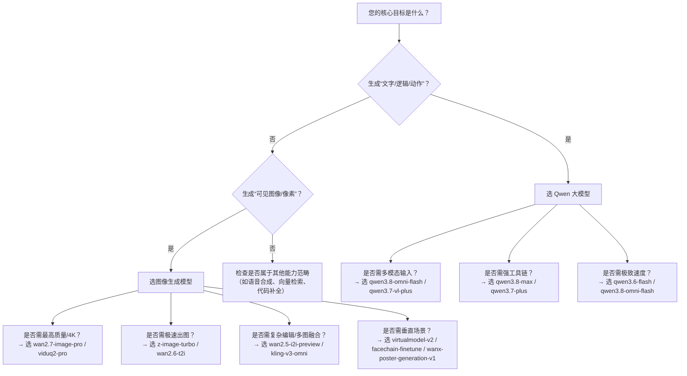

# Qwen大模型与图像生成模型对比

本对比旨在帮助开发者清晰区分百炼平台上两类核心AI能力：**Qwen系列大语言模型（含[多模态](../concepts/multimodal.md)理解）** 与 **专用图像生成模型（文生图/图生图/编辑等）**。随着AIGC技术栈日益分化，二者在设计目标、输入输出范式、调用协议及计费逻辑上已形成明确边界。本文不讨论“Qwen-VL”等视觉语言模型的图文理解能力，而是聚焦于**以生成为目标的纯文本推理（Qwen） vs. 以像素合成为目标的图像生成（Image Generation）** 这一根本差异，为技术选型提供结构化参考。

## 关键维度对比

| 维度 | Qwen 大模型（文本/[多模态](../concepts/multimodal.md)理解） | 图像生成模型（文生图/图生图/编辑） |
|------|-------------------------------|-----------------------------------|
| **核心定位** | 通用人工智能代理：文本生成、逻辑推理、工具调用、跨模态理解（看图说话、听音识意） | 专业视觉合成引擎：根据提示生成/编辑/重构图像像素，强调构图、风格、细节保真度 |
| **典型输入格式** | - 纯文本（`messages` 数组或 `input` 字符串） - [多模态](../concepts/multimodal.md)混合输入（支持 `input_text`/`input_image`/`input_audio`/`input_video` 等类型对象） - 工具声明（`tools` 数组） | - 文本提示（`prompt`，必填） - 参考图像（`image_url` 或 base64，部分模型支持多图） - 控制参数（`size`, `style`, `watermark` 等） - *不接受工具调用声明* |
| **典型输出格式** | - 结构化文本响应（含 `content`, `tool_calls`, `reasoning_trace` 等字段） - 流式 `text/event-stream`（逐 token 返回） - JSON Schema 强约束输出（通过 `response_format` 或 `output_config.format.type`） | - 同步：直接返回图像 URL 数组（`data[0].url`）及元信息 - 异步：返回 `task_id`，需轮询获取结果（含 `result_url`, `status`, `error_message`） - *不返回文本推理过程或工具调用记录* |
| **主流支持模型** | `qwen3.8-max`, `qwen3.7-plus`, `qwen3.8-omni-flash`, `qwen3.7-vl-plus`, `qwen2.5-vl`, `qven3.5-ocr`；第三方模型如 `deepseek-v4-pro`, `glm-5.3` | `qwen-image-3.0-pro`, `wan2.7-image-pro`, `z-image-turbo`, `wan2.6-t2i`, `kling/kling-v3-image-generation`, `vidu/viduq2-pro_reference2image`, `virtualmodel-v2`, `facechain-finetune` |
| **API 端点（典型）** | - OpenAI 兼容：`https://{WorkspaceId}.{region}.maas.aliyuncs.com/compatible-mode/v1/chat/completions` - Anthropic 兼容：`https://{WorkspaceId}.{region}.maas.aliyuncs.com/apps/anthropic/messages` - DashScope 原生：`https://{WorkspaceId}.{region}.maas.aliyuncs.com/api/v1/services/aigc/text-generation/generation` | - 同步：`https://{WorkspaceId}.{region}.maas.aliyuncs.com/api/v1/services/aigc/multimodal-generation/generation` - 异步任务创建：`POST .../generation` → 返回 `task_id` - 异步结果查询：`GET .../tasks/{task_id}` （*注：千问图像模型额外支持 OpenAI 兼容 `/images/generations` 端点*） |
| **计费方式** | 按 **输入 [Token](../concepts/token.md) + 输出 [Token](../concepts/token.md)** 计费（单位：千 tokens），多模态输入中图像/音频按等效 [Token](../concepts/token.md) 折算（详见各模型文档）。工具调用不额外计费，但消耗上下文与推理资源。 | 按 **单次生成请求** 或 **生成图像张数（`n` / `series_amount`）** 计费。部分模型（如 `kling`）按分辨率分级计费（1K/2K/4K）。异步任务无论成功与否均计费一次。免费额度集中于创意工具类模型（如海报、虚拟模特）。 |
| **典型场景** | - 智能客服对话与知识问答 - 多文档摘要与PDF解析（OCR+LLM） - 联网搜索后推理（`web_search` + `code_interpreter`） - 音视频内容分析与总结 - 结构化数据提取（JSON输出） | - 营销素材生成（海报、Banner、商品图） - 设计辅助（风格迁移、线稿上色、局部重绘） - 虚拟人像生成与个性化写真（FaceChain） - 工业图纸/概念图可视化 - 社交媒体配图批量生产 |

## 适用场景建议

### ✅ 选择 Qwen 大模型，当您需要：
- **理解与推理优先**：对上传的图片/音频/视频进行语义解读、问答、摘要或跨模态关联（例如：“分析这张产品图中的缺陷，并联网查最新质检标准”）；
- **复杂工作流编排**：串联多个工具（搜索→抓取→代码执行→总结）完成端到端任务；
- **强逻辑性文本产出**：撰写技术文档、法律条款、营销文案，且需严格遵循 JSON Schema 或业务规则；
- **长上下文交互**：维护多轮对话状态、引用历史响应（`previous_response_id`）、或基于会话级上下文（`conversation`）持续推理。

### ✅ 选择图像生成模型，当您需要：
- **像素级视觉输出**：生成高保真、高分辨率、符合指定构图/风格/比例的图像（如“生成一张16:9的赛博朋克风格咖啡馆室内效果图，含霓虹灯和全息菜单”）；
- **图像编辑与控制**：对已有图片进行局部修改（擦除/重绘/扩图）、风格迁移、主体替换或多人像融合；
- **垂直场景提效**：快速生成电商模特图、鞋靴展示图、创意海报、AI写真，无需自行训练或微调；
- **确定性渲染需求**：要求输出尺寸、水印、色彩空间等参数可精确控制，且结果可预测性强。

### ⚠️ 不建议混用的典型误区：
- ❌ 用 `qwen3.8-omni-flash` “生成图片”——它只能**描述**图片内容，不能输出像素；
- ❌ 用 `wan2.7-image-pro` “回答用户问题”——它没有文本推理能力，无法执行工具或生成答案；
- ❌ 在图像生成 API 中传入 `tools` 参数——该参数被完全忽略，且可能导致请求失败；
- ❌ 期望图像生成模型返回 JSON 结构化数据——其输出本质是二进制图像资源，元信息仅限基础属性（URL、尺寸、状态）。

## 开发者技术选型参考

作为开发者，请按以下决策树快速判断：

**关键实践建议：**
- **域名与地域必须严格一致**：Qwen 和图像生成均强制要求 `{WorkspaceId}.{region}.maas.aliyuncs.com` 格式，旧 `dashscope.aliyuncs.com` 域名已逐步淘汰，迁移可提升稳定性与吞吐。
- **认证方式统一但参数不同**：两者均支持 `Authorization: Bearer <API_KEY>`，但图像生成模型**不识别** `x-api-key`（Anthropic 兼容专属）。
- **错误排查优先级**：  
  - 若返回 `400 Bad Request`：先检查 `model` ID 是否拼写正确、是否在对应服务（text-generation vs multimodal-generation）下可用；  
  - 若返回 `401 Unauthorized`：确认 API Key 所属地域与 Endpoint 地域完全匹配；  
  - 若图像生成返回空 `data` 或 `status=failed`：检查 `prompt` 长度、图像格式/尺寸、`size` 参数合法性（如 `kling` 禁用透明通道）。
- **成本优化提示**：Qwen 的多模态输入（尤其高清图/长音频）Token 成本显著高于纯文本；图像生成中，4K 分辨率费用约为 1K 的 3–4 倍，建议按实际使用场景选择合适档位。

> 本文档依据百炼平台 2024 年 Q3 最新 API 规范编写。模型能力与计费策略将持续演进，请以控制台实时文档及 [模型 API 参考](../../raw/model-api-reference) 为准。

## 被对比主题页

- [qwen api reference](../api/qwen-api-reference.md)
- [image generation](../api/image-generation.md)

