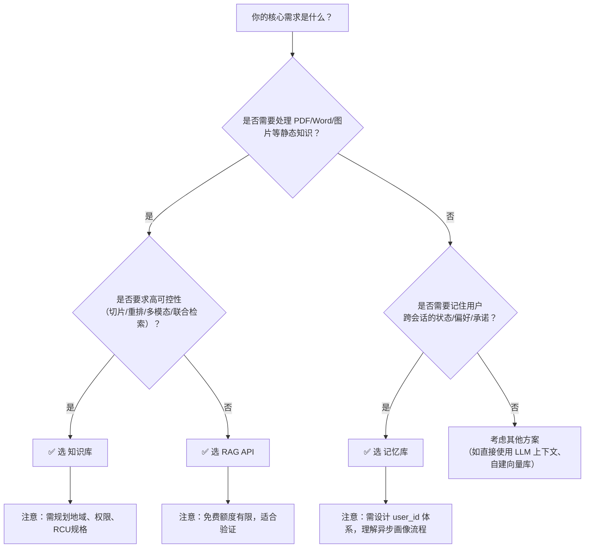

# RAG、知识库与记忆库方案对比

本文档面向百炼平台开发者，旨在清晰区分 **RAG API**、**知识库（Knowledge Base）** 和 **记忆库（Memory Library）** 三类核心能力的定位、能力边界与适用场景，辅助技术选型决策。三者虽均涉及“检索+上下文增强”，但设计目标、数据生命周期、集成方式与计费模型存在本质差异：  
- **RAG API** 是面向开发者的 *端到端 RAG 流程封装接口*，强调快速接入、开箱即用的私有知识问答；  
- **知识库** 是 *多模态、高可控、生产就绪的向量检索基础设施*，支持复杂检索策略与规模化知识管理；  
- **记忆库** 是 *专为对话智能体设计的长期记忆服务*，聚焦跨会话用户状态建模与语义化记忆召回，不处理文档级知识。  

正确区分三者，可避免功能误用（如用记忆库存 PDF 文档）、架构冗余（如重复构建知识索引）或成本浪费（如为静态知识启用高频率记忆更新）。

---

## 关键维度对比

| 维度 | RAG API | 知识库（Knowledge Base） | 记忆库（Memory Library） |
|------|---------|---------------------------|----------------------------|
| **核心定位** | RAG 场景的 *一体化 API 封装*，覆盖知识库创建→文档解析→检索→问答全流程 | *托管式向量检索服务*，提供多模态知识索引、高级检索控制与模型协同能力 | *大模型长期记忆服务*，自动从对话中提取事实/画像，并支持语义化跨会话召回 |
| **输入格式** | 支持 PDF/Word/TXT/Markdown 等文档上传；`/query` 接口仅接受自然语言问题（≤2048 字符） | 支持文档、表格、图片、音视频等多模态数据；支持结构化元数据、标签、自定义切片配置 | 输入为 **对话消息历史（messages）**（JSON 数组），含 role/content/timestamp；支持传入 `profile_schema` 触发画像提取 |
| **输出格式** | 结构化 JSON：`answer`（生成答案） + `references`（来源切片 ID、原文片段、文档路径）；支持 SSE 流式响应 | 多层级输出： • 底层检索：原始召回切片（含向量分数、元数据） • 应用级问答：带引用的答案（可绑定 Qwen 模型生成） • 支持流式 `/chat` 接口 | JSON 格式： • `SearchMemory` 返回 `memory_nodes` 列表（含内容、类型、时间戳、相似度分） • `GetUserProfile` 返回结构化用户画像对象 • 不生成自然语言回答，仅提供记忆上下文 |
| **支持模型** | 问答环节默认使用平台指定模型（如 `qwen3.6-plus`），不可显式切换；嵌入模型固定为 `text-embedding-v4` | **完全解耦**： • 嵌入模型：创建时指定（默认 `text-embedding-v4`），不可变 • 重排模型：按需启用（如 `qwen3-rerank`, `qwen3-vl-rerank`） • 生成模型：问答服务中可绑定任意百炼支持的 Qwen 模型 | **不调用生成模型**；仅依赖内置嵌入与重排模型（`Pro`/`Lite` 版本）完成记忆提取与检索；生成由上层 Agent 完成 |
| **API 端点（典型）** | `POST /v1/knowledge/query`（需 `knowledge_base_id`） | • 单库检索：`POST /api/v1/indices/rag/index/retrieve` • 联合检索：`POST /api/v1/indices/knowledge/search` • 流式问答：`POST /api/v2/apps/knowledge/chat` | • 写入：`POST /add` • 检索：`POST /memory_nodes/search` • 查询画像：`GET /profile_schemas/{id}/user_profile` |
| **地域约束** | 无明确地域限制（遵循百炼平台通用地域策略） | **严格受限**：中国站仅支持 `cn-beijing`（华北2），国际站仅支持 `ap-southeast-1`（新加坡） | 无明确地域限制（遵循百炼平台通用地域策略） |
| **计费方式** | 按 `/query` 调用次数计费；免费试用额度含每知识库每分钟 60 次调用 | 分层计费： • **知识库规格费**：标准版（按小时）、旗舰版（按 RCU，1 RCU ≈ 50 QPS） • **模型调用费**：独立计费（嵌入、重排、生成） • 免费额度仅抵扣标准版规格费 | 按 **存储量 + 调用量** 计费： • 存储：¥0.002 / 万条 / 小时（超出免费额度 10,000 条后） • 调用：`AddMemory` / `SearchMemory` 按次计费（具体单价见计费页） • 商业化起始时间：2026 年 8 月 20 日 10:00（北京时间） |
| **典型场景** | 快速上线客服知识问答、内部文档助手、低代码 RAG 应用原型验证 | 企业级知识中枢（合同库、产品手册、研发文档）、多模态搜索（图纸检索、视频关键帧定位）、高精度合规问答系统 | 智能客服个性化应答（“上次您说过敏源是花生”）、销售助手记忆客户偏好、AI 助手跨会话任务延续（“继续昨天未完成的报销流程”） |
| **数据生命周期** | 文档级持久化；知识库删除后数据不可恢复；切片由平台自动语义分段，不可手动控制粒度 | 文档级持久化；支持设置单文档/单切片过期时间；切片长度（10–6000 token）创建时可配置且不可变 | **记忆级动态生命周期**： • 事实记忆/用户画像默认永不过期 • 可在规则中显式配置过期时间（7/30/180 天） • 删除记忆节点后数据不可恢复 |
| **多租户与共享** | 支持多租户隔离；知识库可被多个 Agent 共享 | 支持业务空间（Workspace）级隔离；知识库可被多个应用、Agent、第三方平台（Dify/Coze）共享 | 支持 `user_id` 级隔离；同一 `user_id` 的记忆可在不同应用间共享；支持多应用共用同一记忆库 |

---

## 各方案适用场景建议

### ✅ 选择 **RAG API** 当：
- 你希望 **5 分钟内跑通一个文档问答 Demo**，无需关心向量化、重排、模型绑定等细节；
- 业务需求简单明确：上传一批 PDF/Word，提供一个搜索框，返回带引用的答案；
- 团队无专职 AI 工程师，依赖平台封装降低集成门槛；
- 对检索精度要求中等，能接受默认语义切片和混合检索策略；
- 预算有限，优先使用免费试用额度验证可行性。

> ⚠️ 注意：不适合需要精细控制切片、多模态检索、联合多知识库或高并发（>60 QPM）的生产场景。

### ✅ 选择 **知识库** 当：
- 你需要构建 **企业级、可运维、可审计的知识中枢**，管理数万份文档、图片、音视频；
- 要求 **检索高度可控**：自定义切片长度、启用重排、设置相似度阈值、标签过滤、Query 改写；
- 需要 **多模态能力**（如根据文字描述搜图片、从会议录音中定位发言片段）；
- 计划深度集成至现有系统（如 ERP、CRM），并需要标准化 API/SDK/CLI/MCP 支持；
- 对性能与稳定性有严苛要求（如 SLA 99.9%，QPS > 100），需旗舰版 RCU 弹性扩容。

> ⚠️ 注意：需主动管理地域、权限、容量配额；不适用于存储用户对话状态或个性化偏好。

### ✅ 选择 **记忆库** 当：
- 你正在构建 **对话式智能体（Agent）**，且必须解决“上下文窗口限制”与“会话不连贯”问题；
- 核心需求是 **跨会话记忆用户行为、偏好、承诺、临时状态**（如“帮我订明天下午三点的会议室”）；
- 需要 **自动化提取结构化用户画像**（职业、预算范围、沟通风格）并用于后续应答；
- 希望以最小开发成本实现“有记忆的 AI”，避免自行设计记忆存储、提取、召回逻辑；
- 接受记忆为“软状态”（非强一致性），且业务能容忍画像提取的异步延迟（秒级）。

> ⚠️ 注意：**不可用于存储文档、法规、产品说明书等静态知识**；它不是知识库的替代品，而是其天然互补组件（常与知识库联合使用：知识库答“公司政策”，记忆库答“您上次申请的假期已获批”）。

---

## 技术选型决策树（面向开发者）

> **联合使用推荐**：  
> 在复杂 Agent 场景中，**三者可协同工作**：  
> - 用户提问 → **记忆库** 检索个性化上下文（“用户是 VIP 客户，偏好邮件回复”）  
> - 同时 → **知识库** 检索产品文档/合同条款  
> - 最终 → Agent 将两路结果注入提示词，调用 **Qwen 模型** 生成融合答案。  
> 此模式兼顾知识准确性、记忆个性化与工程可维护性。

---  
*最后更新：2025年4月 | 百炼平台技术文档团队*

## 被对比主题页

- [rag api](../api/rag-api.md)
- [knowledge base](../guides/knowledge-base.md)
- [memory library overview](../guides/memory-library-overview.md)

