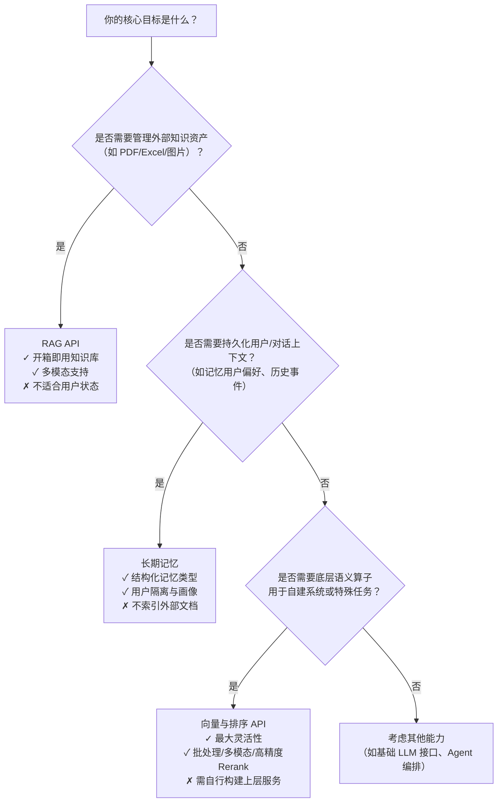

# RAG、[长期记忆](../concepts/long-term-memory.md)与向量检索排序能力对比

本对比旨在帮助开发者清晰理解百炼平台三大核心语义增强能力的定位差异、技术边界与集成路径，避免功能重叠误用或能力错配。随着 LLM 应用从单次问答向持续交互、个性化服务演进，RAG（知识库驱动）、[长期记忆](../concepts/long-term-memory.md)（用户/对话状态持久化）与底层向量与排序能力（可复用的语义计算基座）已形成分层协作关系：**向量与排序是基础算子，RAG 与[长期记忆](../concepts/long-term-memory.md)是面向不同业务目标的上层封装服务**。本文聚焦关键工程维度，提供可落地的技术选型参考。

## 核心能力对比表

| 维度 | RAG API | 长期记忆（新） | 向量与排序 API |
|------|---------|----------------|----------------|
| **核心定位** | 面向**外部结构化/非结构化知识**（文档、表格、音视频）的语义检索与问答服务，强调“知识即服务”（KaaS） | 面向**用户与对话上下文**的结构化记忆持久化与检索，强调“记忆即状态”（MaaS），支持事实、技能、画像三类记忆 | 面向**通用语义计算任务**的原子能力（Embedding/Rerank），是 RAG 与长期记忆的底层依赖，亦可独立用于自建检索系统 |
| **输入格式** | • 知识库管理：JSON（`snake_case`为主，部分接口`camelCase`） • 检索/问答：`query`（字符串）或 `messages`（消息数组，需流式） • 文件上传：需先申请租约，`sizeBytes` 必须为字符串 | • 写入：`messages`（文本+可选`image_url`）或 `custom_content`（原始内容） • 检索：`messages`（查询语句）或 `user_id` + 分页参数 • 用户画像：需预定义 `profile_schema` ID | • 文本向量：`input`（字符串/字符串列表/文件URL） • 多模态向量：`input.contents`（混合 `text`/`image`/`video` 对象数组） • Rerank：`input.query` + `input.documents`（文档列表） |
| **输出格式** | • 管理接口：标准 REST JSON（含 `index_id`, `job_id` 等） • 检索：`retrieved_chunks`（带 `score`, `content`, `metadata`） • 问答：SSE 流式响应（`event: message`, `data: {...}`），含 `answer`, `references` | • 写入（同步）：`memory_nodes` 数组（含 `id`, `type`, `content`, `score`, `metadata`） • 检索：`memory_nodes` 列表（按 `score` 降序），含 `min_score` 过滤结果（仅 `pro` 版本） • 用户画像：结构化 `user_profile` 对象 | • 向量：`data` 数组（每项含 `embedding` 向量、`index`） • Rerank：`results` 数组（含 `index`, `relevance_score`, `document`），默认按分数降序 |
| **支持模型/能力** | • 知识库类型：`document`/`table`/`image`/`multimedia` • Embedding：`text-embedding-v4`, `qwen3-vl-embedding` 等（可显式指定） • Rerank：`qwen3-rerank`（Agent 配置中设定） • Agent 封装：`chat`（问答）、`search`（联合检索） | • 记忆类型：`observation`/`skill`/`user_profile` • 抽取模式：`efficient`（轻量）或 `intelligent`（深度） • 搜索版本：`lite`（基础向量检索）、`pro`（启用 Rerank + `min_score`） • 多模态：支持 `image_url` 解析（需启用） | • 文本向量：`qwen3.7-text-embedding`, `text-embedding-v4`, `text-embedding-async-v2` • 多模态向量：`qwen3-vl-embedding`, `tongyi-embedding-vision-plus-2026-03-06` • Rerank：`qwen3-rerank`, `qwen3-vl-rerank`, `qwen3.7-text-rerank`（`gte-rerank` 系列将于 2026-05-30 下线） |
| **API 端点（Base URL）** | `https://{workspace_id}.cn-beijing.maas.aliyuncs.com` 路径示例： • 创建知识库：`/api/v1/indices/rag/index/create_v2` • 问答：`/api/v2/apps/knowledge/chat` | `https://{workspace_id}.cn-beijing.maas.aliyuncs.com/api/v2/apps/memory` 路径示例： • 写入：`/add` 或 `/add-async` • 检索：`/memory_nodes/search` | • 同步向量：`https://{workspace_id}.{region}.maas.aliyuncs.com/compatible-mode/v1/embeddings`（OpenAI 兼容） • 异步批处理：`/api/v1/services/embeddings/text-embedding/text-embedding` • Rerank：`/api/v1/services/rerank/text-rerank/text-rerank` |
| **计费方式** | • 按知识库调用量计费（如检索 QPS、导入任务数） • 无明确 Pro/Lite 版本区分，但 Agent 中选用的 Embedding/Rerank 模型单独计费 | • 2026年8月20日起商业化计费 • `Add` 和 `Search` 接口按调用次数计费 • 明确区分 `pro`（启用 Rerank）与 `lite`（基础检索）两个计费策略版本 | • 按 Token 数（向量）或任务数（Rerank/异步）计费 • 同步向量：按输入 Token × 向量维度计费（如 `text-embedding-v4` 为 8,192 Token/请求） • 异步批处理：按总 Token 数计费（免费额度 2000 万 Token） • Rerank：按 `query` + `documents` 总 Token 计费 |
| **典型场景** | • 客服知识库问答（PDF/Word 文档） • 表格数据自然语言查询（销售报表） • 图片/视频内容理解与问答（产品图谱、教学视频） • 跨多个知识库的联合语义搜索 | • 用户个性化推荐（基于历史行为记忆） • 对话状态跟踪（“用户上次说要订机票”） • 用户画像构建与更新（职业、偏好、设备信息） • 技能沉淀（“这个用户擅长处理退款流程”） | • 自建向量数据库（如 Milvus/Pinecone）的数据注入 • RAG 系统中替换默认 Embedding/Rerank 模型 • 多模态搜索系统（图文混合检索） • 文本聚类、去重、相似度分析等 NLP 基础任务 |

## 各方案适用场景建议

### ✅ 选择 **RAG API** 当：
- 你的核心需求是**将自有文档、表格、图片等知识资产快速转化为可问答的服务**；
- 需要开箱即用的**知识库全生命周期管理**（上传、切片、监控、删除）；
- 业务要求**强领域适配性**（如金融合同、医疗指南），且需结合 Agent 封装重排、路由等高级策略；
- 已有大量非结构化数据，希望最小化开发成本上线语义搜索。

> ⚠️ 注意：RAG 不适合存储用户私有对话状态或跨会话的个性化记忆；其知识库是“静态知识”，更新需手动触发同步任务。

### ✅ 选择 **长期记忆（新）** 当：
- 你需要**持久化并检索用户级、对话级的动态上下文**（如“用户张三上周投诉过物流延迟”）；
- 业务涉及**多轮对话中的状态继承、个性化响应或用户画像实时更新**；
- 要求记忆具备**结构化语义类型**（事实/技能/画像），且支持按类型精准召回；
- 需要**统一管理用户画像模板与抽取逻辑**，而非简单键值存储。

> ⚠️ 注意：长期记忆不替代知识库——它不索引公开文档，也不支持表格/音视频等复杂知识类型；其“知识”来源于对话流本身。

### ✅ 选择 **向量与排序 API** 当：
- 你正在**自研 RAG 或记忆系统**，需要灵活控制 Embedding/Rerank 模型选型与调用链路；
- 需要**超大规模批量向量化**（如千万级文档入库），必须使用异步批处理接口；
- 业务场景**超出 RAG/记忆的预设范式**（如自定义聚类、跨模态特征比对、A/B 测试不同排序模型）；
- 你追求**极致性能与成本可控性**，愿意承担 SDK 集成与结果后处理的开发工作。

> ⚠️ 注意：该能力无业务逻辑封装，需自行实现索引构建、缓存、去重、融合等工程模块；不提供知识库或记忆的 CRUD 管理界面。

## 面向开发者的选型决策树

**关键协同提示：**
- RAG 与长期记忆**可共存于同一应用**：RAG 提供领域知识，长期记忆提供用户上下文，二者在 Agent 中通过 `knowledge_retrieval` + `memory_retrieval` 插件协同调用。
- 向量与排序 API 是**RAG 与长期记忆的共同依赖**：二者均默认使用平台提供的 Embedding/Rerank 模型，但也可通过配置显式指定同名模型（如 `qwen3-rerank`），确保语义空间一致。
- **计费叠加**：若在 RAG Agent 中启用 `qwen3-rerank`，该 Rerank 调用将按向量与排序 API 规则单独计费；长期记忆 `pro` 版本的 Rerank 调用也计入同一账单。

请根据业务抽象层级（知识服务 → 状态服务 → 基础算子）与工程成熟度（开箱即用 → 半托管 → 全自研）综合决策。如需进一步评估性能指标（P99 延迟、吞吐上限）或迁移路径，可查阅各服务的 [限流文档](../../raw/application-api-reference/rag-api/rag-api-rate-limits.md) 与 [性能基准](../../raw/model-api-reference/vector-and-sort/performance-benchmark.md)。

## 被对比主题页

- [rag api](../api/rag-api.md)
- [long term memory new](../api/long-term-memory-new.md)
- [vector and sort](../api/vector-and-sort.md)

