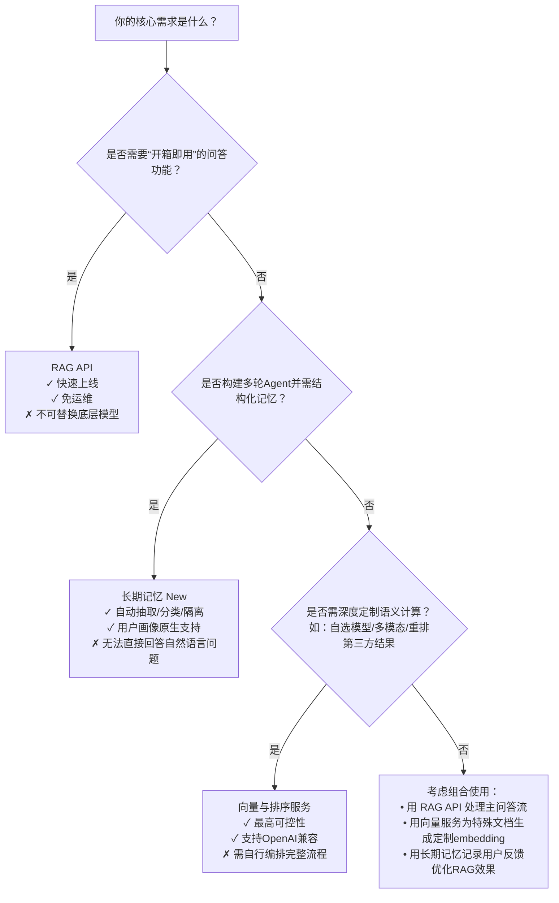

# RAG、[长期记忆](../concepts/long-term-memory.md)与向量检索排序能力对比

本页旨在为百炼平台开发者提供清晰、可落地的技术选型参考，系统对比 **RAG API**（[检索增强生成](../concepts/rag.md)）、**[长期记忆](../concepts/long-term-memory.md)（New）**（结构化记忆管理）与 **向量与排序服务（Vector & Sort）**（底层语义理解基座）三类能力在核心能力维度上的异同。三者定位不同：**RAG 是面向知识问答的端到端应用层服务**，**[长期记忆](../concepts/long-term-memory.md)是面向Agent行为建模的记忆中枢**，而**向量与排序是支撑前两者的原子级语义计算能力**。理解其边界与协同关系，有助于避免重复建设、合理分层架构，并在成本、延迟、可控性与场景适配性之间做出最优权衡。

## 关键维度对比

| 维度 | RAG API | 长期记忆（New） | 向量与排序（Vector & Sort） |
|------|---------|------------------|----------------------------|
| **核心定位** | 端到端[检索增强生成](../concepts/rag.md)服务：封装知识库构建、切片、嵌入、检索、重排、LLM生成全流程 | 结构化记忆中枢：支持事实（observation）、技能（skill）、用户画像（profile）三类记忆的写入、检索、更新与生命周期管理 | 原子级语义计算能力：提供文本/多模态向量化（embedding）与召回结果重排序（rerank）两类独立基础能力 |
| **输入格式** | 自然语言问题（`query`） + `knowledge_id`；文档上传支持 PDF/DOCX/TXT/MD 等格式 | 结构化消息流（`messages`，含 role/content/tool_calls） + `user_id` + `project_id` + 可选 `profile_schema`；支持 `image_url`（需多模态配置） | • 向量：字符串、字符串数组、或含 `text`/`image`/`video` 的 `contents` 对象数组 • 排序：`query` 字符串 + `documents` 字符串数组（或含多模态对象的数组） |
| **输出格式** | `{ "answer": "...", "references": [...], "usage": {...} }` —— 包含生成答案与带分数/来源的原始片段 | • 写入：`{ "memory_node_id": "...", "event_id": "..." }`（异步） • 检索：`{ "results": [...], "total_count": N }`，每项含 `id`, `content`, `score`, `memory_type`, `metadata` | • 向量：`{ "data": [{ "embedding": [...], "index": 0 }], "usage": {...} }` • 排序：`{ "results": [{ "index": 0, "relevance_score": 0.92 }], "usage": {...} }` |
| **支持模型** | • 问答生成：仅 `qwen-max`, `qwen-plus` • 向量化：`qwen-turbo`（仅用于 embedding） • 重排：`enable_rerank=true` 时内部调用 `qwen3-rerank`（不可选） | • 记忆抽取：由 `plan_version`（`pro`/`lite`）隐式决定模型，`pro` 版启用 `qwen3-rerank` 重排与更精细抽取 • 用户画像：依赖 `profile_schema` 关联的抽取规则与模型 | • 向量：`qwen3.7-text-embedding`, `text-embedding-v4`, `qwen3-vl-embedding`, `tongyi-embedding-vision-plus-*` 等 • 排序：`qwen3.7-text-rerank`, `qwen3-rerank`, `qwen3-vl-rerank`, `gte-rerank-v2`（已下线） |
| **API 端点** | `POST /api/v1/knowledge/query`（问答） `POST /v1/knowledge_bases`（建库） `POST /v1/knowledge_bases/{kb_id}/documents`（上传） | `POST /add` / `POST /add-async`（写入） `POST /memory_nodes/search`（检索） `POST /profile_schemas`（建画像模板） | • 向量（同步）：`/api/v1/services/embeddings/text-embedding/...` 或 OpenAI 兼容 `/compatible-mode/v1/embeddings` • 排序：`/api/v1/services/rerank/text-rerank/...` 或 OpenAI 兼容 `/compatible-api/v1/reranks` |
| **计费方式** | 按 **RAG 问答请求次数** 计费（含向量计算、重排、LLM生成全链路）；知识库存储按切片数/月计费；详见 [RAG 计费说明](../../raw/application-api-reference/rag-api/rag-api-pricing.md) | 按 **`Add` 和 `Search` 调用次数** 分别计费；`Pro` 版本单价高于 `Lite`；画像抽取计入 `Add` 调用；商业化起始日：2026年8月20日 | 按 **向量调用次数 × 输入 Token 数**、**排序调用次数 × (Query Token + Documents Token)** 分别计费；异步批处理按任务计费；多模态模型单价更高；地域间价格差异显著 |
| **典型场景** | • 企业知识库问答（如客服FAQ、产品文档查询） • 基于私有资料的报告生成 • 需要“所问即所得”答案的轻量级应用 | • Agent 在多轮对话中持续积累用户偏好、日程、习惯（`observation`） • 记录并复用工具调用流程、API 使用模式（`skill`） • 构建跨会话、跨应用的统一用户画像（`profile`） | • 自建 RAG 系统的向量底座（替代 RAG API 内置向量） • 对第三方检索结果（Elasticsearch、数据库全文检索）进行重排 • 多模态搜索（图文混合检索、视频关键帧匹配） • 语义去重、聚类、相似推荐等非问答类任务 |
| **可控性与灵活性** | 中等：可调 `top_k`, `score_threshold`, `enable_rerank`，但切片策略、向量模型、重排模型均不可替换 | 中等偏高：可通过 `project_id` 隔离记忆类型，`plan_version` 控制质量，`profile_schema` 定义画像结构；但抽取逻辑与模型不可见 | **最高**：完全自主选择模型（`qwen3.7-text-embedding` vs `text-embedding-v4`）、输入格式（是否融合多模态）、参数（`dimensions`, `instruct`, `text_type`）；适合深度定制与A/B测试 |
| **延迟特征** | • 同步问答：300–1500ms（取决于 `top_k`, `enable_rerank`, LLM 选择） • 文档同步：异步，分钟级 | • 同步写入（`/add`）：~200–800ms（`intelligent` 模式可能超时） • 异步写入（`/add-async`）：秒级触发，结果需轮询 • 检索（`/search`）：~100–500ms | • 向量（同步）：50–300ms（单次≤20行） • 排序：200–1000ms（取决于文档数与模型） • 异步批处理：任务创建瞬时，结果生成需分钟级 |

## 各方案适用场景建议

### ✅ 优先选用 **RAG API** 当：
- 你希望 **零工程投入快速上线一个知识问答功能**，且知识源以静态文档（PDF/Word/Markdown）为主；
- 业务对答案准确性要求高，但对底层技术栈无定制需求（如必须用特定 embedding 模型）；
- 团队缺乏向量数据库（如 Milvus、Qdrant）运维与 RAG 流程编排（chunking → embedding → retrieval → rerank → LLM）经验；
- 场景明确为“用户提问 → 返回答案+引用”，无需维护跨会话状态或复杂记忆关联。

> 📌 *典型客户*：SaaS 产品后台集成帮助中心、金融机构内部合规文档查询系统、教育机构课程资料智能答疑。

### ✅ 优先选用 **长期记忆（New）** 当：
- 你的应用是 **多轮、长周期、强状态的 AI Agent**（如个人助理、销售陪练、教学教练），需要在对话中动态学习并复用用户信息与技能；
- 你需要 **结构化地组织不同类型记忆**（例如：将“用户讨厌咖啡因”存为 `observation`，将“调用CRM接口更新客户状态”存为 `skill`，将“用户职级、行业、常用沟通风格”存为 `profile`）；
- 你已有对话历史数据流（`messages`），希望平台自动从中提取、归类、持久化关键事实，而非手动标注；
- 你计划构建跨多个应用（如App、Web、小程序）的统一用户认知层。

> 📌 *典型客户*：智能客服 Agent、个性化学习助手、企业级销售赋能平台、AI 健康管理师。

### ✅ 优先选用 **向量与排序服务** 当：
- 你正在 **自研 RAG 系统或高级搜索产品**，需要最大自由度控制 embedding 模型、分块策略、重排逻辑与向量库选型；
- 你需要对 **非百炼托管的数据源**（如 MySQL 全文检索结果、Elasticsearch 返回的文档、第三方 API 数据）进行语义重排；
- 你的场景涉及 **多模态内容**（如用图片搜相似商品、用文字描述找匹配视频、图文混合新闻推荐）；
- 你有严格的 **性能压测、成本优化或模型迭代需求**，必须精确控制每个环节的模型、Token、延迟与费用。

> 📌 *典型客户*：搜索引擎公司升级语义相关性、电商平台构建多模态商品搜索、内容平台实现跨图文视频的智能推荐引擎。

## 技术选型决策树（面向开发者）

> 💡 **重要协同提示**：三者并非互斥，而是互补层级。  
> - 你可用 **向量服务** 替换 RAG API 的默认 embedding 模型（通过自定义切片后调用 `/embeddings` 生成向量，再注入自建向量库）；  
> - 你可在 **长期记忆** 的 `AddMemory` 流程中，调用 **向量服务** 对 `messages` 进行预处理，提升抽取精度；  
> - 你可将 **RAG API 的 `references` 输出** 作为种子，存入 **长期记忆** 的 `observation` 类型，实现问答结果的长期沉淀与复用。  
> 请根据 MVP 阶段目标选择起点，再随业务演进平滑扩展能力边界。

---  
*最后更新：2026年06月15日*  
*文档版本：v2.4*

## 被对比主题页

- [rag api](../api/rag-api.md)
- [long term memory new](../api/long-term-memory-new.md)
- [vector and sort](../api/vector-and-sort.md)

