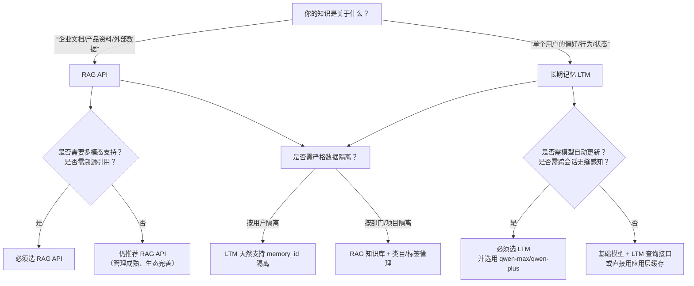

# 知识增强方案对比：RAG API 与[长期记忆](../concepts/long-term-memory.md)（Long Term Memory）

本页旨在为百炼平台开发者提供清晰、可落地的技术选型参考，系统对比两种核心知识增强能力：**RAG API**（面向外部知识库的[检索增强生成](../concepts/rag.md)服务）与**[长期记忆](../concepts/long-term-memory.md)（Long Term Memory, LTM）**（面向用户级状态的结构化持久化机制）。二者虽均用于扩展大模型的认知边界，但在设计目标、数据主权、时效粒度、调用范式及适用场景上存在本质差异。理解这些差异，有助于避免能力误用（如用 RAG 存储用户偏好）、规避架构风险（如用 LTM 托管企业文档），并提升系统稳定性与成本效益。

## 关键维度对比

| 维度 | RAG API | [长期记忆](../concepts/long-term-memory.md)（Long Term Memory） |
|--------|---------|------------------------------|
| **核心定位** | 外部知识库的**托管式检索增强服务**：将业务文档、数据库、音视频等非结构化/结构化数据接入模型推理链路，实现“用即查、查即答”。 | 用户级上下文的**结构化状态持久化机制**：跨会话保存用户偏好、行为特征、历史交互等高价值语义片段，实现“记所学、用所记”。 |
| **输入格式** | 支持多源异构输入： • 文档类：PDF/Word/Excel/PPT/TXT/HTML 等（通过 `/job/create` 或文件上传接口） • 表格类：CSV/JSON（指定 `structureType: structured`） • 多模态：JPG/PNG/MP4/MP3（需配置 `multimodalEmbeddingModelName`） • 元数据：`category`、`tags`、自定义字段（通过 `metadata` 传入） | 严格结构化 JSON 输入： • 必填：`memory_id`（字符串，全局唯一） • 可选：`fragments[]`（每个含 `type`、`content`（JSON 对象）、`ttl_seconds`） • 控制参数：`enable_auto_update`、`retrieval_strategy` |
| **输出格式** | • 检索接口（`/knowledge/search`）：返回带 `score`、`chunk_id`、`content` 的结构化结果数组 • 问答接口（`/knowledge/chat`）：SSE 流式响应，含 `answer`、`references`（引用切片 ID 及原文）、`agent_id` 等字段 • 管理接口：标准 RESTful JSON（如 `{ "index_id": "idx-xxx", "status": "published" }`） | • 写入接口（`/v1/memory/upsert`）：返回 `success: true` 或错误码 • 查询接口（`/v1/memory/get`）：返回 `fragments[]` 数组，每个 fragment 包含 `id`、`type`、`content`、`created_at`、`expires_at` • 自动注入：无显式输出，fragment 内容自动拼接至系统提示词（`system` message）中 |
| **支持模型** | **不绑定具体模型**：RAG 能力由独立服务提供，问答接口可配置任意百炼支持的 LLM（如 `qwen3.7-plus`、`qwen-max`），模型仅负责生成最终答案，检索逻辑由 RAG 引擎完成。 | **强模型依赖**： • 完整读写（`upsert` + `auto_update`）：仅限 `qwen-max-20240919`、`qwen-plus-20240919` 及后续明确标注 `ltm_enabled: true` 的模型 • 只读访问（`get_memory`）：基础模型（如 `qwen-turbo`）亦可调用查询接口，但无法触发自动更新 |
| **API 端点** | 统一业务空间域名： `https://{workspace_id}.cn-beijing.maas.aliyuncs.com` • 知识库管理：`/api/v1/indices/rag/...` • 数据导入：`/api/v1/connector/dash/...` • 检索/问答：`/api/v1/indices/knowledge/search`、`/api/v2/apps/knowledge/chat` | 独立服务端点： `https://dash.cn-beijing.maas.aliyuncs.com`（固定域名） • 写入：`POST /v1/memory/upsert` • 查询：`GET /v1/memory/get` • （注：不共享 RAG 的 workspace_id 认证域） |
| **认证方式** | API Key 鉴权： `Authorization: Bearer <API-Key>` Key 在控制台「API Key 管理」页获取 | API Key 鉴权： `Authorization: Bearer <API-Key>` Key 同一控制台，但需确保该 Key 已开通 Long Term Memory 权限 |
| **计费方式** | 按**调用量分层计费**： • 知识库管理操作（创建/删除/更新）：按次计费 • 数据导入（文件解析、切片、向量化）：按文档页数/字节数计费 • 检索与问答：按 token（输入+输出）计费，流式问答按实际返回 token 计量 | 按**存储量与时长计费**： • 写入（`upsert`）：按写入的 fragment 总字节数计费（含 `content` 序列化后大小） • 存储：按 `memory_id` 下所有 fragment 的日均占用字节数 × 存储天数计费 • 查询（`get`）：免费（不计费） |
| **典型场景** | • 企业知识库问答（HR 制度、产品手册、技术文档） • 客服工单辅助（检索历史解决方案） • 数据库自然语言查询（NL2SQL） • 图片/视频内容理解（多模态 RAG） • 法律条文、医疗指南等专业领域检索 | • 个性化推荐（记住用户口味、设备偏好、常购品类） • 智能客服连续对话（跨会话识别用户身份与历史诉求） • 电商导购（记录浏览路径、加购意向、比价行为） • SaaS 应用状态同步（用户界面偏好、常用筛选条件） • 游戏 NPC 记忆玩家关键交互事件 |
| **数据所有权与生命周期** | 数据归属**应用方**，存于百炼专属知识库存储区；知识库可随时删除，操作不可逆；文档/切片支持精细化增删改查。 | 数据归属**应用方**，以 `memory_id` 为单位隔离；单个 memory 下 fragment 最多 100 个，总大小 ≤ 2MB；支持 TTL 过期，`ttl_seconds=0` 表示永不过期（实际行为以运行时为准）。 |
| **一致性与延迟** | 检索结果为**强一致性**（写入后立即可查）；知识库发布后检索即生效。 | **最终一致性**：写入后秒级内可被查询到；自动更新触发的写入可能存在 1~3 秒延迟。 |

## 适用场景建议

### ✅ 优先选用 RAG API 当：
- 你需要将**静态、批量、高价值的业务资料**（如 PDF 手册、Excel 产品表、内部 Wiki 页面）转化为可检索的知识资产；
- 你的应用场景要求**精确溯源**（如客服需向用户展示答案出处原文）或**多模态理解**（如根据用户上传的故障图片匹配维修指南）；
- 知识内容由**运营/法务/产品等非技术角色维护**，需要控制台可视化管理、版本回溯、权限分级；
- 你希望**解耦知识管理与模型推理**，同一知识库可被多个不同模型（Qwen-Max/Qwen-Plus）复用；
- 你需要对检索过程进行深度干预（如自定义嵌入/重排模型、调整切片策略、设置类目过滤）。

### ✅ 优先选用长期记忆（LTM）当：
- 你需要**跨会话、跨设备持续感知单个用户的状态**（如记住用户说“我不吃香菜”，下次点餐自动过滤）；
- 用户数据具有**强结构化语义**（如 `{"type": "shipping_address", "content": {"province": "浙江", "city": "杭州"}}`），且需按类型高效检索；
- 你追求**极简集成**：只需在对话请求中添加 `memory_id`，平台自动注入上下文，无需修改提示词工程；
- 你依赖模型**自主进化记忆**（启用 `enable_auto_update` 后，模型可在回答中隐式更新偏好）；
- 你需要**低延迟、高频次的用户状态读写**（如实时记录用户点击流并用于下一轮推荐），且能接受最终一致性。

### ⚠️ 明确不建议混用的场景：
- **❌ 用 LTM 存储企业文档**：LTM 单 memory 上限 2MB，且无文档解析、切片、多模态支持能力，无法替代知识库。
- **❌ 用 RAG API 存储用户偏好**：RAG 不支持按 `user_id` 隔离数据，无 TTL 机制，管理成本高，且无法实现模型自动更新。
- **❌ 在未启用 LTM 的模型上调用 `enable_auto_update`**：将导致自动更新失效，且无报错提示，仅静默忽略。
- **❌ 对同一业务实体同时使用 RAG 和 LTM 存储相同信息**（如用户订单既存 RAG 文档又存 LTM fragment）：造成数据冗余、一致性维护困难。

## 技术选型决策树（面向开发者）

> **最后建议**：  
> - **MVP 阶段**：若需求明确属于“用户状态”，直接启用 LTM 并选用 `qwen-plus-20240919`；若属于“企业知识”，优先构建 RAG 知识库。  
> - **混合架构**：大型应用可并行使用——用 RAG 托管公司级知识，用 LTM 托管用户级画像，二者通过 `agent_config` 中的路由规则协同（例如：用户问“我的订单”，LTM 提供订单摘要；问“退货政策”，RAG 提供制度原文）。  
> - **监控重点**：RAG 关注 `RETRIEVAL_TIMEOUT` 错误码与重排得分分布；LTM 关注 `memory_id` 的碎片数量与平均 TTL，预防存储超限。

## 被对比主题页

- [rag api](../api/rag-api.md)
- [long term memory new](../api/long-term-memory-new.md)

