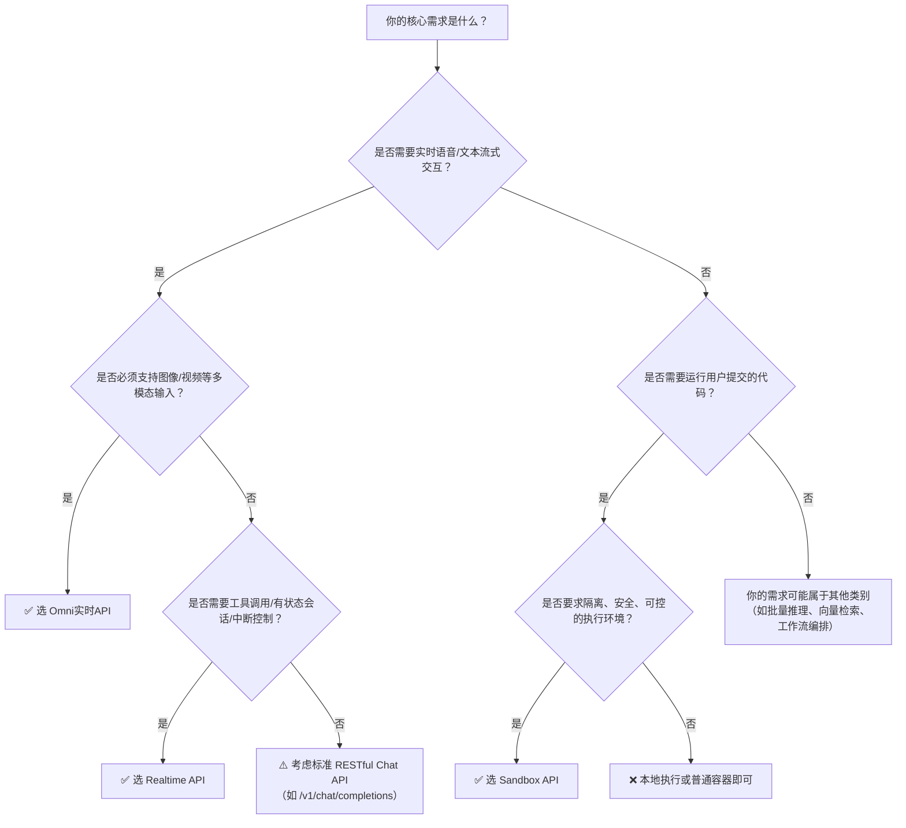

# 实时API、Omni实时API与沙箱环境对比

本文旨在帮助开发者清晰区分百炼平台中三类关键实时/交互式能力接口：**Realtime API**（专注低延迟语音与文本流式对话）、**Omni实时API**（面向多模态端到端实时处理）和**Sandbox API**（提供可编程、隔离的代码执行沙箱）。三者定位迥异，不构成替代关系，而是服务于不同技术栈与业务场景。正确选型可显著降低集成成本、规避权限与资源误用风险，并保障生产环境稳定性。

以下从核心能力维度进行结构化对比，并附针对性使用建议。

## 关键维度对比表

| 维度 | Realtime API | Omni实时API | 沙箱环境（Sandbox API） |
|------|--------------|--------------|---------------------------|
| **协议与通信模型** | WebSocket 双向流式（事件驱动），需手动管理连接生命周期 | WebSocket 双向流式（事件驱动），强调多模态输入同步与低延迟响应 | HTTP RESTful + WebSocket 数据面（`/connect` 后进入 E2B 协议），以“实例”为单位管理计算生命周期 |
| **输入格式** | `input_audio`（16kHz PCM base64）、`input_text`、`tool_result`；严格要求音频格式 | `input_audio`（16kHz PCM base64）、`input_text`、`input_image`（JPEG/PNG base64 或 URL，≤10 MB）；支持混合模态并发输入 | 无固定“输入格式”；通过 `exec` 命令传入 Shell/Python 代码，或通过 `uploadFile` 上传任意二进制/文本文件 |
| **输出格式** | 增量式事件：`output_text_delta`、`output_audio_delta`、`tool_call`；支持中断/暂停语义 | 增量式事件：`output_text`、`output_audio`、`output_image`（base64）；含完整 ASR/TTS 流与图像理解结果 | 命令执行结果（stdout/stderr）、文件下载链接、进程状态；输出为结构化 JSON，非流式（除非用户代码自行实现[流式输出](../concepts/streaming-output.md)） |
| **支持模型/能力本质** | 专用实时模型： • `qwen-audio-realtime-v1`（语音端到端） • `qwen2.5-realtime-v1`（文本+工具调用+有状态会话） | 统一多模态实时模型： • `omni-realtime-202409`（ASR/TTS/文本生成/图像理解一体化） | **不提供模型服务**；提供可运行任意代码的隔离容器环境，能力由模版镜像定义（如 `code-interpreter-v1`、`browser`） |
| **API 端点** | `wss://dashscope.aliyuncs.com/realtime/v1?model=...&api_key=...` | `wss://dashscope.aliyuncs.com/realtime/v1/omni?model=omni-realtime-202409&api_key=...&stream=true` | 控制面：`https://{workspace_id}.cn-beijing.maas.aliyuncs.com/api/v1/agentstudio/sandbox` 数据面：`POST /sandboxes/{id}/connect` 返回独立 domain 与 token |
| **计费方式** | 按**实际使用的音频时长（秒）与文本 token 数**计费；连接空闲不计费，但连接建立即开始计费（含初始化开销） | 按**音频时长（秒）、文本 token 数、图像请求数（每张图计 1 次）** 分项计费；多模态混合请求按各模态分别计量 | 按**实例运行时长（秒） × 资源规格（vCPU × 内存）** 计费；暂停状态不计费；网络流量、文件存储另计（如有） |
| **典型场景** | • 语音助手（带唤醒词、实时打断） • 客服语音坐席实时转写与应答 • 多轮工具增强对话（如查天气+订机票） | • 音视频会议实时字幕+发言人摘要+关键画面识别 • 教育场景：学生语音提问 + 手写公式图片上传 + 实时解题讲解 • 智能硬件：摄像头+麦克风同步输入的交互式设备 | • AI 编程助手：运行用户提交的 Python 代码并返回图表/结果 • 网页自动化：用 Playwright 抓取动态渲染内容 • [安全沙箱](../concepts/sandbox.md)：隔离执行可疑脚本并分析行为 |
| **会话/状态管理** | 支持 `session_id` 恢复（24 小时内），会话状态在服务端维护（含上下文、工具调用状态） | 无显式 `session_id`；会话状态隐式绑定于 WebSocket 连接，超时断连即丢失全部状态 | 通过 `sandboxID` 标识实例；支持 `pause`/`resume` 保留内存与进程状态；实例释放后状态不可恢复 |
| **最大连接时长** | 30 分钟（服务端强制关闭） | 10 分钟（服务端强制关闭） | 实例最长生命周期：7 天（604800 秒），可配置 `timeout` 参数（5 分钟起） |
| **并发限制** | 同一 `session_id` 不支持并发连接；无全局连接数硬限（依赖账号配额） | 同一 `api_key` 最多 50 并发连接（企业版可申请提升） | 单 workspace 默认并发实例数受配额约束（控制台可查看/申请提升） |

## 适用场景建议

### ✅ 选择 Realtime API 当：
- 你的核心需求是**极低延迟的语音交互闭环**（如 <300ms 端到端响应），且主要输入为语音或纯文本；
- 需要**精确控制对话流程**：例如支持用户随时中断正在合成的语音、动态注入工具调用结果、维持多轮上下文状态；
- 场景对模型能力要求明确且单一：仅需语音识别+合成，或文本推理+工具调用，**无需图像理解等扩展模态**；
- 已有成熟音频采集链路（满足 16kHz PCM 格式），且能接受 SDK（如 AOQ）封装复杂性。

> ⚠️ 注意：不适用于通用大模型问答（如 `qwen-max`）、批量文本处理、或需要图像/视频分析的场景。

### ✅ 选择 Omni实时API 当：
- 你需要**在一个会话中无缝融合多种输入模态**（语音+文字+图片），并期望模型统一理解与响应；
- 对**端到端 P95 延迟有强要求（<800ms）**，且需同时获得高质量 ASR、TTS 和视觉理解结果；
- 应用场景天然具备多模态属性：如远程医疗问诊（医生语音描述 + 患者上传皮疹照片）、智能车载（语音指令 + 中控屏截图分析）；
- 接受“单连接短生命周期”模型，能通过快速重建连接应对长时间会话。

> ⚠️ 注意：不适用于需要持久化代码执行环境、运行未签名第三方库、或进行浏览器自动化操作的场景。

### ✅ 选择 Sandbox API 当：
- 你的应用本质是**需要安全、隔离、可控地执行任意用户代码**（Python/Shell/Node.js 等）；
- 任务具有**明确的开始与结束边界**，且结果可序列化（如代码执行输出、网页截图、文件生成）；
- 必须访问外部网络（如调用 API、爬取网页）、使用特定系统库（如 OpenCV）、或需要 GUI 环境（如 Chromium）；
- 需要精细控制资源（CPU/内存）、网络策略（白名单/黑名单）、生命周期（自动暂停/超时销毁）。

> ⚠️ 注意：不适用于流式语音/文本生成、实时对话状态维护、或直接调用百炼大模型推理服务——它提供的是“算力沙箱”，而非“AI 模型服务”。

## 技术选型决策树（面向开发者）

> **重要提醒**：  
> - Realtime API 与 Omni实时API **不可混用同一 `api_key` 的凭证类型**（前者需短期有效 key，后者需带 `realtime` scope 的长期 key）；  
> - Sandbox API 的鉴权**仅认 `Authorization: Bearer <key>`**，E2B SDK 中的 `api_key` 字段会被忽略；  
> - 所有实时类 API 均**不返回 HTTP 状态码**，错误必须通过监听 WebSocket 的 `error` 事件解析；  
> - 生产环境强烈推荐使用官方 SDK（AOQ for Realtime/Omni；E2B SDK for Sandbox）以规避连接重试、编解码、协议兼容等底层细节风险。

---  
*最后更新：2024年10月*

## 被对比主题页

- [realtime api user guide](../api/realtime-api-user-guide.md)
- [omni realtime api](../api/omni-realtime-api.md)
- [sandbox api](../api/sandbox-api.md)

