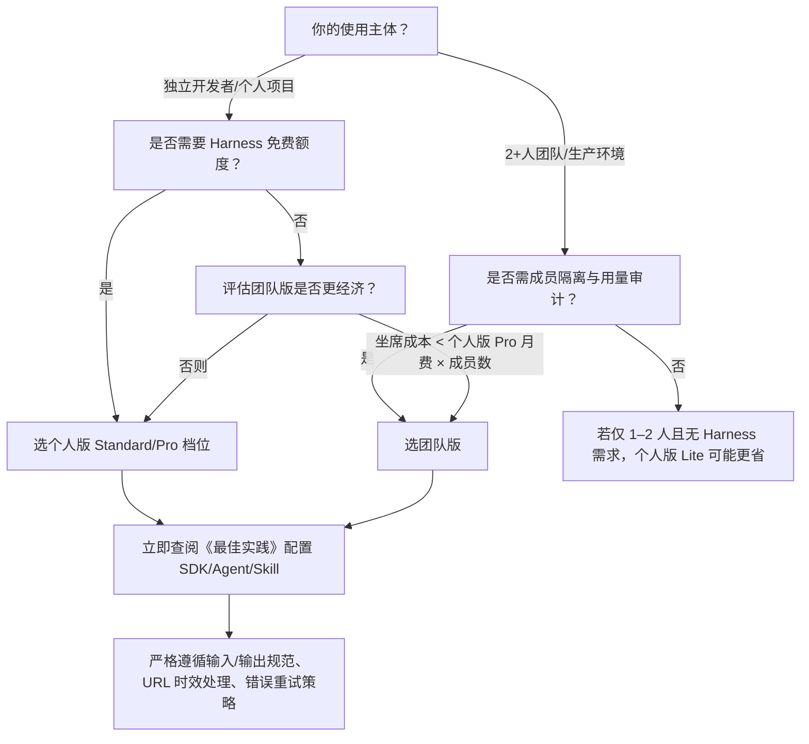

# Token 计费方案对比：个人版、团队版与最佳实践

本文档面向百炼平台开发者，系统对比 **Token Plan 个人版**、**Token Plan 团队版** 两大正式计费方案，并结合 **Token Plan 最佳实践** 提供技术选型建议。对比聚焦于实际开发接入、资源调度、成本控制与权限治理等关键维度，旨在帮助开发者根据项目规模、协作模式与能力需求，选择最匹配的计费路径，避免误用 API Key、混淆计费归属、触发超额扣费或调用失败等问题。

---

## 关键维度对比表

| 维度 | 个人版（Token Plan Personal） | 团队版（Token Plan Team Edition） | 最佳实践（Token Plan Best Practice） |
|------|------------------------------|-----------------------------------|-------------------------------------|
| **定位目标** | 独立开发者、MVP 验证、轻量级应用原型 | 中小研发团队（2–50 人）、需成员隔离与用量管控的生产环境 | 全版本通用的技术集成方法论，非独立计费方案，指导如何 *高效使用* 个人版/团队版已购能力 |
| **计费单元** | 按月固定 Credits 额度（Lite/Standard/Pro 档位），支持购买用量包（100 元/20,000 Credits） | 按“坐席”（Seat）计费：`standard` / `advanced` / `premium`，每坐席含独立月度额度（25k/100k/250k Credits），另可购买共享用量包（625,000 Credits/个） | ❌ 不计费 —— 是对 *已有额度* 的使用优化指南，不新增费用，但直接影响单位 Credits 的产出效率与稳定性 |
| **API Key 类型** | 必须使用 `sk-sp-xxx`（Token Plan 专属 Key）调用模型；Harness 工具必须使用独立 `sk-xxx`（百炼通用 Key） | 所有成员使用各自分配的 `sk-sp-xxx` 坐席专属 Key；**不支持** `sk-xxx` 调用 Harness 工具（团队版无 Harness 权益） | 强制要求所有能力调用均使用 `sk-sp-xxx`（Token Plan Key），明确禁止混用 `sk-xxx`，否则鉴权失败 |
| **输入格式** | 标准 OpenAI/Anthropic 兼容格式（`messages`, `model`, `max_tokens`）；决策模型用 `state`+`questions`；图像/视频/TTS/ASR 使用统一 `input` 结构体嵌套 | 完全兼容个人版输入格式；坐席间无协议差异，同一模型请求体结构一致 | 统一规范： • 同步能力（决策/图像/ASR/TTS）：JSON body + `POST /v1/chat/completions` 或专用端点 • 异步能力（视频）：`POST /v1/tasks` → 轮询 `GET /v1/tasks/{id}` • 实时能力（语音）：WebSocket 连接 + event 流 |
| **输出格式** | 同步响应（JSON）：含 `choices[0].message.content`、`output.audio.url`、`output.choices[0].message.content[0].image` 等；异步任务返回 `task_id` | 与个人版完全一致；输出结构、字段命名、URL 时效性规则无差异 | 明确约定消费方式： • 同步结果：直接解析 JSON 字段（如 `answers.c1.choice`, `output.text`） • 临时 URL：必须立即下载（`output.audio.url` 有效期 ≤ 1 小时） • 视频任务：轮询至 `task_status == "SUCCEEDED"` 后提取 `output.video_url` |
| **支持模型范围** | ✅ 全覆盖：千问（qwen4-max、qwen3.8-flash 夜间 4 折等）、万相、DeepSeek（夜间 5 折）、智谱、HappyHorse、决策模型（`decision-model-preview`，**不扣 Credits**） ❌ 不支持：`auto` 模型的 `tool_choice`、`thinking_budget` 等高级参数 | ✅ 全覆盖（同个人版主流模型），含 `qwen4-max-preview`（预览期 2 折）、`deepseek-v4-pro-0813`（夜间 5 折）等 ❌ 不支持：Harness 相关工具（团队版无该权益） | ✅ 按能力分类明确支持模型： • 决策：`decision-model-preview`（零 token 开销） • 图像：`qwen-image-3.0-pro`, `wan2.7-image-pro` • 视频：`happyhorse-1.1-t2v`, `happyhorse-1.1-i2v` • 语音：`qwen-audio-3.0-asr-flash`, `qwen-audio-3.0-tts-plus`, `qwen-audio-3.0-realtime-plus` • 视觉理解：原生支持（qwen3.8-max）或 Skill 代理扩展 |
| **API 端点** | 模型调用：`https://dashscope.aliyuncs.com/api/v1/chat/completions` 等标准端点 Harness 工具：独立 MCP URL（控制台获取，需 `sk-xxx`） | 仅标准端点：`https://dashscope.aliyuncs.com/api/v1/chat/completions`（Base URL 由坐席分配，含地域前缀） ❌ 无 Harness 端点 | 统一收敛： • `/v1/chat/completions`（文本/多模态同步） • `/v1/embeddings`（向量） • `/v1/tasks`（异步视频） • WebSocket `/v1/realtime`（实时语音） • 所有端点均强制要求 `sk-sp-xxx` |
| **内置工具支持** | ✅ 模型级工具（`web_search`, `code_interpreter` 等）：自动触发，按 Credits 抵扣 | ✅ 完全相同：`web_search`, `web_search_image`, `image_search`, `web_extractor`, `code_interpreter` 均可用，按实际调用消耗 Credits | ✅ 明确调用方式： • 工具通过 `tool_choice`（若模型支持）或自动推理触发 • 输出中 `tool_calls` 字段解析需适配各模型返回差异（如 qwen vs deepseek） |
| **Harness 权益** | ✅ Standard/Pro 档位附赠（联网搜索增强版、图像生成等），**独立计量、不扣 Credits**，需 `sk-xxx` + MCP 接口 | ❌ **不提供** —— 团队版无 Harness 权益，所有工具调用均计入坐席 Credits | ❌ 不涉及 —— Harness 属于个人版专属权益，最佳实践文档不覆盖其接入逻辑 |
| **典型场景** | • 个人开发者快速验证多模态能力 • 学生项目/开源工具原型开发 • 需要联网搜索增强版、图像生成免费额度的轻量应用 | • SaaS 产品后端多租户调用隔离 • AI 工具链内部团队协作（如标注平台+审核模型+生成模型） • 需按成员设置用量上限、审计调用明细的合规场景 | • 构建高可靠 TTS 服务（处理 URL 过期、重试逻辑） • 设计决策模型分流策略（基于 `confidence` 自动路由） • 实现视频生成状态机（提交→轮询→下载→通知） • 在 Agent 中安全注入视觉理解能力（Skill 代理模式） |

---

## 各方案适用场景建议

### ✅ 选择 **个人版** 当：
- 你是**独立开发者、自由职业者或学生**，无团队协作需求；
- 项目处于 **MVP 阶段或 PoC 验证期**，需低成本试错多种模型（尤其是 `qwen4-max-preview` 2 折、`qwen3.8-flash` 夜间 4 折）；
- 明确需要 **Harness 免费额度**（如每月 100 次联网搜索增强版、20 张图像生成），且能接受 `sk-sp-xxx` 与 `sk-xxx` 双 Key 管理；
- 应用部署在 **华北2（北京）地域**，且无需跨地域调用；
- 可接受 **额度不结转、无法自助退订** 的订阅约束。

### ✅ 选择 **团队版** 当：
- 你管理一个 **2–50 人的中小研发团队**，需为成员分配独立 API Key 并隔离用量；
- 生产环境要求 **精细化用量管控**（如为前端成员限制每日 5,000 Credits，为算法同学开放共享包）；
- 需要 **集中查看成员级、模型级、时间维度用量报表**，支撑成本分摊与预算规划；
- 团队已使用 **钉钉或 SSO 统一身份认证**，希望一键同步成员与坐席绑定；
- **无需 Harness 工具**，所有能力（包括搜索、代码解释）均通过模型 API 调用并计入 Credits；
- 可接受 **坐席不可回收、升级不支持降配、额度按自然月刷新** 的运营规则。

### ✅ 遵循 **最佳实践** 当（无论选用个人版或团队版）：
- 你正在 **构建生产级 AI 应用**，需保障服务稳定性（如处理 TTS URL 过期、视频任务超时、实时语音断连重连）；
- 你希望 **最大化单位 Credits 效率**：例如用 `decision-model-preview` 替代 LLM 做工单分类（零开销），用 `qwen3.8-flash` 夜间跑批量摘要（4 折）；
- 你需要 **统一接入多模态能力**（图像/视频/语音/决策），避免为每种能力重复实现鉴权、重试、错误解析逻辑；
- 你在设计 **Agent 或 Skill 扩展**，需安全注入视觉理解、语音合成等能力，而非硬编码调用；
- 你关注 **安全合规**：环境变量管理密钥、不日志打印敏感字段、及时下载临时资源。

> ⚠️ **重要提醒**：个人版与团队版 **不可混用**。`sk-sp-xxx` 不能调用 Harness，`sk-xxx` 不能调用模型 API；团队版成员若误用个人版 Key，将导致鉴权失败。务必在控制台确认当前订阅类型及对应 Key 的使用范围。

---

## 面向开发者的选型决策树

**最后建议**：  
无论选择哪个计费方案，**务必以《Token Plan 最佳实践》为技术落地蓝本**。它不改变计费模型，但直接决定你能否将 Credits 转化为稳定、高效、可维护的 AI 能力。推荐在项目启动初期即引入最佳实践中的 SDK 封装、环境变量管理、异步任务状态机等模式，避免后期因计费异常或调用失败返工。

## 被对比主题页

- [token plan personal](../guides/token-plan-personal.md)
- [token plan team edition](../guides/token-plan-team-edition.md)
- [token plan best practice](../guides/token-plan-best-practice.md)

